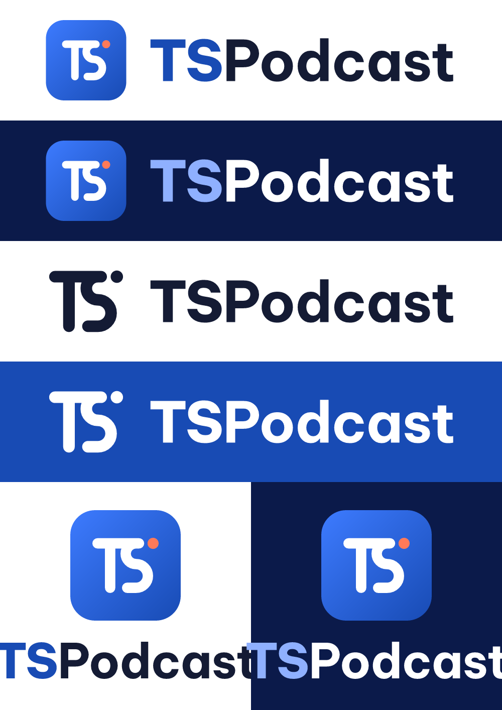
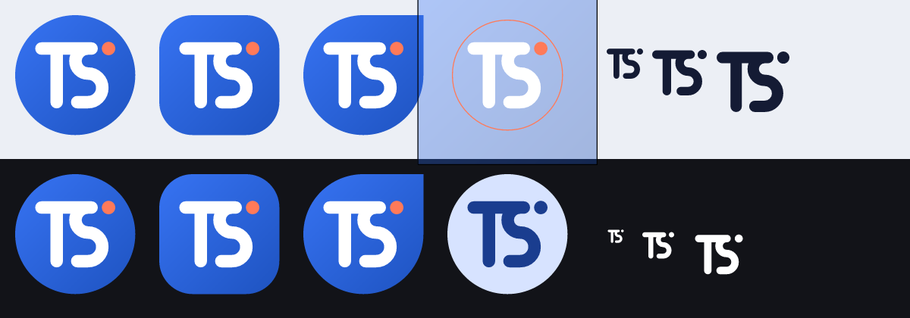

# TSPodcast — Bộ nhận diện thương hiệu

> Podcast · Radio · Nhạc — **Thế giới trong tai bạn**

Tài liệu này là nguồn chuẩn cho logo, màu sắc, chữ và các tài sản (asset) của TSPodcast.
Mọi file trong `brand/` được sinh ra từ mã trong `brand/scripts/`, nên **muốn sửa thì sửa
generator rồi chạy lại**, đừng sửa tay file PNG/SVG đầu ra.

```bash
cd brand/scripts
npm install
npm run build      # tải font (nếu thiếu) và sinh lại toàn bộ asset, kể cả icon Android
```

---

## 1. Logo

### Ý tưởng: "Lên sóng"



Biểu tượng là chữ ghép **T + S** được vẽ bằng **một nét bút duy nhất** (dày 14/100, đầu bo tròn):

- **Thanh ngang của chữ T chạy tiếp thành nét trên của chữ S**, nên hai chữ cái dùng chung một thanh.
- **Chữ S là hai nửa vòng tròn**, tức là một đoạn sóng âm. Nét đuôi nằm ngang khép chữ S lại.
- **Chấm cam san hô** ở cuối thanh ngang là đèn "ON AIR", gợi ý đang phát sóng, đang thu âm và radio trực tiếp.

Logo chỉ dùng đường thẳng, cung tròn và hình tròn, vẽ tay trên lưới 100×100 (xem `MARK`
trong `scripts/lib.js`). Nhờ vậy:

- vẫn nhận ra ở 16 px (favicon) và 24 dp (icon thanh trạng thái);
- chuyển sang một màu (themed icon Android 13, in ấn, khắc) mà không mất chi tiết;
- tách biệt hẳn với logo podcast quen thuộc (Apple Podcasts dùng micro và sóng tròn,
  Pocket Casts và Spotify dùng vòng cung đồng tâm, Castbox dùng khối cam). TSPodcast không dùng vòng cung đồng tâm.

Các phương án đã cân nhắc và lý do chọn nằm ở [`docs/done/brand/concepts/`](../docs/done/brand/concepts/README.md).

### Các phiên bản

| File (`brand/logo/`) | Dùng khi |
|---|---|
| `tspodcast-icon.svg` | Icon app bo góc (gradient xanh, chữ trắng, chấm cam). Dùng làm avatar mạng xã hội và minh hoạ. |
| `tspodcast-icon-square.svg` | Icon tràn viền không bo góc, cho các store tự cắt góc (Play, App Store). |
| `tspodcast-mark.svg` | Biểu tượng xanh và chấm cam, nền trong suốt, đặt trên nền sáng. |
| `tspodcast-mark-white.svg` | Biểu tượng trắng và chấm cam, đặt trên nền tối hoặc ảnh. |
| `tspodcast-mark-mono-black.svg` / `-mono-white.svg` | Một màu: in đen trắng, khắc, đóng dấu, watermark. |
| `tspodcast-wordmark.svg` / `-white.svg` | Chỉ có chữ "TSPodcast". |
| `tspodcast-lockup-horizontal.svg` | **Logo chính**: icon và chữ nằm ngang, đặt trên nền sáng. |
| `tspodcast-lockup-horizontal-dark.svg` | Phiên bản nằm ngang cho nền tối: icon và chữ trắng ("TS" xanh nhạt `#8FB0FF`). |
| `tspodcast-lockup-horizontal-mono-black.svg` / `-mono-white.svg` | Nằm ngang, một màu. |
| `tspodcast-lockup-vertical*.svg` | Icon đặt trên chữ, cho bố cục vuông hoặc dọc (poster, màn chào). |

PNG xuất sẵn nằm ở `brand/logo/png/`: icon cỡ 16, 32, 48, 64, 128, 256, 512, 1024; biểu tượng
cỡ 256, 512, 1024; lockup và wordmark ở cỡ 1x và @2x.

### Quy tắc dùng logo

- **Khoảng trống an toàn:** tối thiểu bằng **¼ chiều cao icon** ở mọi phía (file SVG đã chừa sẵn).
- **Kích thước tối thiểu:** lockup ngang cao 24 px (màn hình) hoặc 8 mm (in); biểu tượng rời 16 px.
- **Không được:** xoay hay nghiêng logo; đổi màu chấm cam ở bản đầy đủ màu; thêm viền hay bóng đổ vào biểu tượng;
  kéo giãn; đặt bản xanh lên nền xanh; tách chấm cam ra dùng như một logo riêng.
- Chấm cam là điểm nhấn duy nhất. Ở bản một màu, chấm lấy cùng màu với nét.

---

## 2. Màu sắc

Màu chính kế thừa màu đang dùng trong app (`ColorsTheme.Primary = #184BB4`), nên giao diện
hiện tại vẫn khớp với thương hiệu mới.

| Tên | HEX | RGB | Vai trò |
|---|---|---|---|
| **Xanh TS** | `#184BB4` | 24, 75, 180 | Màu chính: nút bấm, chữ "TS", nền splash. |
| **Xanh Sáng** | `#3D7BFF` | 61, 123, 255 | Điểm đầu của gradient, highlight. |
| **Xanh Đêm** | `#0B1A4A` | 11, 26, 74 | Nền tối, nền video, chữ trên nền cam. |
| **Cam San Hô** | `#FF7A59` | 255, 122, 89 | Điểm nhấn duy nhất: chấm "ON AIR", nút kêu gọi hành động. |
| **Mực** | `#141B34` | 20, 27, 52 | Chữ chính trên nền sáng. |
| **Sương** | `#EEF3FF` | 238, 243, 255 | Nền sáng, thẻ, nền OG image. |
| **Xám** | `#7E858C` | 126, 133, 140 | Chữ phụ (trùng `TextDescriptionColor` trong app). |

**Gradient thương hiệu:** góc 135° (trên-trái xuống dưới-phải), từ Xanh Sáng `#3D7BFF` sang Xanh TS `#184BB4`.
Dùng cho nền icon app và các ô (tile). Nền lớn như video hoặc feature graphic dùng gradient
Xanh TS sang Xanh Đêm.

**Tỉ lệ dùng màu gợi ý:** khoảng 60% Xanh (TS, Sáng, Đêm), 30% trung tính (Sương, Mực, trắng), 10% Cam San Hô.

### Độ tương phản (WCAG 2.x)

| Cặp màu | Tỉ lệ | Kết luận |
|---|---|---|
| Trắng trên Xanh TS | 7.77 : 1 | AAA, dùng cho mọi cỡ chữ |
| Mực trên trắng | 16.99 : 1 | AAA |
| Xanh TS trên Sương | 6.99 : 1 | AA, dùng cho chữ thường |
| Trắng trên Xanh Đêm | 16.66 : 1 | AAA |
| Cam San Hô trên Xanh Đêm | 6.49 : 1 | AA |
| Xanh Đêm trên Cam San Hô | 6.49 : 1 | AA, dùng làm chữ trên nút cam |
| Trắng trên Xanh Sáng | 3.84 : 1 | Chỉ dùng cho chữ lớn (≥ 24 px) và đồ hoạ |
| Xám trên trắng | 3.74 : 1 | Chỉ dùng cho chữ phụ cỡ lớn, không dùng cho đoạn văn dài |
| ⚠ Trắng trên Cam San Hô | 2.57 : 1 | **Không dùng cho chữ.** Trên nền cam, viết chữ bằng màu Xanh Đêm. |

Trong Android, màu thương hiệu có sẵn ở `app/src/main/res/values/colors.xml` (`ts_brand_*`).

---

## 3. Chữ (Typography)

**Font thương hiệu: [Be Vietnam Pro](https://fonts.google.com/specimen/Be+Vietnam+Pro)**, giấy phép
SIL Open Font License 1.1, miễn phí cho mọi mục đích. Font do người Việt thiết kế, dấu tiếng Việt
được vẽ chuẩn (ví dụ: ẩ ẫ ặ ơ ư đ), nên không bị lệch dấu như nhiều font Latin.

| Vai trò | Độ đậm | Cỡ tham khảo (màn hình) | Ghi chú |
|---|---|---|---|
| Wordmark "TSPodcast" | 800 (TS) và 700 (Podcast) | — | Giãn chữ −12/1000 em. Đã chuyển thành path, không gõ lại. |
| Tiêu đề lớn (headline store, video) | 800 ExtraBold | 56–84 px | Giãn chữ −10 đến −14/1000 em. Tối đa 2 dòng. |
| Tiêu đề mục | 700 Bold | 24–32 px | |
| Thân bài | 400 Regular hoặc 500 Medium | 16–18 px | Giãn dòng 1.5 |
| Chú thích, nhãn | 500 Medium | 12–14 px | |

Font dự phòng trên web: `"Be Vietnam Pro", system-ui, -apple-system, "Segoe UI", Roboto, sans-serif`.
Trong app Android, có thể tiếp tục dùng font hệ thống cho thân bài, còn tiêu đề nên dùng Be Vietnam Pro qua downloadable fonts.

**Giọng văn:** thân thiện, ngắn gọn, xưng "bạn". Ưu tiên động từ ("Nghe ngay", "Khám phá") hơn danh từ.
Tagline là **"Thế giới trong tai bạn"**; mô tả ngắn là **"Podcast · Radio · Nhạc"**.

---

## 4. Icon Android



| Tài nguyên | Mô tả |
|---|---|
| `mipmap-anydpi-v26/ic_launcher.xml`, `ic_launcher_round.xml` | Adaptive icon gồm 3 lớp: background, foreground, monochrome. |
| `drawable/ic_launcher_background.xml` | Gradient thương hiệu trên canvas 108 dp. |
| `drawable/ic_launcher_foreground.xml` | Biểu tượng rộng 48 dp, đường chéo khoảng 62 dp, nằm gọn trong **vùng an toàn 66 dp**. |
| `drawable/ic_launcher_monochrome.xml` | Lớp một màu cho themed icon Android 13 trở lên. |
| `mipmap-*/ic_launcher.png`, `ic_launcher_round.png` | Icon kiểu cũ cho API 24–25, đủ 5 mật độ màn hình (mdpi đến xxxhdpi). |
| `app/src/main/ic_launcher-playstore.png` | Icon 512×512 cho Play Console. |
| `drawable/ic_splash_icon.xml` và `values-v31/themes.xml` | Splash screen Android 12+: nền Xanh TS, biểu tượng trắng nằm trong vòng tròn 192 dp. |
| `drawable/ic_stat_tspodcast.xml` và `values/notification_icons.xml` | Icon trắng 24 dp ở thanh trạng thái, thay icon mặc định của media3 trong thông báo trình phát. |

Ảnh xem trước ở trên lần lượt cho thấy icon dưới mặt nạ tròn, squircle và giọt nước; vùng an
toàn (vòng cam); themed icon; và icon thanh trạng thái ở 1x, 2x, 3x.

### iOS

| Tài nguyên (`iosApp/TSPodcast/Resources/Assets.xcassets/`) | Mô tả |
|---|---|
| `AppIcon.appiconset` | Icon 1024 bản sáng, tối và tinted (iOS 18 trở lên). |
| `LaunchLogo.imageset` | Màn khởi động: biểu tượng trắng + chấm cam, khung 120 pt (@1x/@2x/@3x). Sinh bởi `scripts/ios.js`. |
| `LaunchBackground.colorset` | Nền màn khởi động: Xanh TS `#184BB4`, giữ nguyên ở Dark Mode như splash Android. |

`Info.plist` → `UILaunchScreen` trỏ tới hai tài nguyên trên (`UIImageName`, `UIColorName`).

---

## 5. Store, web, mạng xã hội, video

| Thư mục | Nội dung |
|---|---|
| `store/play-feature-graphic-1024x500.png` | Ảnh feature graphic cho Google Play. Nguồn SVG ở `store/src/`. |
| `store/play-icon-512.png` | Icon cho Play Console, giống `ic_launcher-playstore.png`. |
| `store/appstore-icon-1024.png` | Icon App Store 1024×1024, **không có kênh alpha** (đã kiểm tra). |
| `store/og-image-1200x630.png` | Ảnh xem trước khi chia sẻ link (Open Graph, Zalo, Facebook). |
| `store/templates/*.svg` | Mẫu khung ảnh chụp màn hình có thể chỉnh sửa (chữ thật, ảnh liên kết `screenshot.png`): Play 1080×1920 và App Store 6.9" 1320×2868. |
| `store/screenshots/` | Ví dụ ghép khung: cấu hình ở `examples.json`, ảnh gốc ở `raw/`, kết quả ở `out/`. |
| `web/` | Favicon (SVG, ICO, 16, 32), apple-touch-icon 180, icon 192, 512 và maskable 512, `site.webmanifest`, `og-image.png`. Xem [`web/README.md`](web/README.md). |
| `video/` | Thẻ tiêu đề mở đầu và kết thúc, cỡ 1920×1080 và 1080×1920 (PNG). Nguồn SVG ở `video/src/`. |

### Ghép ảnh chụp màn hình vào khung store

```bash
cd brand/scripts
# một ảnh
node frame.js --preset play  --headline "Nghe podcast Việt\nmỗi ngày" \
  --sub "Chương trình thịnh hành, cập nhật liên tục" in.png out.png
node frame.js --preset ios69 --theme light --headline "Kho nhạc mở,\nnghe thả ga" in.png out.png
# nhiều ảnh: sửa ../store/screenshots/examples.json, đặt ảnh thật vào raw/, rồi chạy
node frame.js --batch ../store/screenshots/examples.json
```

- `--preset play` cho Google Play (1080×1920), `--preset ios69` cho App Store iPhone 6.9" (1320×2868).
- `--theme brand` (mặc định, nền gradient xanh) hoặc `--theme light` (nền Sương).
- Viết `\n` trong headline để tự chọn chỗ ngắt dòng cho tự nhiên.
- Ảnh đầu ra luôn được làm phẳng, không có alpha, đúng yêu cầu của App Store.
- Ảnh trong `store/screenshots/raw/` hiện chỉ là **ảnh minh hoạ**. Hãy thay bằng ảnh chụp màn hình thật,
  ví dụ `adb exec-out screencap -p > raw/01-kham-pha.png`, rồi chạy lại.

Gợi ý headline (ngắn, động từ đặt trước, tối đa khoảng 30 ký tự mỗi dòng).

> **Không dùng từ so sánh tuyệt đối** như "nhất", "hay nhất", "tốt nhất", "số 1", "duy nhất",
> "hàng đầu" trong headline, ảnh store hay mô tả. Luật Quảng cáo cấm các từ này khi không có
> tài liệu chứng minh, và Google Play cũng không cho dùng chúng trong tên, icon, ảnh store.
> Hãy mô tả điều app làm được thay vì xếp hạng nó.

1. **Nghe podcast Việt mỗi ngày**: Chương trình thịnh hành, cập nhật liên tục
2. **Radio trực tuyến, bật là nghe**: Đài trong nước và quốc tế, phát trực tiếp
3. **Kho nhạc mở, nghe thả ga**: Feed nhạc theo chuẩn Podcasting 2.0
4. **Gom kênh yêu thích về một chỗ**: Mở app là nghe ngay kênh bạn theo dõi
5. **Tắt màn hình vẫn nghe tiếp**: Điều khiển ngay trên thanh thông báo
