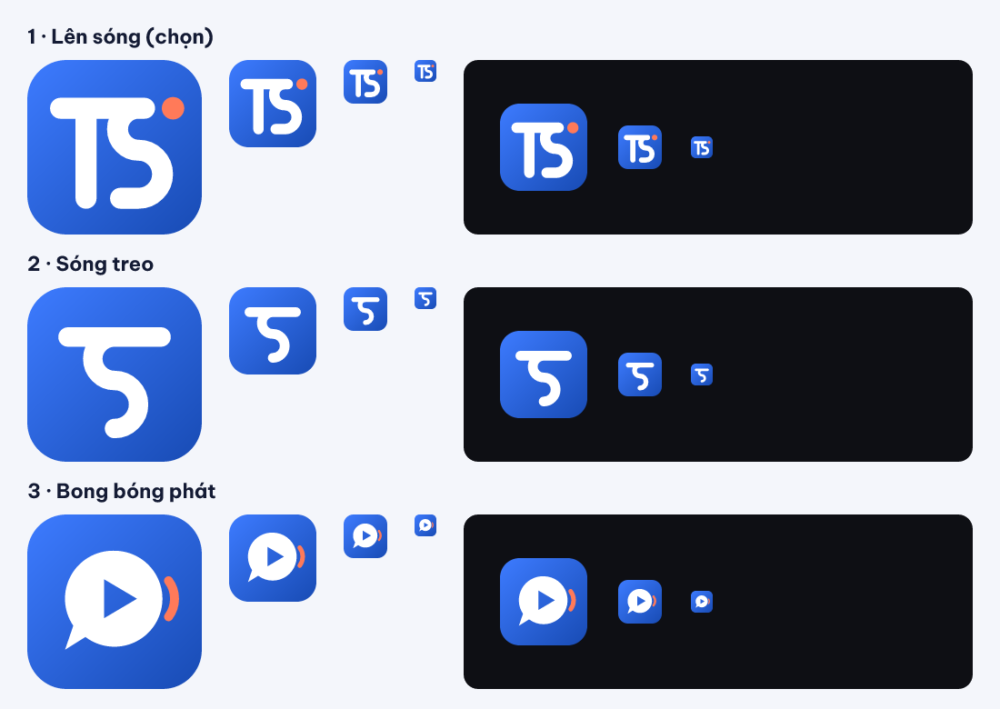

# Logo concepts — TSPodcast (TSP-15)

Brief: an original mark, simple and recognizable at 48 px, monochrome-safe (Android 13 themed icon),
works on light and dark, says "podcast / audio" plus "TS", and is clearly distinct from Spotify,
Apple Podcasts, Castbox and Pocket Casts. Every concept is hand-written SVG on a 100-unit grid,
built from lines, arcs and circles only.

## 1 · Lên sóng ("On air") — **chosen**

`concept-1-len-song.svg`

A T and an S drawn with one 14-unit round-cap stroke. The T's crossbar runs on to become the S's
top arm, so the two letters share one line. The S is two half-circles, which reads as a sound wave.
A coral dot at the end of the bar is the "ON AIR" lamp: live radio, recording, "now playing".

- **Legibility:** reads as "TS" at 24 px. At 16 px it holds as a white glyph with a warm dot.
- **Monochrome:** loses nothing, since the dot just takes the stroke colour.
- **Ownable:** no concentric arcs, microphone or circle badge, so it doesn't collide with the
  Apple Podcasts, Pocket Casts or Spotify marks. The stroke style also echoes the existing rounded UI icons.
- **Brand continuity:** the blue builds on the in-app primary `#184BB4`. Coral comes from the
  onboarding and bottom-bar accents already in the app.

## 2 · Sóng treo ("Hanging wave")

`concept-2-song-treo.svg`

A T whose stem is an S-shaped wave hanging from the crossbar. It is the most "audio" of the three,
but at small sizes it reads as the digit **5** (or "ち"), because the T never gets a visible vertical
stem. Rejected because the letters aren't legible at 48 px.

## 3 · Bong bóng phát ("Play bubble")

`concept-3-bong-bong-phat.svg`

A speech bubble with a play triangle knocked out, plus a coral sound tick: talk + play = podcast.
It is clear, but generic. Similar bubble/play marks are common among chat, video and
podcast apps, and it carries no "TS". Rejected as not ownable.

Implementation of the chosen concept: [`brand/BRAND.md`](../../../brand/BRAND.md).
