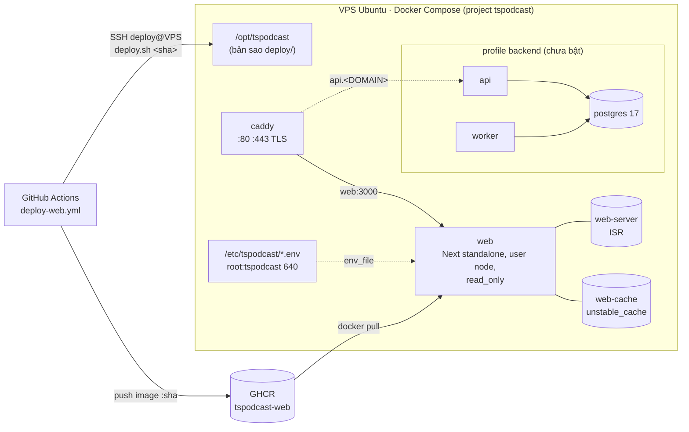

# Hướng dẫn deploy production: web TSPodcast lên VPS (và chỗ cho backend)

> Ticket: TSP-18 · Ngày lập: 2026-10-30 · Nhánh: `tuandv/vps-deploy`
> Thực hiện theo `docs/plans/web-vps-deploy.md` (Caddy, Next standalone, GHCR, SSH deploy) và `docs/plans/ke-hoach-backend-quickwin-cuoc-lon.md` §1–§2 (Postgres 17, `api`, `worker`, backup).
> Không có giá trị thật nào (domain, IP, key) trong repo. Mọi chỗ `<DOMAIN>`, `<VPS_HOST>`… là giá trị owner tự điền.
> Bản tĩnh trên Firebase Hosting (`tspodcast.web.app`, `npm run build:static`) **không bị đụng tới** và vẫn dùng làm dự phòng.

---

## 0. Tổng quan



| File | Việc |
|---|---|
| `web/Dockerfile`, `web/docker-entrypoint.sh`, `web/.dockerignore` | Image Next.js standalone, Node 22 alpine, user `node`, healthcheck `GET /robots.txt` |
| `web/next.config.ts` | `output: "standalone"` chỉ khi `NEXT_OUTPUT_STANDALONE=1` (Dockerfile đặt). `npm run build:static` và `npm run start` không đổi |
| `web/scripts/prune-isr-seeds.mjs` | Xoá bản dựng sẵn lúc build (không có key) của các route ISR, xem §14 |
| `deploy/docker-compose.yml` | `caddy`, `web`; `postgres`, `api`, `worker` sau profile `backend` |
| `deploy/caddy/Caddyfile`, `deploy/caddy/sites-available/api.caddy` | TLS, header bảo mật, nén, `www` → apex, `api.<DOMAIN>` để dành |
| `deploy/env/*.env.example` | Mẫu `compose.env`, `web.env`, `backend.env` (chỉ có tên biến) |
| `deploy/scripts/bootstrap-vps.sh` | Dựng server một lần (chạy lại được) |
| `deploy/scripts/deploy.sh`, `rollback.sh`, `compose.sh` | Deploy một tag, quay lại tag trước, gọi `docker compose` đúng tham số |
| `deploy/scripts/backup-postgres.sh`, `restore-postgres.sh`, `backup-upload.example.sh` | Backup/restore Postgres, hook đẩy lên R2 |
| `deploy/scripts/healthcheck/smoke.sh` | Smoke test (status, header, redirect) |
| `deploy/scripts/run-worker-job.sh`, `deploy/systemd/*`, `deploy/cron/*` | Timer backup 04:00, crawl 02:00 (giờ VN), bản cron thay thế |
| `deploy/ci/scan-secrets.mjs` | Quét image tìm key bị lộ |
| `.github/workflows/deploy-web.yml` | Build → kiểm tra → push GHCR → (duyệt tay) → SSH deploy |

Đường đi một lần deploy: push `main` có thay đổi `web/**` hoặc `deploy/**` → job **build** (lint, build image, quét secret, chạy thử image ở chế độ read-only, push `:<sha>`) → job **deploy** chờ owner bấm duyệt trong environment `production` → quét image với giá trị key thật → copy `deploy/` lên `/opt/tspodcast` → `deploy.sh <sha>` (pull, `compose up -d`, chờ healthy, smoke test, tự quay lại tag cũ nếu lỗi) → smoke test URL công khai → gắn tag `latest`.

---

## 1. Chuẩn bị

**Owner cần có:**

- Domain đã mua, vào được trang quản lý DNS (Cloudflare hoặc nhà đăng ký).
- VPS **Ubuntu 24.04 LTS** (22.04 cũng chạy), khuyến nghị 2 vCPU / 4 GB (`web-vps-deploy.md` §2), IPv4 công khai (IPv6 nếu có). Đăng nhập được bằng SSH key (root hoặc user có sudo). Nếu nhà cung cấp có firewall riêng (security group), mở 22, 80, 443 TCP và 443 UDP.
- Quyền admin repo GitHub (tạo environment, secret, variable).
- Cặp key PodcastIndex **riêng cho web** (https://api.podcastindex.org/), không dùng key của app Android.
- (Tuỳ chọn) `ANTHROPIC_API_KEY` để bật AI, đã đặt spend limit trên console.anthropic.com.
- Máy cá nhân có `ssh`, `scp`, `ssh-keygen`, `ssh-keyscan`.

**Danh sách giá trị owner phải cung cấp** (không giá trị nào nằm trong repo):

| Giá trị | Ở đâu | Bắt buộc |
|---|---|---|
| `DOMAIN` (vd. `example.com`), `ACME_EMAIL` | `/etc/tspodcast/compose.env` | Có |
| `WEB_IMAGE` = `ghcr.io/<github owner, chữ thường>/tspodcast-web` | `/etc/tspodcast/compose.env` | Có |
| `PODCASTINDEX_API_KEY`, `PODCASTINDEX_API_SECRET` | `/etc/tspodcast/web.env` **và** secret GitHub (chỉ để quét) | Có |
| `ANTHROPIC_API_KEY` | `/etc/tspodcast/web.env` và secret GitHub (chỉ để quét) | Không (tắt AI) |
| `GOOGLE_SITE_VERIFICATION`, `APP_ADS_TXT`, `ANDROID_CERT_SHA256` | `/etc/tspodcast/web.env` | Không |
| `SITE_URL` = `https://<DOMAIN>`, `SITE_LOCALE` (`vi`) | GitHub **repository variables** | `SITE_URL` có |
| `VPS_HOST`, `VPS_USER` (= `deploy`), `VPS_SSH_KEY`, `VPS_SSH_KNOWN_HOSTS` | Secret của environment `production` | Có |
| `GHCR_USER`, `GHCR_TOKEN` (PAT classic, scope `read:packages`) | Secret của environment `production` | Có nếu package private (mặc định) |
| Bản ghi DNS A/AAAA cho `@`, `www` (và `api` khi bật backend) | Trang DNS | Có |
| `backend.env` (Postgres, R2, App Check…) | `/etc/tspodcast/backend.env` | Chỉ khi bật backend (§9) |

---

## 2. Dựng VPS lần đầu

### 2.1 Tạo SSH key cho CI (trên máy cá nhân)

```bash
ssh-keygen -t ed25519 -N "" -C "github-actions-tspodcast" -f ~/.ssh/tspodcast_ci
cat ~/.ssh/tspodcast_ci.pub    # dùng cho DEPLOY_PUBKEY ở bước 2.3
# ~/.ssh/tspodcast_ci (private) chỉ dán vào secret VPS_SSH_KEY ở §4, không gửi đi đâu khác.
```

### 2.2 Đưa thư mục `deploy/` lên VPS

```bash
# Từ thư mục gốc repo trên máy cá nhân. <SSH_USER> là user đang đăng nhập được (root hoặc user sudo).
scp -r deploy <SSH_USER>@<VPS_HOST>:/tmp/tspodcast-deploy
ssh <SSH_USER>@<VPS_HOST>
```

### 2.3 Chạy bootstrap

```bash
# Trên VPS. ADMIN_USER là user sudo của chính bạn (sẽ là cách đăng nhập duy nhất
# sau khi tắt root login). Nếu đang là root, script tạo user này và chép
# authorized_keys của root sang.
sudo ADMIN_USER=<ten-ban> \
     DEPLOY_PUBKEY="$(cat <<'EOF'
ssh-ed25519 AAAA...nội dung tspodcast_ci.pub... github-actions-tspodcast
EOF
)" \
     DOMAIN=<DOMAIN> ACME_EMAIL=<EMAIL> \
     WEB_IMAGE=ghcr.io/<owner>/tspodcast-web \
     bash /tmp/tspodcast-deploy/scripts/bootstrap-vps.sh
```

Script làm, theo thứ tự (chạy lại không hỏng gì): `apt upgrade` → user admin (sudo) và user `deploy` (nhóm `docker` + `tspodcast`, không sudo, chỉ đăng nhập bằng key CI) → SSH chỉ cho key, tắt root login (file `/etc/ssh/sshd_config.d/01-tspodcast-hardening.conf`) → `ufw` 22 (giới hạn tần suất), 80, 443/tcp, 443/udp → `fail2ban` cho sshd → `unattended-upgrades` (chỉ bản vá bảo mật, không tự reboot) → Docker Engine + compose plugin từ apt repo của Docker, xoay log 10 MB × 5 → swap 2 GB nếu RAM < 4 GB → `/opt/tspodcast`, `/etc/tspodcast` (750, file 640), `/var/lib/tspodcast`, `/var/backups/tspodcast` → cài (không bật) systemd timer.

**Ngay sau khi script chạy xong, giữ nguyên phiên SSH hiện tại** và mở terminal mới thử `ssh <ten-ban>@<VPS_HOST>` rồi `sudo -v`. Chỉ đóng phiên cũ khi phiên mới vào được. Nếu `ADMIN_USER` vừa được tạo, đặt mật khẩu cho sudo: `sudo passwd <ten-ban>` (làm trong phiên cũ).

Nếu `sudo` báo cần reboot (`/var/run/reboot-required`), reboot sau khi đã thử SSH thành công.

---

## 3. DNS và file env trên VPS

### 3.1 DNS

| Loại | Tên | Giá trị | Khi nào |
|---|---|---|---|
| A | `@` | IPv4 của VPS | Ngay |
| A | `www` | IPv4 của VPS | Ngay |
| AAAA | `@`, `www` | IPv6 của VPS | Chỉ khi VPS có IPv6 chạy được (thử `curl -6 https://ifconfig.co` trên VPS) |
| A (+AAAA) | `api` | IP của VPS | Khi bật backend (§9). Tạo sớm cũng không sao: Caddy chưa xin cert cho `api` khi chưa có `api.caddy` |

Cloudflare: để **DNS only (mây xám)** lúc đầu cho Caddy xin cert. Muốn bật proxy (mây cam) sau đó thì đặt SSL/TLS = **Full (strict)** và bỏ comment khối `trusted_proxies` trong `deploy/caddy/Caddyfile` (nếu không, rate limit AI theo IP sẽ gom mọi người dùng vào IP của Cloudflare).

Kiểm tra từ máy cá nhân: `dig +short A <DOMAIN>` và `dig +short A www.<DOMAIN>` trả về IP của VPS.

### 3.2 File env

Bootstrap đã tạo ba file từ mẫu, quyền `root:tspodcast 640`. Sửa bằng `sudoedit` (giữ nguyên quyền):

```bash
sudoedit /etc/tspodcast/compose.env   # DOMAIN, ACME_EMAIL, WEB_IMAGE (bootstrap có thể đã điền)
sudoedit /etc/tspodcast/web.env       # PODCASTINDEX_API_KEY, PODCASTINDEX_API_SECRET, ANTHROPIC_API_KEY…
ls -l /etc/tspodcast                  # phải là -rw-r----- root tspodcast
```

- Giá trị có ký tự `$` phải đặt trong **nháy đơn**: `PODCASTINDEX_API_SECRET='ab$cd'`. Docker Compose tự thay `$VAR` trong giá trị không có nháy hoặc nháy kép, secret sẽ bị cắt và PodcastIndex trả 401 (cùng bẫy với `.env.local`, xem `web/README.md`).
- `NEXT_PUBLIC_SITE_URL`, `NEXT_PUBLIC_SITE_LOCALE`, `SITE_NOINDEX` **không** đặt ở `web.env`: Next.js nhúng chúng vào bundle lúc build, nên CI lấy từ biến GitHub `SITE_URL`/`SITE_LOCALE` (§4). Đổi domain = build lại image.
- Không bao giờ chạy `docker compose config` hay `docker inspect` rồi dán kết quả ra ngoài: cả hai in giá trị env.

---

## 4. GitHub: GHCR, environment `production`, secret và variable

1. **Repository variables** (Settings → Secrets and variables → Actions → tab *Variables* → *New repository variable*):
   - `SITE_URL` = `https://<DOMAIN>` (không có `/` cuối, chữ thường).
   - `SITE_LOCALE` = `vi` (tuỳ chọn; `en` cho bản tiếng Anh).
2. **Environment** (Settings → Environments → *New environment* → tên `production`):
   - *Required reviewers*: thêm owner. Đây là bước duyệt tay trước mỗi lần deploy. Lưu ý: với repo **private**, required reviewers chỉ có trên gói GitHub trả phí (Pro/Team/Enterprise). Gói Free thì job vẫn chạy nhưng không dừng chờ duyệt; khi đó có thể tắt deploy tự động bằng cách chỉ chạy workflow tay (§6).
   - *Deployment branches and tags*: *Selected branches* → `main`.
   - *Environment secrets*:

| Secret | Giá trị | Lấy ở đâu |
|---|---|---|
| `VPS_HOST` | IP hoặc hostname của VPS | Trang quản lý VPS |
| `VPS_USER` | `deploy` | Tên user bootstrap tạo |
| `VPS_SSH_KEY` | Toàn bộ nội dung `~/.ssh/tspodcast_ci` (private key, cả dòng BEGIN/END) | Bước 2.1 |
| `VPS_SSH_KNOWN_HOSTS` | Kết quả `ssh-keyscan -t ed25519 <VPS_HOST>` | Xem cách kiểm vân tay ngay dưới bảng |
| `GHCR_USER` | Tên user GitHub sở hữu token | |
| `GHCR_TOKEN` | Personal access token **(classic)**, chỉ scope `read:packages`, hạn ≤ 1 năm | GitHub → Settings → Developer settings → Personal access tokens (classic) |
| `PODCASTINDEX_API_KEY`, `PODCASTINDEX_API_SECRET` | Giống `web.env` | Chỉ dùng để quét image, **không** đưa vào build |
| `ANTHROPIC_API_KEY` | Giống `web.env` (bỏ trống nếu không bật AI) | Như trên |

   Kiểm vân tay host key trước khi tin `ssh-keyscan` (tránh MITM ngay lần đầu):

   ```bash
   # Trên VPS:
   ssh-keygen -lf /etc/ssh/ssh_host_ed25519_key.pub
   # Trên máy cá nhân, phải ra đúng cùng chuỗi SHA256:...
   ssh-keyscan -t ed25519 <VPS_HOST> 2>/dev/null | tee /tmp/known_hosts_vps | ssh-keygen -lf -
   cat /tmp/known_hosts_vps   # dán dòng này vào secret VPS_SSH_KNOWN_HOSTS
   ```

3. **GHCR**: lần build đầu, workflow tự tạo package `tspodcast-web` dưới owner (dùng `GITHUB_TOKEN`, không cần thêm gì) và liên kết với repo qua label `org.opencontainers.image.source`. Package mặc định **private**: VPS cần `GHCR_USER`/`GHCR_TOKEN` để pull. Nếu tổ chức chặn quyền ghi package của workflow: Settings → Actions → General → *Workflow permissions* → cho phép *Read and write*, hoặc vào trang package → *Package settings* → *Manage Actions access* thêm repo với quyền *Write*.
4. Workflow **chỉ** dùng các secret/variable ở trên cộng `GITHUB_TOKEN` tự có.

---

## 5. Deploy lần đầu

Điều kiện: §2–§4 xong, DNS đã trỏ về VPS (Caddy cần DNS đúng để xin cert).

**Qua CI (khuyến nghị):** GitHub → Actions → *Deploy web (VPS)* → *Run workflow* trên `main` → chờ job *Build and check image* xong (~5–8 phút) → job *Deploy to VPS* hiện *Review deployments* → *Approve and deploy*. Job deploy in các dòng của `deploy.sh` và kết quả smoke test công khai.

**Tay, khi đã có image trên GHCR** (đăng nhập VPS bằng user admin):

```bash
sudo -iu deploy
docker login ghcr.io -u <GHCR_USER>    # một lần; dán GHCR_TOKEN khi được hỏi (không để token trong shell history)
/opt/tspodcast/scripts/deploy.sh <sha đầy đủ của commit đã build>
```

Lần đầu Caddy xin cert cho `<DOMAIN>` và `www.<DOMAIN>` (vài giây đến 1 phút). Xem: `/opt/tspodcast/scripts/compose.sh logs caddy | grep -i "certificate obtained"`.

---

## 6. Deploy thường ngày và phương án dự phòng

- **Bình thường:** merge vào `main` có thay đổi trong `web/**`, `deploy/**` hoặc workflow → CI build → owner duyệt → deploy. Chỉ đổi `deploy/**` (Caddyfile, compose) cũng chạy lại, `deploy.sh` reload Caddy sau khi web healthy.
- **Build nhưng không deploy:** *Run workflow* và bỏ chọn *Deploy to the VPS after building* (hoặc chạy từ nhánh khác `main`: job deploy tự bỏ qua).
- **Deploy lại đúng một commit cũ qua CI:** mở run cũ → *Re-run all jobs*. Nhanh hơn: `rollback.sh` (§7).
- **CI không dùng được (GitHub Actions lỗi, hết phút…): build ngay trên VPS.** Cần ~2 GB RAM trống (swap của bootstrap đủ cho gói 2 GB nhưng chậm). Image mang `NEXT_PUBLIC_SITE_URL=https://<DOMAIN>` và `SITE_LOCALE` từ `compose.env`.

  ```bash
  sudo -iu deploy
  # Lần đầu: clone repo (repo private thì dùng deploy key read-only hoặc PAT có scope repo)
  git clone https://github.com/<owner>/<repo>.git /opt/tspodcast-src
  # Mỗi lần:
  git -C /opt/tspodcast-src pull --ff-only
  tar -C /opt/tspodcast-src/deploy -cf - . | tar -C /opt/tspodcast -xf - --no-same-owner
  /opt/tspodcast/scripts/deploy.sh --build /opt/tspodcast-src/web
  ```

  Tag sẽ là `local-<12 ký tự sha>`. Image build trên server **không** qua bước quét secret của CI. Quét theo mẫu (không cần Node trên server):

  ```bash
  cid="$(docker create ghcr.io/<owner>/tspodcast-web:local-<sha>)"
  docker cp "$cid:/app" /tmp/img-app && docker rm "$cid"
  docker run --rm -v /tmp/img-app:/scan:ro -v /opt/tspodcast/ci:/ci:ro node:22-alpine node /ci/scan-secrets.mjs /scan
  rm -rf /tmp/img-app
  ```

  Khi CI chạy lại được, deploy lại qua CI để có bản đã quét đủ.

---

## 7. Rollback

```bash
sudo -iu deploy
/opt/tspodcast/scripts/rollback.sh --list     # tag hiện tại, tag trước, 20 lần deploy gần nhất
/opt/tspodcast/scripts/rollback.sh            # về tag ngay trước
/opt/tspodcast/scripts/rollback.sh <sha>      # về một tag cụ thể
```

- `deploy.sh` tự rollback khi bản mới không healthy hoặc smoke test fail; `rollback.sh` là để quay lại bản đã chạy được nhưng có lỗi nghiệp vụ.
- Server giữ image của 3 lần deploy gần nhất nên rollback không cần GHCR. Tag cũ hơn thì cần `docker login ghcr.io` còn hiệu lực.
- Chạy `rollback.sh` hai lần liên tiếp là quay về chỗ cũ.
- Tương đương thủ công (như `web-vps-deploy.md` §4): `WEB_TAG=<sha cũ> /opt/tspodcast/scripts/compose.sh up -d web`, nhưng cách này không ghi lại tag và không smoke test.

---

## 8. Backup và restore (khi đã bật backend)

Web không có dữ liệu cần backup (cache tự dựng lại). Cần giữ: `/etc/tspodcast/*.env` (chép ra chỗ an toàn, **không** vào repo, không vào backup công khai) và volume `tspodcast_caddy-data` (cert + tài khoản ACME; mất thì Caddy xin lại, chỉ tốn rate limit). Snapshot VPS của nhà cung cấp (+20% giá) bọc được cả hai.

Postgres (profile `backend`):

```bash
# Chạy thử một lần bằng tay (user deploy):
/opt/tspodcast/scripts/backup-postgres.sh
ls -lh /var/backups/tspodcast/postgres/daily/

# Hook đẩy lên R2 (plan §2.6), một lần:
sudo apt-get install -y rclone
sudo install -o root -g tspodcast -m 750 /opt/tspodcast/scripts/backup-upload.example.sh /etc/tspodcast/backup-upload.sh

# Bật lịch 04:00 giờ VN:
sudo systemctl enable --now tspodcast-backup.timer
systemctl list-timers 'tspodcast-*'
journalctl -u tspodcast-backup --since today
```

- File: `pg_dump -Fc` (nén), kiểm bằng `pg_restore --list` trước khi giữ. Giữ 14 bản ngày + 8 bản tuần (`KEEP_DAILY`, `KEEP_WEEKLY`). Đặt `BACKUP_PING_URL` (healthchecks.io) trong `compose.env` để được báo khi backup không chạy.
- Restore vào DB chính (dừng `api`/`worker` trong lúc restore, hỏi xác nhận): `/opt/tspodcast/scripts/restore-postgres.sh /var/backups/tspodcast/postgres/daily/<file>.dump`
- Diễn tập restore hằng tuần (plan §2.6) mà không đụng DB thật: `restore-postgres.sh --yes --target-db restore_check <file>` rồi `compose.sh exec postgres dropdb -U tspodcast restore_check`.
- Lấy file từ R2 về rồi restore y như trên.
- Cron thay cho systemd: `deploy/cron/tspodcast.cron.example` (giờ UTC, dùng một trong hai).

---

## 9. Bật profile `backend` sau này

Các service `postgres`, `api`, `worker` đã khai báo nhưng image, lệnh, cổng và `/healthz` của `api`/`worker` là **placeholder (TODO BE-M0/BE-M2)**. Khi `backend/` có code:

1. Thêm Dockerfile cho `backend/` và job CI push `ghcr.io/<owner>/tspodcast-api` + `tspodcast-worker` (chưa làm). Đối chiếu lệnh chạy, cổng `8080`, `/healthz` trong `deploy/docker-compose.yml` và `caddy/sites-available/api.caddy`, tên biến trong `backend.env.example`.
2. `sudoedit /etc/tspodcast/backend.env`: `POSTGRES_PASSWORD` (`openssl rand -base64 32 | tr -d '/+=' | cut -c1-32`), `DATABASE_URL`, R2, App Check… **Không** đặt `PODCASTINDEX_*` hay `ANTHROPIC_API_KEY` ở đây: `deploy.sh` từ chối chạy nếu thấy (bất biến §1 của plan).
3. `sudoedit /etc/tspodcast/compose.env`: `COMPOSE_PROFILES=backend`, `API_IMAGE`, `API_TAG`, `WORKER_IMAGE`, `WORKER_TAG`.
4. Khởi động DB trước và kiểm extension:

   ```bash
   /opt/tspodcast/scripts/compose.sh up -d postgres
   /opt/tspodcast/scripts/compose.sh exec postgres psql -U tspodcast -d tspodcast -c '\dx'
   # phải thấy pg_trgm và unaccent (chỉ tạo khi volume còn trống lần đầu)
   ```

5. Chạy migration của backend (TODO, theo code `backend/`), rồi `compose.sh up -d api worker`.
6. Kiểm bất biến: `compose.sh exec api sh -c 'env | grep -c "^PODCASTINDEX_" || true'` phải in `0` (lệnh chỉ in số đếm, không in giá trị). Web không ở network `backend` nên không chạm được Postgres.
7. DNS `api.<DOMAIN>` (§3.1), rồi bật site và reload Caddy:

   ```bash
   sudo cp /opt/tspodcast/caddy/sites-available/api.caddy /etc/tspodcast/caddy/
   /opt/tspodcast/scripts/compose.sh exec caddy caddy reload --config /etc/caddy/Caddyfile
   curl -sS https://api.<DOMAIN>/healthz
   ```

8. Backup (§8). Nếu worker không có pg-boss cron riêng thì bật `tspodcast-crawl.timer` (02:00) sau khi sửa lệnh trong `run-worker-job.sh`.
9. Theo dõi RAM: tổng giới hạn khi bật đủ là ~3,3 GB (web 768M, postgres 1G, api 512M, worker 768M, caddy 256M) trên VPS 4 GB + swap. Khi RAM > 80% kéo dài thì nâng gói (plan §2.6).

---

## 10. Log và giám sát

```bash
/opt/tspodcast/scripts/compose.sh ps                      # trạng thái + (healthy)
/opt/tspodcast/scripts/compose.sh logs -f --tail=200 web
/opt/tspodcast/scripts/compose.sh logs --tail=200 caddy   # access log JSON + ACME
docker stats --no-stream                                  # RAM/CPU từng container
cat /var/lib/tspodcast/deploy-history.log                 # lịch sử deploy
df -h / && docker system df                               # dung lượng
sudo fail2ban-client status sshd
```

- Log Docker xoay 10 MB × 5 file mỗi container (compose và `daemon.json`).
- UptimeRobot (miễn phí, 5 phút): monitor HTTP `https://<DOMAIN>/robots.txt`, thêm monitor *keyword* trên `https://<DOMAIN>/` với từ khoá **không** được xuất hiện `setup-title` (dấu hiệu `web.env` thiếu key).
- Cảnh báo disk > 80% (`web-vps-deploy.md` bước 11): dòng cuối của `deploy/cron/tspodcast.cron.example` ghi vào syslog; nối Telegram/healthchecks nếu cần đẩy thông báo.
- Bản vá bảo mật: `unattended-upgrades` tự cài; xem `/var/log/unattended-upgrades/`. Khi có `/var/run/reboot-required` thì reboot giờ thấp điểm (container tự lên lại nhờ `restart: unless-stopped`).
- Image nền (`node:22-alpine`, `caddy:2-alpine`, `postgres:17-alpine`): mỗi lần CI build lấy bản mới của Node; Caddy/Postgres cập nhật bằng `compose.sh pull caddy && compose.sh up -d caddy`.

---

## 11. Checklist lần chạy đầu trên VPS

Chạy theo thứ tự; cột phải là kết quả mong đợi.

| # | Lệnh (trên VPS trừ khi ghi khác) | Kết quả mong đợi |
|---|---|---|
| 1 | `lsb_release -ds; nproc; free -h` | `Ubuntu 24.04.x LTS`, ≥ 2 CPU, ≥ 2 GB RAM |
| 2 | `sudo ... bash /tmp/tspodcast-deploy/scripts/bootstrap-vps.sh` (§2.3) | Kết thúc bằng `==> Done` và danh sách *Next steps*, không có `ERROR:` |
| 3 | Terminal mới trên máy cá nhân: `ssh <ten-ban>@<VPS_HOST> sudo -v` | Vào được, sudo hỏi mật khẩu rồi im lặng |
| 4 | `ssh root@<VPS_HOST>` từ máy cá nhân | `Permission denied (publickey)` |
| 5 | `sudo sshd -T \| grep -E '^(permitrootlogin\|passwordauthentication) '` | `permitrootlogin no` và `passwordauthentication no` |
| 6 | `sudo ufw status` | `Status: active`; `22/tcp LIMIT`, `80/tcp ALLOW`, `443/tcp ALLOW`, `443/udp ALLOW` (và bản `(v6)`) |
| 7 | `sudo fail2ban-client status sshd` | `Status for the jail: sshd` |
| 8 | `systemctl is-enabled unattended-upgrades; cat /etc/apt/apt.conf.d/20auto-upgrades` | `enabled`; hai dòng `"1"` |
| 9 | `docker --version; docker compose version` | `Docker version 2x.x`, `Docker Compose version v2.x` (cần ≥ 2.24 cho `env_file.required`) |
| 10 | `swapon --show; sysctl vm.swappiness` | Có `/swapfile` nếu RAM < 4 GB; `vm.swappiness = 10` |
| 11 | `id deploy` | Có `docker` và `tspodcast` trong groups |
| 12 | `ls -ld /etc/tspodcast; ls -l /etc/tspodcast` | `drwxr-x--- root tspodcast`; ba file `-rw-r----- root tspodcast` |
| 13 | `sudo grep -cE '^(DOMAIN\|ACME_EMAIL\|WEB_IMAGE)=.+' /etc/tspodcast/compose.env` | `3` |
| 14 | `sudo grep -cE '^PODCASTINDEX_API_(KEY\|SECRET)=.+' /etc/tspodcast/web.env` | `2` (lệnh chỉ đếm, không in key) |
| 15 | Máy cá nhân: `dig +short A <DOMAIN>; dig +short A www.<DOMAIN>` | IP của VPS (cả hai) |
| 16 | Máy cá nhân: `ssh -i ~/.ssh/tspodcast_ci deploy@<VPS_HOST> 'docker ps && ls /opt/tspodcast'` | Bảng `docker ps` (có thể trống) và `caddy ci cron docker-compose.yml env postgres scripts systemd` |
| 17 | GitHub: chạy workflow (§5), duyệt deploy | Job *Deploy* xanh; log có `Smoke test: http://127.0.0.1:3000` … `Result: 0 failed` và `deployed ghcr.io/...:<sha>` |
| 18 | `sudo -iu deploy /opt/tspodcast/scripts/compose.sh ps` | `tspodcast-caddy-1` và `tspodcast-web-1` đều `Up … (healthy)` |
| 19 | `sudo -iu deploy /opt/tspodcast/scripts/compose.sh logs caddy \| grep -c "certificate obtained successfully"` | ≥ 2 (apex + www) |
| 20 | Máy cá nhân: `curl -sI https://<DOMAIN>/ \| grep -iE '^(HTTP\|strict-transport\|x-content-type)'` | `HTTP/2 200`, `strict-transport-security: max-age=31536000`, `x-content-type-options: nosniff` |
| 21 | Máy cá nhân: `curl -sI http://<DOMAIN>/ \| head -1; curl -sI https://www.<DOMAIN>/ \| grep -i ^location` | `HTTP/1.1 308 Permanent Redirect`; `location: https://<DOMAIN>/` |
| 22 | Máy cá nhân (từ thư mục repo): `deploy/scripts/healthcheck/smoke.sh --public https://<DOMAIN>` | `Result: 0 failed` |
| 23 | Trình duyệt: `https://<DOMAIN>/`, `/trending`, `/search?q=tin tức`, một trang podcast, `/sitemap.xml`, `/robots.txt` | Có dữ liệu thật, không có khung "chưa cấu hình khoá" |
| 24 | `sudo -iu deploy docker inspect -f '{{.HostConfig.ReadonlyRootfs}} {{.Config.User}}' tspodcast-web-1` | `true node` |
| 25 | `sudo ss -tlnp \| grep -E ':(80\|443\|3000)\b'` | 80/443 trên `0.0.0.0`/`[::]`; 3000 chỉ trên `127.0.0.1` |
| 26 | `sudo -iu deploy /opt/tspodcast/scripts/rollback.sh --list` | `current: <sha>` |

Sau đó: bỏ `SITE_NOINDEX` (mặc định đã không đặt), khai báo Search Console/Bing, cập nhật Website trong Play listing, chuyển `tspodcast.web.app` thành redirect 301 (các bước 8–10 của `web-vps-deploy.md`).

---

## 12. Xử lý sự cố

| Triệu chứng | Nguyên nhân thường gặp | Cách xử lý |
|---|---|---|
| Caddy log `challenge failed` / `no such host`, web không có HTTPS | DNS chưa trỏ hoặc chưa lan truyền; firewall nhà cung cấp chặn 80; Cloudflare proxy bật sớm | `dig`, mở 80/443 ở security group, tắt proxy cho tới khi có cert. Thử nhiều lần liên tục sẽ chạm rate limit Let's Encrypt (5 lần fail/giờ): khi thử nghiệm thêm `acme_ca https://acme-staging-v02.api.letsencrypt.org/directory` vào khối global rồi bỏ sau |
| `deploy.sh`: `pull of … failed` | VPS chưa `docker login ghcr.io` với user `deploy`; PAT hết hạn/thiếu `read:packages`; `WEB_IMAGE` sai owner hoặc có chữ hoa | Đăng nhập lại (§5), sửa `compose.env` |
| `permission denied … docker.sock` | Nhóm `docker` mới thêm, phiên cũ chưa nhận | Đăng xuất rồi vào lại, hoặc `sudo -iu deploy` |
| `/etc/tspodcast/compose.env not readable` | Không thuộc nhóm `tspodcast` hoặc quyền sai | `id`; `sudo chown root:tspodcast /etc/tspodcast/*.env && sudo chmod 640 /etc/tspodcast/*.env` |
| `env_file … unknown field "required"` | Docker Compose < 2.24 | `sudo apt-get install --only-upgrade docker-compose-plugin` |
| Web `unhealthy`, log `docker-entrypoint: … is not writable` | Thiếu volume `web-server` (chạy image không qua compose) | Luôn chạy qua `compose.sh`/`deploy.sh` |
| Web bị restart liên tục, `docker inspect -f '{{.State.OOMKilled}}' tspodcast-web-1` = `true` | Thiếu RAM | Tăng `memory` của `web` trong compose và `--max-old-space-size`, kiểm swap, nâng gói |
| Trang hiện khung "chưa cấu hình khoá", smoke test báo `setup notice` | `web.env` thiếu `PODCASTINDEX_*` | Điền rồi `compose.sh up -d web` (`up` đọc lại env_file; `restart` thì không) |
| Trang báo "Không tải được dữ liệu", log có `401` | Secret bị cắt do `$` | Đặt giá trị trong nháy đơn (§3.2) |
| Log có `429`, `Retry-After` lớn | PodcastIndex chặn IP tạm thời (đã gặp 2026-10-29) | Chờ hết `Retry-After`; dùng key riêng cho web; cache ISR sẽ đỡ dần |
| AI trả 503 | `ANTHROPIC_API_KEY` trống | Điền rồi `compose.sh up -d web` |
| CI: `Host key verification failed` | VPS cài lại, host key đổi | Kiểm vân tay mới (§4) rồi cập nhật `VPS_SSH_KNOWN_HOSTS` |
| CI: `Repository variable SITE_URL must be…` | Chưa tạo variable hoặc có `/` cuối | §4 bước 1 |
| CI: `Secret scan FAILED` | Key bị hard-code trong `web/` | Không deploy; xoá key khỏi code, **thu hồi và cấp key mới**, xoá version image đó trên GHCR |
| CI: job deploy không chờ duyệt | Repo private trên gói Free | §4 bước 2; hoặc chỉ deploy bằng *Run workflow* |
| `caddy reload failed` cuối `deploy.sh` | Caddyfile mới lỗi cú pháp (web vẫn đã lên) | `compose.sh exec caddy caddy validate --config /etc/caddy/Caddyfile`, sửa, deploy lại |
| Port 3000 hoặc 5432 truy cập được từ ngoài | Ai đó sửa `ports:` | Docker publish port **bỏ qua ufw**; chỉ publish `127.0.0.1:…` cho mọi thứ trừ Caddy |
| Mất SSH (khoá nhầm) | Không còn key hợp lệ | Console/VNC của nhà cung cấp → xoá `/etc/ssh/sshd_config.d/01-tspodcast-hardening.conf` → `systemctl reload ssh` |

---

## 13. Đã kiểm tra gì, còn phải kiểm tra gì

**Đã kiểm tra trên máy dev (macOS, không có Docker), 2026-10-30:**

- `cd web && npm ci && NEXT_OUTPUT_STANDALONE=1 npm run build` (Node 24): build thành công, ra `.next/standalone` (~58 MB, `server.js` ở gốc nhờ `outputFileTracingRoot`).
- Chạy `server.js` của bản standalone theo đúng bố cục image (prune ISR, `server.seed` → `server`, entrypoint đã thay đường dẫn): `x-nextjs-cache: MISS` rồi `HIT` cho `/`, `/trending`, `/app-ads.txt`; `APP_ADS_TXT` lúc chạy được áp dụng (bản build không key trả 404); file cũ trong thư mục `server` bị xoá khi khởi động; header bảo mật có mặt; lệnh healthcheck trả 0 khi server sống, 1 khi chết.
- `smoke.sh --allow-missing-keys` chạy qua server đó: `0 failed` (không có key nên home hiện setup notice, đúng là cảnh báo). Nhánh `--public` chạy thử với `tspodcast.web.app` để kiểm logic redirect/HSTS.
- Nhánh static export của `next.config.ts`: `NEXT_PUBLIC_STATIC_EXPORT=1 NEXT_OUTPUT_STANDALONE=1 next build` vẫn đi đường export (`cpus: 2`, không sinh `standalone`). Build tĩnh đầy đủ **không** chạy vì cần key PodcastIndex (không key thì dừng ở `generateStaticParams` của `/category`, giống trước thay đổi).
- `npm run lint` sạch. `bash -n` và `shellcheck -x` cho mọi script: 0 lỗi. `actionlint` cho workflow: 0 lỗi. `docker-compose.yml` hợp lệ theo JSON schema chính thức của compose-spec. `scan-secrets.mjs` thử với key cài cắm (giá trị, mẫu `sk-ant-`, `process.env.X` trong bundle client): bắt đủ, không in giá trị.

**Kiểm tra tự động ở lần chạy CI đầu tiên** (chưa chạy được vì máy dev không có Docker): `docker compose config` (có/không profile `backend`), `caddy validate` (có/không `api.caddy`), `docker build` trên Linux/musl, image chạy `--read-only --cap-drop ALL` không key và qua smoke test.

**Phải kiểm tra trên VPS** (checklist §11): bootstrap trên Ubuntu thật (SSH hardening, ufw, Docker apt repo, swap), Caddy xin cert thật, HTTP/3, IPv6, giới hạn RAM có hợp với gói VPS, deploy/rollback thật (`deploy.sh`, `rollback.sh` mới chỉ qua `shellcheck`), timer systemd. Phần backend (`postgres` read-only + capabilities, backup/restore, `api.caddy`) chỉ kiểm được khi có `backend/`.

---

## 14. Ghi chú kỹ thuật

- **ISR không nằm trong `.next/cache`.** Next 16 ghi trang ISR cạnh code đã biên dịch (`.next/server/app`, `.next/server/route-cache`); `.next/cache` chỉ chứa dữ liệu `unstable_cache` (`fetch-cache`). Plan `web-vps-deploy.md` §1 giả định ngược lại. Vì container chạy `read_only`, image để server ở `.next/server.seed`, entrypoint chép sang volume `web-server` mỗi lần khởi động (xoá sạch bản cũ, nên deploy mới không dính code cũ). Volume `web-cache` giữ `unstable_cache` qua các lần deploy (khoá cache có hash của hàm nên đổi code là tự vô hiệu).
- **Build không có key.** CI build image không có `PODCASTINDEX_*` (đúng plan), nên trang ISR dựng sẵn lúc build là khung "chưa cấu hình khoá", sitemap rỗng, `app-ads.txt` 404, thiếu `GOOGLE_SITE_VERIFICATION`. Nếu giữ, chúng được phục vụ tới hết `revalidate` (tới 6 giờ với `/radio`) sau mỗi deploy. `prune-isr-seeds.mjs` xoá các bản này; lần request đầu sau deploy render chặn (cache MISS) bằng env của server. Smoke test của `deploy.sh` chính là lượt "làm nóng" đó. Route không có `revalidate` (`robots.txt`, `manifest`, `_not-found`) giữ nguyên vì chỉ phụ thuộc giá trị build.
- **`NEXT_PUBLIC_*` là giá trị build.** Đổi domain/ngôn ngữ phải build lại image (đổi `SITE_URL` trên GitHub rồi chạy workflow). `robots.txt` là `force-static` nên `SITE_NOINDEX` cũng là giá trị build (build arg trong Dockerfile, mặc định trống).
- **Caddy** chạy root trong container (để bind 80/443) nhưng bỏ mọi capability trừ `NET_BIND_SERVICE`, `read_only`, `no-new-privileges`. HSTS 1 năm, chưa `includeSubDomains`/`preload` (thêm khi chắc mọi subdomain đều HTTPS). CSP chưa đặt: Next chèn inline script, cần nonce, để việc sau.
- **Docker và ufw:** port publish bởi Docker đi thẳng qua iptables, không qua ufw. Stack chỉ publish 80/443 (Caddy) và `127.0.0.1:3000`; Postgres không publish và nằm trong network `internal`.
- **Nhóm `docker` tương đương root.** User `deploy` không có sudo nhưng vào được Docker, nên key CI là thông tin nhạy cảm như quyền root. Key có `no-port-forwarding,no-agent-forwarding,no-X11-forwarding`; nên xoay key mỗi năm (sửa `~deploy/.ssh/authorized_keys` và secret `VPS_SSH_KEY`).
- **Thông tin GHCR trên VPS:** `docker login` lưu token base64 trong `~deploy/.docker/config.json`. Token chỉ có `read:packages`; thu hồi trên GitHub khi nghi lộ.
- **Bất biến backend (plan §1):** `backend.env` không chứa key PodcastIndex/Anthropic (`deploy.sh` kiểm khi profile `backend` bật); `web` không có credential DB và không ở network `backend`.
