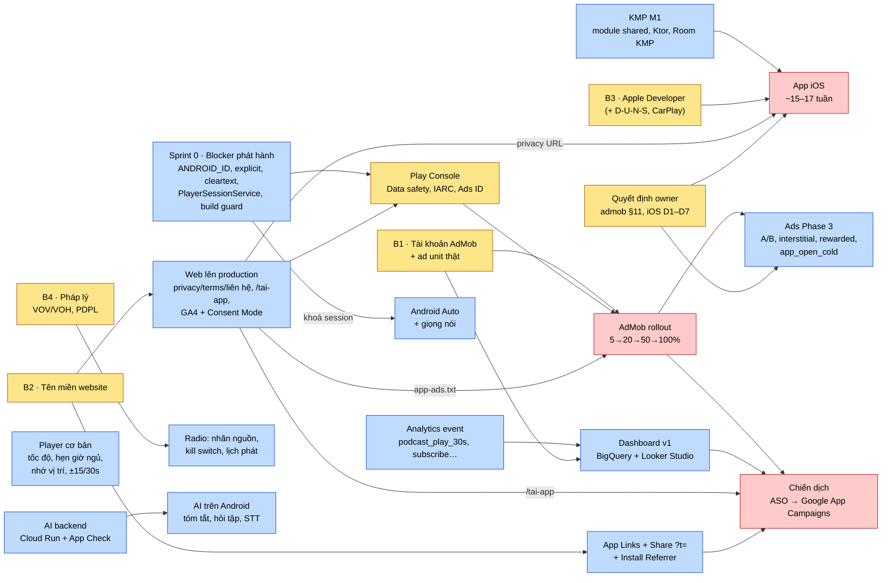
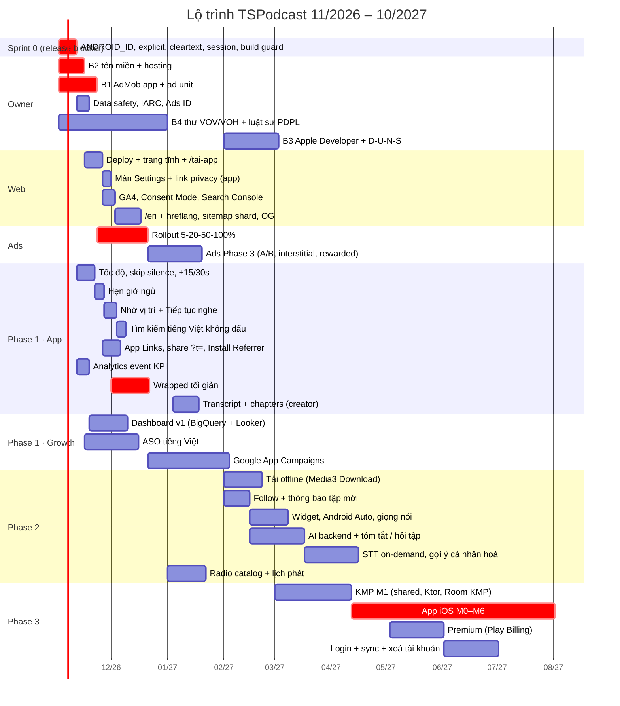

# Kế hoạch tổng: các việc đã research nhưng chưa làm

> **Trạng thái: Đang làm** (2026-11-01) — đã làm: id AdMob thật + build guard (PR #45), bỏ `device_id`, màn Settings, lọc explicit, consent NĐ 13 (PR #38, #39), tốc độ, hẹn giờ ngủ, tua ±, nhớ vị trí (PR #36), ASO (PR #35, #48), app iOS (PR #30).
> Còn lại: `network_security_config` và `PlayerSessionService` (Sprint 0), tên miền, dashboard, AI, tải offline, Android Auto, widget, backend.

> Ticket: TSP-17 · Ngày lập: 2026-10-29 · Mốc code: `main` @ `ac05152` (sau PR #24)
> Gom từ: `docs/in-progress/research/feature-roadmap-ai-growth.md`, `docs/done/research/competitor-analysis.md`, `docs/in-progress/policy/store-policy-review.md`, `docs/in-progress/plans/admob-migration.md`, `docs/in-progress/plans/seo-web-dashboard.md`, `docs/done/ios/*`, `docs/in-progress/ios/*`, `docs/done/plans/KMP_MIGRATION_PLAN.md`, `docs/done/crashlytics/2026-10-crash-triage.md`.
> Mỗi mục đã được đối chiếu với code trên `main`. Chỉ liệt kê mục **chưa làm** hoặc **làm dở**. Chi tiết kỹ thuật vẫn nằm ở tài liệu gốc (cột "Nguồn").

---

## 0. Tóm tắt

- **Trạng thái PR:** không còn PR mở. Mọi nhánh `tuandv/TSP-*` đã vào `main`. Commit `806dbe2` trên `tuandv/TSP-5-remove-applovin` đã được thay thế bởi `2e5da2c` + TSP-16, **không merge**.
- **4 blocker phía owner** quyết định gần như toàn bộ lộ trình: **(B1)** tài khoản AdMob + ad unit thật, **(B2)** tên miền website, **(B3)** Apple Developer account, **(B4)** pháp lý (thư xin phép VOV/VOH, luật sư PDPL).
- **Việc code làm được ngay, không chờ ai:** gỡ `ANDROID_ID` khỏi Analytics, lọc/nhãn explicit, thu hẹp cleartext, khoá `PlayerSessionService`, build guard id test AdMob, các tính năng player cơ bản (tốc độ, hẹn giờ ngủ, nhớ vị trí).
- **Thứ tự đề xuất:** Sprint 0 (blocker phát hành, code) → Phase 1 (player cơ bản + web lên sóng + bật AdMob dần) → Phase 2 (giữ chân, AI backend) → Phase 3 (KMP + iOS, Premium, tài khoản).

---

## 1. Sơ đồ phụ thuộc

Ô vàng là việc của owner (không code được thay). Mũi tên nghĩa là "phải xong trước".

---

## 2. Timeline đề xuất

Mốc theo `feature-roadmap-ai-growth.md` §c (Phase 1: 11/2026–01/2027, Phase 2: 02–04/2027, Phase 3: 05–10/2027). Các việc chờ owner (B1–B4) giả định xong trong tháng 11/2026. Nếu trễ, các việc phụ thuộc trượt theo.

---

## 3. Backlog chi tiết

Cột **Pha**: S0 = Sprint 0, P1/P2/P3 = Phase 1/2/3 của roadmap. **Phụ thuộc**: B1–B4 ở §0, hoặc mục khác.

### 3.1 Sprint 0: chặn phát hành Android (code làm ngay)

| Việc | Pha | Phụ thuộc | Nguồn |
|---|---|---|---|
| Bỏ `device_id` (ANDROID_ID) khỏi default attrs của Analytics (`sharedFirebase/.../TSAnalytics.kt:73`) | S0 | — | Policy §5.2, §11#6 |
| Lọc hoặc gắn nhãn nội dung explicit (truyền `clean`, nhãn trên UI) | S0 | — | Policy §11#13 |
| `network_security_config` thay cho `usesCleartextTraffic="true"`, chỉ mở http cho host radio | S0 | — | Policy §11#18 |
| `PlayerSessionService`: kiểm tra controller trong `onConnect` thay vì export bằng permission | S0 | — | Policy §11#19 |
| Build guard: release chứa id test `3940256099942544` thì fail (và ngược lại với debug) | S0 | — | AdMob §8 |
| `AdPolicy`: không hiện ad toàn màn hình trong 10s sau khi bấm Play | S0 | — | AdMob §2.1.1 |
| Màn Settings: link chính sách bảo mật, "Quyền riêng tư & quảng cáo", toggle explicit | S0 | URL privacy cần B2 | Policy §11#4, AdMob §5 |

### 3.2 Owner: Play Console, tài khoản, pháp lý

| Việc | Pha | Phụ thuộc | Nguồn |
|---|---|---|---|
| Tạo app AdMob + ad unit (App Open, Banner, Native…), GDPR/US message, link Firebase, đưa id vào CI | P1 | B1 | AdMob "Việc owner cần làm" |
| Thu hồi key AppLovin, quyết định Meta app `1177427693996135` | P1 | — | AdMob "Việc owner cần làm" |
| Data safety (bỏ Meta/AppLovin, thêm AdMob), khai báo Ads ID, Target audience 13+, IARC, foreground service | P1 | Sprint 0 xong | Policy §11#3,#5,#12,#14 |
| Trả lời câu hỏi AdMob §11 (rewarded, Premium, consent VN) và iOS D1–D7 | P1 | — | AdMob §11, iOS README §4 |
| Thư xin phép VOV/VOH; luật sư cho PDPL 91/2025 | P1 | B4 | Policy §2.3, §5.3 |
| Đóng issue Crashlytics `c49b19cb`, `a2b0bd4b`, `a53aa8ef`, `23322637` sau khi bản mới lên; theo dõi `App.missingNativeLib` | P1 | Release mới | Crash triage §Ghi chú |

### 3.3 Web, SEO, dashboard, chiến dịch

| Việc | Pha | Phụ thuộc | Nguồn |
|---|---|---|---|
| Chọn hosting, deploy production | P1 | B2 | SEO A.12, F.2 |
| Trang `/gioi-thieu`, `/chinh-sach-bao-mat`, `/dieu-khoan`, `/lien-he` (takedown) | P1 | B2 | SEO A.3, Policy §2.1 |
| `/tai-app` + JSON-LD `MobileApplication` | P1 | B2 | SEO A.3, A.6 |
| `app-ads.txt` có pub id thật, `assetlinks.json` có `ANDROID_CERT_SHA256` | P1 | B1, B2 | AdMob §7.1, SEO A.10 |
| GA4 web stream + Consent Mode v2, event web, `web-vitals`, Lighthouse CI | P1 | Deploy | SEO A.8, A.11 |
| Search Console, Bing, IndexNow | P1 | Deploy | SEO A.7 |
| `/en` + hreflang, sitemap phân mảnh + sitemap tập, OG image động, trang `/radio/[id]` | P2 | Deploy | SEO A.3–A.9 |
| Dashboard v1: Firebase Blaze, BigQuery export, Dataform, AdMob API job, Looker Studio | P1 | Event KPI, B1 | SEO B.1–B.5 |
| ASO tiếng Việt, rồi Google App Campaigns (Install → In-app action) | P1 | Ads rollout, dashboard v1, `/tai-app` | SEO C, Roadmap G12 |
| Dashboard v2 `/internal` có auth | P3 | Dashboard v1 | SEO B.5 |

### 3.4 Quảng cáo (sau rollout)

| Việc | Pha | Phụ thuộc | Nguồn |
|---|---|---|---|
| Rollout có guardrail 5→20→50→100% | P1 | B1, Data safety, `app-ads.txt` | AdMob §9 |
| `search_results`: native sau kết quả thứ 5 thay cho banner | P2 | Rollout | AdMob §2.2 |
| Call site cho `interstitial_nav`, `rewarded_ad_free` (nút opt-in, pause player) | P2 | Quyết định §11.5 | AdMob §2.2 |
| `app_open_cold` với `core-splashscreen` (tối đa 3s) | P2 | Rollout | AdMob §2.2, §4.1 |
| Firebase A/B Exp-1..4, `discover_collapsible` | P2 | Rollout | AdMob §9 |
| Consent VN + fallback non-personalized | P2 | B4, §11.7 | AdMob §5 |
| Ad Inspector menu debug, LeakCanary, Macrobenchmark cold start | P2 | — | AdMob §8 |
| Mediation bidding | P3 | Rollout ổn định | AdMob §9 |

### 3.5 App Android: player, nội dung, tăng trưởng

| Việc | Pha | Phụ thuộc | Nguồn |
|---|---|---|---|
| Tốc độ phát, skip silence, tua ±15/30s | P1 | — | Comp Q2, iOS features-spec §3.6 |
| Hẹn giờ ngủ | P1 | — | Roadmap G4 |
| Nhớ vị trí nghe + hàng "Tiếp tục nghe" | P1 | — | Comp Q4 |
| Tìm kiếm tiếng Việt không dấu | P1 | — | Roadmap A5 bước 1 |
| UI transcript + chapters từ creator (model đã có field) | P1 | — | Roadmap A1, Comp Q8 |
| App Links `autoVerify` + share tập có `?t=` | P1 | B2 | Roadmap G1, SEO A.10 |
| Play Install Referrer + deferred deeplink sau onboarding | P1 | App Links | SEO A.10, B.3 |
| Event `podcast_play_30s`, `listen_progress`, `subscribe_podcast`, `onboarding_complete`, `share` | P1 | — | SEO B.2 |
| Xin `POST_NOTIFICATIONS` đúng ngữ cảnh thay vì lúc mở app | P1 | — | Roadmap G11, Policy #2 |
| Thống kê nghe, streak, Wrapped tối giản (mục tiêu 12/2026) | P1 | Event nghe | Roadmap G3, M4 |
| Radio: nhãn "Phát từ vovmedia.vn", nút mở trang đài, kill switch Remote Config | P1 | B4 | Policy §11#17 |
| Kênh báo cáo nội dung + SLA gỡ | P1 | Trang liên hệ | Policy §11#16 |
| Tải offline (Media3 DownloadService, chỉ storage riêng, không tải nhạc/radio) | P2 | — | Roadmap G7, Policy #21 |
| Follow show + thông báo tập mới (WorkManager/FCM) | P2 | — | Comp M2 |
| Widget Glance | P2 | — | Roadmap G2 |
| Android Auto `MediaLibraryService` + `onPlayFromSearch` | P2 | Khoá session (S0) | Roadmap G5, A9 |
| Onboarding mới (chọn 3 show, radio một chạm), OPML, thêm RSS bằng URL | P2 | — | Roadmap G10, M5 |
| Radio catalog, lịch phát, báo thức radio | P2 | B4 | Comp M6 |
| Màn hình đồng ý PDPL lần đầu + chính sách tiếng Việt | P2 | B4 (luật sư) | Policy §5.3 |

### 3.6 AI

Web đã có `/api/ai/{summary,chat,search}`. Android chưa có gì. Mọi tính năng AI trên app cần backend riêng (Cloud Run + App Check, ~$10–50/tháng).

| Việc | Pha | Phụ thuộc | Nguồn |
|---|---|---|---|
| Backend AI (Cloud Run + App Check), cân nhắc Haiku + Batch như tài liệu tính chi phí | P2 | — | Roadmap §0 |
| Tóm tắt AI + chapters AI, "Hỏi tập này" trên Android | P2 | Backend, màn hình đồng ý (Apple 5.1.2) | Roadmap A2, A3 |
| Speech-to-text on-demand (có hạn mức free hoặc Premium) | P2 | Backend | Roadmap A1 |
| Lưu và chia sẻ clip thủ công (≤60s) | P2 | — | Roadmap A4 |
| Gợi ý cá nhân hoá on-device (giai đoạn 1) | P2 | Event nghe | Roadmap A6 |
| Tìm kiếm ngữ nghĩa, dịch, bản tin AI hằng ngày, clip AI gợi ý | P3 | Backend | Roadmap A5, A7, A8 |
| PhoWhisper on-device, lồng tiếng (chỉ creator đồng ý) | P3 | — | Roadmap A1, A7 |

### 3.7 KMP, iOS, kiếm tiền, tài khoản

| Việc | Pha | Phụ thuộc | Nguồn |
|---|---|---|---|
| KMP M1: module `sharedKmp` thật (hiện chưa có `build.gradle.kts`), model, Ktor, kotlinx.serialization, Room KMP, DataStore, Koin | P3 | — | `docs/done/ios/architecture.md` (thay cho `KMP_MIGRATION_PLAN.md` đã cũ) |
| App iOS M0–M6: Xcode project, SKIE, SwiftUI, AVPlayer, download, CarPlay | P3 | KMP M1, B3, D1–D7 | iOS submission §15 |
| Privacy manifest, ATT sau UMP, App Privacy labels, age rating, TestFlight | P3 | App iOS, privacy URL | Policy §9, iOS submission §3–§14 |
| `apple-app-site-association` + Smart App Banner | P3 | App id iOS | SEO A.10 |
| Premium (Play Billing) kèm màn quản lý/khôi phục; "Bỏ quảng cáo" | P3 | Quyết định §11.6 | Roadmap B7, Policy #24 |
| Đăng nhập tuỳ chọn + sync, kèm xoá tài khoản trong app và trên web | P3 | — | Comp M7, Policy #20 |
| Reaction/bình luận theo timestamp (OTP + kiểm duyệt theo NĐ 147) | P3 | Đăng nhập | Roadmap G8 |
| Wear OS độc lập | P3 | — | Roadmap G6 |

---

## 4. Đã xong (để tham chiếu)

targetSdk 36; gỡ AppLovin, Facebook SDK, IMA; `:ads` seam + `:ads-admob` (GMA Next-Gen 1.6.0, UMP 4.0.0, id test); App Open warm start theo chính sách audio-first; nhãn "Quảng cáo" cho native; event `ads_*`; PodcastIndex attribution + TTL 7 ngày; loại trừ backup; fix crash `libsecuredtoken` và NPE PodcastDetail; website Next.js (podcast, tập, danh mục, thịnh hành, radio, tìm kiếm, JSON-LD, robots, sitemap, route `app-ads.txt` và `assetlinks.json`, AI summary/chat/search); bộ nhận diện "Lên sóng".
