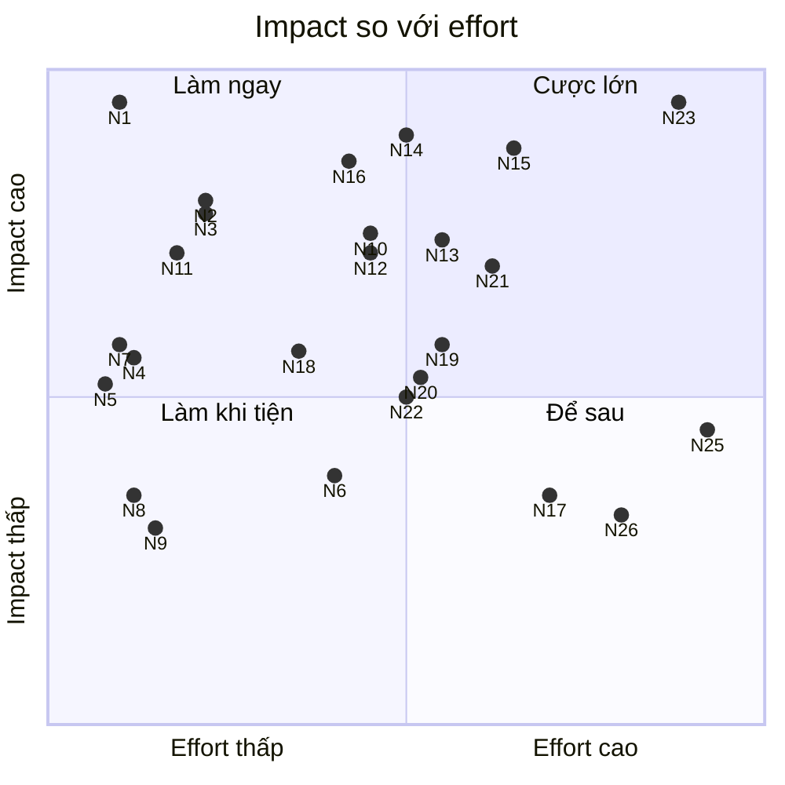

# Đề xuất tính năng đột phá cho TSPodcast (sau khi iOS đạt parity)

> **Trạng thái: Đang làm** (2026-11-01) — đã làm trong iOS M6 (PR #30) và Android (PR #36, #38, #39): N1 lite, N2 "Thời sự & Bản tin", N4 tốc độ, N5 tìm không dấu, N11 consent lite, App Shortcuts.
> Còn lại: các mục cần backend hoặc tên miền (N3, N8, N12, N14, N21, N23...), xem [kế hoạch backend](../../planned/plans/ke-hoach-backend-quickwin-cuoc-lon.md).

> Ngày lập: 30/10/2026 · Đi kèm: `docs/done/research/competitor-analysis.md`,
> `docs/in-progress/research/feature-roadmap-ai-growth.md`, `docs/done/ios/features-spec.md`,
> `docs/in-progress/policy/store-policy-review.md`, `docs/in-progress/plans/roadmap-backlog.md`.
>
> Cách đọc: tài liệu này **không lặp lại** các mục Q1–Q9, M1–M7, B1–B8, A1–A9, G1–G13 và
> quyết định iOS D1–D7. Mục nào mở rộng hoặc làm thay đổi một mục cũ sẽ ghi rõ "Mở rộng" và
> "Điều gì thay đổi". Mọi nhận định về sản phẩm hay API đều có link (gom ở §7). Chỗ ghi
> **(chưa kiểm chứng)** là chưa tìm được nguồn gốc hoặc chưa thử trên thiết bị. Số liệu ghi
> **"đo ngày 30/10/2026"** là truy vấn của nhóm nghiên cứu (PodcastIndex API, DB dump công khai,
> Apple charts, iTunes Search API), không phải số liệu công bố.
>
> Thang effort (1 dev): **S** ≤ 1 tuần · **M** 1–4 tuần · **L** 1–3 tháng · **XL** > 3 tháng.
>
> **Đã qua vòng phản biện (30/10/2026)** về sản phẩm, kỹ thuật và App Review. Các mục bị sửa có ghi chú
> "**Phản biện:**" ngay dưới. Thay đổi chính:
> - **Sửa số liệu sai:**
>   - YouGov: VN đứng thứ 4 châu Á–TBD, không phải cao nhất.
>   - Tốc độ di động: 152 Mbps là số không có nguồn; Ookla 08/2026 đo ~220 Mbps.
>   - Ngày đổi giá Gemini không áp dụng cho Flash-Lite.
>   - Mức phạt 50–70 triệu đồng của Nghị định 330 áp cho MXH/dịch vụ truyền thông trực tuyến.
>   - Castamatic 14 không nói xử lý trên máy.
>   - Snipd dịch được "sang mọi ngôn ngữ".
> - **Thêm rủi ro bị bỏ sót:**
>   - Điều khoản PodcastIndex §5.5 cấm dựng cơ sở dữ liệu hay bản sao lâu dài từ nội dung API (N14).
>   - Có thể cần giấy phép thông tin tổng hợp cho hub thời sự (N2).
>   - Play Families với kệ Thiếu nhi (N18).
>   - Apple 5.1.1(iv): không được ép đồng ý (N11).
> - **Hạ cấp hoặc cắt:**
>   - N24 chuyển sang §3.4 (không đề xuất giai đoạn này).
>   - N17 và N25 lùi về "Để sau".
>   - N6 lùi về "Làm khi tiện".
>   - N4, N5, N7 ghi rõ là **bắt kịp (table stakes)**, không phải khác biệt.
> - **Nâng effort cho sát đội 1–2 người:** N10, N13, N15, N21, N23.

---

## 1. Tóm tắt cho owner

**3 cược lớn:**
1. **N23 "Học tiếng Anh bằng podcast thật":**
   - 7/50 show top Apple Podcasts VN là show học tiếng Anh, và không show nào khai `podcast:transcript`.
   - Đã có app làm gần giống: Snipd dịch transcript "sang mọi ngôn ngữ", "Fluent: Học qua Podcast" có transcript và quiz từ vựng.
   - Vì vậy khác biệt nằm ở **miễn phí + lấy tiếng Việt làm trung tâm + catalog sẵn**, không phải ở công nghệ.
2. **N14 + N21 "Nhà của podcast Việt":** chỉ mục sạch + bộ công cụ creator.
   - Theo heuristic chưa soát tay, 37% feed `vi` hoạt động trong 365 ngày khớp từ khoá cờ bạc. Chưa ai biên tập mảng này.
   - **Cần PodcastIndex đồng ý bằng văn bản** vì điều khoản §5.5 (xem N14).
3. **N15 + N16 "AI tiếng Việt chi phí thấp":** Foundation Models (on-device, rồi PCC miễn phí cho dev nhỏ, có quota theo ngày) + Gemini Flash-Lite audio + cache chung.
   - Chi phí transcript ước tính từ ~$105 xuống ~$13–26/tháng.
   - Con số này chỉ đúng khi Gemini 2.5 Flash-Lite còn chạy. Nếu chuyển sang 3.5 Flash-Lite, ước tính ~$55–70/tháng.
   - Chất lượng tiếng Việt chưa kiểm chứng.

**5 quick win:**
- **N1** an toàn nội dung Việt (allowlist, chặn spam/AI-slop).
- **N2** hub "Thời sự" từ RSS chính thức của VOV, Đài HN, Tuổi Trẻ, VnExpress. Chỉ làm sau khi luật sư xem phần giấy phép thông tin tổng hợp.
- **N3** bậc thang transcript/chapters (SRT Spotify → timestamp show notes).
- **N4** núm 0.1x + nhớ tốc độ theo show (bắt kịp Apple, không phải khác biệt).
- **N10** gói native iOS (Live Activities, widget/Control, App Shortcuts tiếng Việt, Spotlight).

**Phải sửa ngay (không phải tính năng):** bỏ mọi câu chữ "nghe khi chạy xe máy", vì Luật 36/2024 cấm người lái xe máy dùng thiết bị âm thanh (N7). Màn đồng ý PDPL thành việc gấp do Nghị định 330/2026 đã hiệu lực (N11).

---

## 2. Bối cảnh mới từ 2025–2026 (chỉ phần mới so với competitor-analysis.md)

### 2.1 Thị trường Việt Nam

- **Đã có số liệu nghe podcast:** theo YouGov (21/04/2025), 48% người tiêu dùng ở VN nghe podcast từ 1 giờ/tuần trở lên, **đứng thứ 4** trong các thị trường châu Á–Thái Bình Dương được liệt kê (sau Indonesia 59%, Thái Lan và Ấn Độ 54%). Số này thay cho câu "không tìm được khảo sát VN" trong competitor-analysis §2. YouGov không chia theo nền tảng hay thể loại.
  - *Phản biện:* bản trước ghi "cao nhất châu Á–TBD", sai so với bài gốc (đã đối chiếu 30/10/2026).
- **Người Việt thực sự nghe gì** (Apple Podcasts VN top 50, đo ngày 30/10/2026):
  - Đứng đầu là nhóm self-help/cảm xúc (#1 Tri Kỷ Cảm Xúc, #3 Better Version).
  - 7 show học tiếng Anh (BBC 6 Minute English, Luke's English Podcast…).
  - Phật pháp/chánh niệm (#4 Thầy Thích Pháp Hòa).
  - Thiếu nhi (#2 "Kho truyện cổ tích – CMDD Audio" khi đối chiếu lại; thứ hạng thay đổi theo ngày).
  - Truyện ngủ, thời sự (Tuổi Trẻ, RFI, BBC), và thương hiệu sách nói (Fonos, Voiz FM).
- **Nguồn cung podcast Việt trên PodcastIndex rất mỏng** (đo ngày 30/10/2026):
  - Theo DB dump ngày 24/10/2026: 12.647 feed `language=vi`, nhưng chỉ 324 feed có tập mới trong 30 ngày và 445 feed trong 90 ngày.
  - Theo endpoint `recent/feeds` (giới hạn 500 kết quả): 196 feed.
  - 53–58% feed hoạt động được host trên anchor.fm (Spotify for Creators).
- **Spam:**
  - 601 feed trên host `ngocbaomedia.com` là SEO cờ bạc.
  - Từ khoá cờ bạc khớp 701/1.891 feed `vi` hoạt động trong 365 ngày (37%). Đây là heuristic, chưa soát tay.
  - Đợt spam hiện đang lặng: trong tập 90 ngày chỉ khớp 8/445.
- **Thẻ Podcasting 2.0 trong 120 feed VN phổ biến nhất** (đo ngày 30/10/2026):
  - `podcast:transcript` 9, `soundbite` 2, `funding` 5.
  - `chapters`, `person`, `podroll`, `liveItem`, `alternateEnclosure`, `value`, `socialInteract`: **0**.
  - 14 feed có ≥3 timestamp trong show notes.
  - `itunes:season`: 32 feed.
  - Kết luận: tính năng nào dựa trên thẻ phải có đường lùi.
- **App nhạc Việt đã rời mảng podcast:**
  - zingmp3.vn/podcast-discover chuyển hướng về trang chủ, nhaccuatui.com/podcast trả 404 (đo ngày 30/10/2026).
  - Nhac.vn khoá show quốc tế như Luke's English Podcast sau nút "nâng cấp tài khoản".
- **App của các đài đánh giá thấp** (App Store VN, đo ngày 30/10/2026):

  | App | Rating | Số lượt |
  |---|---|---|
  | VOV Media Online | 2.96★ | 53 |
  | VOV – Tiếng nói Việt Nam | 2.59★ | 101 |
  | VOH Radio Online | 3.60★ | 86 |
  | HANOI ON | 3.8★ | 70 |

- **Các đài phát hành podcast RSS chính thức:**
  - VOV (Thời sự, Tin nhanh 24h, Sự kiện Bàn luận, Kinh tế Tài chính…) và Đài Hà Nội ("Đọc truyện đêm khuya", 1.041 tập) qua anchor.fm.
  - Tuổi Trẻ và VnExpress có RSS riêng.
- **YouTube Premium Lite ra mắt ở VN ngày 11/08/2026**, giá 49.000đ/tháng (web) hoặc 65.000đ/tháng (trong app), có phát nền và tải offline cho video. Không còn rẻ để có phát nền trên YouTube nữa, nhưng giá này thành mốc neo cho Premium (B7).
- **Phân phối:** Zalo có 78,3 triệu MAU, TikTok tiếp cận 76,1 triệu người trưởng thành (DataReportal 2026). Zalo Mini App có hơn 13 triệu người dùng/tháng (cuối 2024).
- **Thanh toán:** App Store VN đã nhận MoMo, ZaloPay, VNPAY, ShopeePay. Google Play VN nhận MoMo, ZaloPay, ShopeePay, VTC Pay và trừ tiền qua nhà mạng. Premium (B7) qua IAP đã tới được người dùng ví điện tử.

### 2.2 Pháp lý Việt Nam mới (ngoài store-policy-review.md)

| Văn bản | Hiệu lực | Ảnh hưởng tới TSPodcast |
|---|---|---|
| Luật TTATGT đường bộ 36/2024, Điều 33.3(c) | 01/01/2025 | Cấm người **lái** xe máy dùng thiết bị âm thanh, kể cả 1 tai nghe. Phạt 800k–1 triệu đồng, trừ 4 điểm. Người ngồi sau không bị cấm |
| Luật Trí tuệ nhân tạo 134/2025, Điều 11 | 01/03/2026 | Phải cho người dùng biết họ đang tương tác với AI (A3). Audio/ảnh do AI tạo phải được đánh dấu "ở định dạng máy đọc". Giọng nói mô phỏng người thật phải có nhãn (A7) |
| Nghị định 142/2026, Điều 18 | 01/05/2026 | **Miễn** gắn nhãn cho bản tóm tắt, diễn đạt lại, bản dịch "không làm sai lệch nội dung cốt lõi". Bộ KH&CN sẽ ra hướng dẫn kỹ thuật về nhãn (chưa có) |
| Nghị định 330/2026 (xử phạt dữ liệu cá nhân) | 19/08/2026 (theo bản tóm tắt của công ty luật, cần đối chiếu văn bản gốc) | Xử lý dữ liệu không có đồng ý: 30–50 triệu đồng (Đ.43). Coi im lặng là đồng ý: 50–70 triệu đồng (Đ.43). Không công bố thông tin minh bạch về loại dữ liệu, mục đích và quyền: 30–50 triệu đồng (Đ.43). Mức 50–70 triệu đồng cho việc thiếu chính sách quyền riêng tư minh bạch (Đ.65) áp cho **mạng xã hội / dịch vụ truyền thông trực tuyến**. Mức trần chung cho dữ liệu xuyên biên giới là 5% doanh thu năm trước (Đ.7(4)); bài tóm tắt không nêu khung phạt cụ thể |
| Luật An ninh mạng 116/2025 | 01/07/2026 | Định danh người dùng và lưu trữ dữ liệu trong nước khi có tài khoản hoặc bình luận |
| Luật Báo chí 126/2025 | 01/07/2026 | Sản phẩm báo chí giữ nguyên trách nhiệm báo chí dù phát hành qua kênh nào. Bản tin AI viết lại tin (A8) rủi ro hơn phát nguyên tập chính thức |
| Luật Công nghiệp công nghệ số | 01/01/2026 | Công nhận tài sản mã hoá, nhưng **không** phải phương tiện thanh toán. Loại hẳn Value4Value/Lightning ở VN |
| Dự thảo sửa Nghị định 147 | Lấy ý kiến từ 13/07/2026 | Theo dõi. Ảnh hưởng nếu làm UGC |

### 2.3 Đối thủ và nền tảng: điểm mới đáng kể

- **AI-slop tràn vào PodcastIndex:**
  - Podnews (15/04/2026) ghi nhận chỉ 44,6% show mới trong 24 giờ "có vẻ hợp lệ", còn khoảng 45,7% có thể do AI tạo.
  - Spotify gắn huy hiệu "Verified" từ 19/05/2026.
  - Thẻ `podcast:txt purpose="ai-content"` vào spec từ 05/03/2026.
  - Endpoint `/recent/problematic` liệt kê show mới bị đánh dấu spam, phishing hoặc "low-effort AI". Podnews (15/04/2026) nói endpoint này đã có, nhưng chưa thấy nó trong tài liệu API công khai. Cần gọi thử ở Pha 0.
- **Thành tính năng mặc định:**
  - Spotify Podcast Clips cho cả Free và Premium (27/05/2026), đang triển khai dần toàn cầu, chỉ trên mobile. Menu chia sẻ có 4 lựa chọn: tập / chương / mốc thời gian / clip.
  - Pocket Casts có chapters AI (07/07/2026). Lúc ra mắt chỉ có trên Android, Web và Desktop; iOS "sắp có".
  - Overcast có transcript (08/04/2026). Tập không có transcript được tạo tự động trên máy hỗ trợ AI chạy iOS 26.
  - Castamatic 13 (20/04/2026) tạo transcript (Speech framework) và chapters (Foundation Models) hoàn toàn trên máy. Castamatic 14 (22/10/2026) thêm chapters lấy từ show notes, chọn hoặc bỏ chương, và clip video. Bài viết về bản 14 không nói gì về xử lý trên máy.
  - *Phản biện:* đối chiếu Castamatic 14 thì thấy **parse timestamp trong show notes đã là việc app độc lập thường làm**, nên N3 là bắt kịp, không phải khác biệt.
- **Vẫn khoá sau tường phí hoặc giới hạn quốc gia:**
  - YouTube "Auto speed" và "On-the-go mode" chỉ cho Premium (28/05/2026).
  - Spotify "Ask" chỉ ở US/SE/IE.
  - Alexa Podcasts chỉ ở Mỹ.
  - Link và chapters tự động của Apple chỉ cho tiếng Anh.
  - Snipd không hỗ trợ tiếng Việt và bán phút AI.
- **Apple:**
  - iOS 26 có Enhance Dialogue, tốc độ 0.5–3x với bước 0.1, lưu cài đặt theo từng show.
  - iOS 26.4 có video HLS.
  - iOS 27 (phát hành giữa 09/2026) có tìm kiếm trong show.
  - Từ iOS 26.1, Apple Intelligence hỗ trợ tiếng Việt. Model đi theo cài đặt **ngôn ngữ Siri** (Apple Developer Forums 805378).
  - Siri "cổ điển" có tiếng Việt (trang iOS feature availability, đối chiếu 30/10/2026).
  - **WWDC26:** model PCC mở cho bên thứ ba, "with no cloud API cost" với dev trong Small Business Program có dưới 2 triệu lượt tải lần đầu, tính trên mọi app của tài khoản.
    - Có giới hạn dùng theo ngày, mức giới hạn không công bố.
    - Apple ghi "expanded access … for a fee in the future".
    - Vượt ngưỡng thì phải chuyển giải pháp khác trong 6 tháng.
    - Cần iOS 27 và Xcode 27 (theo session WWDC26; trang PCC không ghi).
  - Có App Intents schema `.audio` (iOS 27.0+): `playAudio`, `addToLibrary`… và entity `podcastShow` / `podcastEpisode` / `podcastCollection`. Đã đối chiếu tài liệu Apple.
  - Siri AI tiếng Việt "coming by the end of the year" (Apple Newsroom 26/10/2026). Hôm đó Siri AI chỉ mở cho FR/JA/KO/PT/ES.
- **Android / Google:**
  - ML Kit GenAI Summarization **không** hỗ trợ tiếng Việt (chỉ EN/JA/KO).
  - ML Kit GenAI Speech Recognition có vi-VN ở mức Beta (API alpha).
  - Firebase AI Logic gọi được Gemini mà không cần backend riêng.
  - Gemini nhận thẳng audio tới 9,5 giờ mỗi prompt.
  - Giá Gemini (đối chiếu trang pricing ngày 30/10/2026), tính trên 1M token:

    | Model | Audio vào | Ra | Batch (vào / ra) |
    |---|---|---|---|
    | 2.5 Flash-Lite | $0.30 | $0.40 | $0.15 / $0.20 |
    | 3.5 Flash-Lite | $0.30 | **$2.50** | — |

  - Chưa model Flash-Lite nào có ngày khai tử hay ngày đổi giá.
  - Gemini TTS vi-VN đã GA.

---

## 3. Danh sách đề xuất

Mỗi đề xuất gồm: người dùng thấy gì · vì sao bây giờ · cách làm trên stack của mình · effort ·
phụ thuộc · rủi ro (App Store / Play / luật VN) · đo thành công · mở rộng từ mục nào.

### 3.1 Quick wins (S–M, gần như không cần backend)

#### N1. Lớp an toàn nội dung Việt: allowlist, chặn spam cờ bạc và AI-slop

- **Người dùng thấy:**
  - Discover và Trending tiếng Việt chỉ gồm show đã qua biên tập. Không còn feed cờ bạc, show AI rác hay nguồn nhạy cảm.
  - Có nhãn "Có dùng AI" khi feed tự khai `podcast:txt purpose="ai-content"`, và bộ lọc "Ẩn nội dung do AI tạo".
  - Mỗi show có nút "Báo cáo nội dung" và "Ẩn show này".
  - Tìm kiếm vẫn mở.
- **Vì sao bây giờ:**
  - Có 601 feed spam trên một host, và 37% feed `vi` hoạt động trong 365 ngày khớp từ khoá cờ bạc (đo ngày 30/10/2026). Đợt spam đang lặng nhưng có thể quay lại bất kỳ lúc nào.
  - `podcasts/trending?lang=vi` trộn VOV với các kênh hải ngoại nhạy cảm.
  - Khoảng 45,7% show mới toàn cầu có thể do AI tạo (Podnews).
  - Luật An ninh mạng 116/2025 nâng mức rủi ro trong nước.
- **Cách làm:**
  - Viết `ContentPolicy` trong KMP shared. Repository áp dụng nó cho `recent/feeds`, `podcasts/trending`, `episodes/random`.
  - Dữ liệu chính sách lấy từ Remote Config: `vi_discover_allowlist` (feedId), `feed_blocklist`, `host_blocklist`, `spam_keywords`.
  - Tôn trọng `podcast:block`.
  - Nhãn ai-content: nếu API JSON không trả trường `txt`, phải parse RSS trực tiếp **(chưa kiểm chứng)**.
  - Báo cáo ghi vào Firestore `reports` kèm install ID, không cần tài khoản.
  - Ẩn show lưu cục bộ (Room / DataStore).
- **Effort:** S. Bản v2 có job tự chấm điểm là N14.
- **Phụ thuộc:** Remote Config, Firestore. Không cần tài khoản.
- **Rủi ro:** giảm rủi ro Apple 1.1/4.3, Play gambling/spam, và luật VN. Danh sách nguồn nào bị coi là nội dung cấm cần luật sư xem **(chưa kiểm chứng)**.
- **Đo thành công:**
  - 0 feed thuộc blocklist xuất hiện trên Discover (script kiểm tra hằng ngày).
  - Số báo cáo trên 1.000 DAU.
  - 0 review 1★ nhắc "cờ bạc/spam".
- **Mở rộng:** Q6, D6, Policy §11#16 (kênh báo cáo).
- **Phản biện:**
  - Effort S chỉ đúng cho v1: danh sách Remote Config, bộ lọc trong repository, và ẩn show lưu cục bộ.
  - Nhãn "Có dùng AI" cần parse RSS riêng, nên tách thành việc riêng (S). Trước khi tự viết bộ phát hiện AI-slop, hãy thử `/recent/problematic`.
  - Collection `reports` ghi không cần đăng nhập phải có App Check + Security Rules giới hạn tần suất. Nếu không, nó dễ bị spam.
  - Install ID là dữ liệu cá nhân, phải nêu trong chính sách quyền riêng tư (N11).
  - Ẩn nguồn hải ngoại khỏi Discover là **quyết định biên tập**. Ghi rõ tiêu chí trong tài liệu nội bộ để tránh tranh cãi. Store không cấm việc này.
  - Remote Config chỉ chứa danh sách dữ liệu, không chứa code, nên không vi phạm Apple 2.5.2.

#### N2. Hub "Thời sự & Bản tin" từ RSS chính thức (cả iOS lẫn Android) — trước đây "Đài & Thời sự"

- **Người dùng thấy:**
  - Kệ "Bản tin" gồm VOV Thời sự, Tin nhanh 24h, Sự kiện Bàn luận, Kinh tế Tài chính, Tuổi Trẻ, VnExpress Hôm nay.
  - Playlist "Điểm tin sáng" ghép tập mới nhất của các nguồn trên, **không dùng AI**.
  - Kệ "Truyện đêm khuya" (Đài Hà Nội) mở sẵn hẹn giờ ngủ.
- **Vì sao bây giờ:**
  - Các đài tự phát hành feed: itunes:author "Đài Tiếng nói Việt Nam", link vov1.vn, cập nhật 29/10/2026.
  - App chính thức của đài chỉ được 2.6–3.8★.
  - D1 loại *stream* radio khỏi iOS, nhưng tập on-demand do chính đài phát hành qua RSS là podcast bình thường.
- **Điều gì thay đổi so với D1/M6:** iOS v1 vẫn có nội dung "đài" hợp lệ mà không cần chờ thư phép VOV/VOH (B4). Stream trực tiếp vẫn bị loại.
- **Cách làm:**
  - Danh sách feed ID lấy từ Remote Config.
  - Playlist "Điểm tin sáng" dựng trong KMP shared bằng `episodes/byfeedid`, lấy tập mới nhất mỗi nguồn.
  - Mặc định hẹn giờ ngủ cho kệ truyện (G4).
- **Effort:** S–M.
- **Phụ thuộc:** Remote Config. Nên gửi email xác nhận một lần tới chủ feed (banthoisu.vov@gmail.com), vì quyền sở hữu hiện chỉ dựa trên metadata tự khai.
- **Rủi ro:**
  - Không dùng tên hay logo VOV/VOH trong store listing hay ASO (Apple 5.2.1, Play impersonation; G12). Trong app, chỉ hiện tên và ảnh của chính feed.
  - Phát nguyên tập chính thức an toàn hơn bản tin AI viết lại (Luật Báo chí 126/2025).
  - Điều khoản tái sử dụng của từng đài **(chưa kiểm chứng)**.
- **Đo thành công:**
  - % DAU mở hub.
  - Lượt phát 5h–9h.
  - D7 của nhóm dùng hub so với nhóm không dùng.
  - Lượt dùng hẹn giờ ngủ trên kệ truyện.
- **Mở rộng:** D1, M6, G4, A8 (bản không AI đi trước).
- **Phản biện:**
  - **Đổi tên kệ thành "Thời sự & Bản tin", bỏ chữ "Đài".** Lý do:
    - Chữ "Đài" dễ bị reviewer và người dùng hiểu là có radio, trong khi D1 đã loại radio khỏi iOS.
    - Nó cũng gần với việc mượn thương hiệu (Apple 5.2.1).
  - **Rủi ro pháp lý bị đánh giá thấp:**
    - Một kệ tin tức do app tự tuyển chọn từ nhiều cơ quan báo chí có thể bị coi là cung cấp "thông tin tổng hợp" theo Nghị định 147/2024. Loại hình này có thể cần giấy phép **(chưa kiểm chứng, cần luật sư trước khi ship)**.
    - Phát nguyên tập vẫn an toàn hơn bản AI viết lại.
  - Phải xác nhận chủ feed **trước** khi đưa lên kệ. Feed anchor.fm chỉ có metadata tự khai, nếu kệ đưa nhầm feed giả mạo thì app chịu rủi ro.
  - Rủi ro nâng từ "thấp" lên **trung bình**. Ô ma trận đổi từ "Làm ngay" sang **"Làm ngay sau khi luật sư xem"**.

#### N3. Bậc thang transcript và chapters ("Bản ghi" + "Chương")

- **Người dùng thấy:**
  - Tab "Bản ghi" ghi rõ nguồn ("Nguồn: nhà sản xuất" hoặc "Tạo tự động"), chạm vào câu để tua, có chế độ "Đọc cùng" tự cuộn và tô sáng.
  - Chương có ảnh và link. Link hiện thành banner theo thời gian, giống timed links của Apple. Có nút "Bỏ qua chương".
- **Điều gì thay đổi so với Q8:**
  - Chỉ đọc `podcast:chapters` thì gần như vô dụng ở VN (0/120 feed).
  - Parse timestamp trong show notes phủ được khoảng 12% show top (14/120) mà không tốn gì.
  - Transcript VN có thật: Spotify xuất file SRT tiếng Việt qua `podcast:transcript` (ví dụ "Tâm Sự Tài Chính" có 233 thẻ transcript).
  - Show học tiếng Anh top VN **không có** transcript, nên cần N16/N23.
- **Cách làm:**
  - KMP shared `TranscriptParser` (SRT/VTT/JSON/HTML).
  - `ChapterResolver` thử theo thứ tự: JSON chapters → ID3 → regex trên show notes → AI (N19).
  - Model Episode đã có trường `transcripts`.
  - UI làm native (Compose / SwiftUI).
- **Effort:** S (parse + UI) đến M (chế độ "Đọc cùng" + banner link).
- **Phụ thuộc:** không.
- **Rủi ro:** thấp, vì là nội dung creator cung cấp và có ghi nguồn.
- **Đo thành công:**
  - % lượt phát có transcript hoặc chapters.
  - Số lần mở transcript trên 100 lượt phát.
  - Số lần bỏ qua chương.
- **Mở rộng:** Q8, A1 (đường lùi), D7.
- **Phản biện:**
  - Đáng làm, effort trung thực. Nhưng đây là **bắt kịp**, không phải khác biệt: Overcast, Castamatic và Apple đều đã có.
  - Banner link theo thời gian chỉ có giá trị khi feed có chapters chứa URL, mà ở VN là 0/120. Ưu tiên thấp trong N3.

#### N4. Hồ sơ phát theo từng show + núm tốc độ 0.1x + "Giọng rõ hơn"

- **Người dùng thấy:**
  - Núm tốc độ 0.5–3.0x, bước 0.1.
  - Mỗi show tự nhớ tốc độ, bỏ khoảng lặng và tăng giọng.
  - Nút "Giọng rõ hơn".
- **Vì sao bây giờ:** iOS 26 Apple Podcasts đã có núm 0.1x, Enhance Dialogue và cài đặt theo show. Trên iOS, TSPodcast nằm cạnh app này, nên UI tốc độ yếu hơn sẽ trông kém hẳn.
- **Cách làm:**
  - KMP `PlaybackProfileRepository(feedId)`.
  - Android: Media3 `PlaybackParameters` + một `AudioProcessor` tự viết (EQ dải tiếng nói, compressor) + `LoudnessEnhancer`.
  - iOS: `MTAudioProcessingTap` trên audio mix của `AVPlayerItem`.
  - Không thấy API công khai nào cho app bên thứ ba bật Enhance Dialogue của Apple **(chưa kiểm chứng)**.
  - `AUSoundIsolation` đòi chuyển sang `AVAudioEngine`: effort L, ưu tiên thấp.
- **Effort:** S (núm + nhớ theo show) · M (DSP trên 2 nền tảng).
- **Phụ thuộc:** không.
- **Rủi ro:** không.
- **Đo thành công:**
  - % người nghe có ít nhất 1 show đặt tốc độ khác mặc định.
  - Phút nghe/DAU.
  - Tỉ lệ nghe hết tập.
- **Mở rộng:** Q2, D7.
- **Phản biện:**
  - Đây là **bắt kịp Apple Podcasts iOS 26**, không phải khác biệt.
  - Chỉ nên làm phần S: núm 0.1x và nhớ theo show.
  - Phần DSP ("Giọng rõ hơn") khó hơn ghi:
    - `MTAudioProcessingTap` là C API, dễ lỗi, và không dùng được với stream HLS **(chưa kiểm chứng trên iOS 26)**.
    - Mỗi nền tảng một bộ xử lý riêng, cộng việc chỉnh tai nghe.
  - Effort DSP nâng từ M lên **M–L**. Lùi sau khi có số liệu dùng.

#### N5. Tìm trong show

- **Người dùng thấy:** ô tìm kiếm trên trang chi tiết show, lọc tập không phân biệt dấu.
- **Vì sao bây giờ:** Apple đưa tính năng này vào iOS 27. Show VN thường có hàng trăm tập ("Đọc truyện đêm khuya" có 1.041 tập).
- **Cách làm:** gọi `episodes/byfeedid` với `max` cao, chuẩn hoá tiếng Việt bỏ dấu dùng lại bước 1 của A5, chạy trong KMP shared. Về sau mở rộng sang nội dung transcript.
- **Effort:** S. **Phụ thuộc:** không. **Rủi ro:** không.
- **Đo thành công:** số lượt tìm trong show trên 100 lần mở show có hơn 50 tập.
- **Mở rộng:** A5.

#### N6. "Người trong tập": trang khách mời và host

- **Người dùng thấy:**
  - Chip host/khách mời trên trang tập.
  - Chạm vào tên để mở "Các tập có [tên]" trên mọi show.
  - Về sau có "Theo dõi người này".
- **Vì sao bây giờ:**
  - Apple và Spotify không có tìm kiếm khách mời xuyên show.
  - `search/byperson` tìm cả trong title/description/author, nên chạy được dù VN dùng thẻ `person` 0/120.
  - Endpoint này đã khai báo trong code nhưng chưa dùng.
- **Cách làm:**
  - Có thẻ `persons` thì hiện chip kèm ảnh và vai trò.
  - Không có thẻ thì trích tên bằng heuristic từ description (mẫu "khách mời:", "cùng với…").
  - Chuẩn hoá dấu trước khi truy vấn.
  - Kết quả ghi "kết quả liên quan" để tránh nhầm người.
- **Effort:** S (khi có thẻ) · M (trích tên tiếng Việt).
- **Phụ thuộc:** không. "Theo dõi người" cần backend M2.
- **Rủi ro:** thấp. Không dùng AI viết tiểu sử người thật nếu không có nhãn.
- **Đo thành công:** lượt chạm chip, lượt follow show bắt nguồn từ trang người.
- **Mở rộng:** A6, M2.
- **Phản biện:**
  - Ở VN thẻ `person` là 0/120, nên trên thực tế **luôn phải dùng heuristic**, tức effort thật là **M**, không phải S.
  - Trích tên tiếng Việt từ description dễ gán nhầm người thật. Rủi ro gồm uy tín, và tên người là dữ liệu cá nhân theo PDPL.
  - Hạ từ "Làm ngay" xuống **"Làm khi tiện"**. Chỉ hiện chip khi feed có thẻ `person`. Phần heuristic để sau N16, khi đã có danh sách khách mời do AI trích ra (có nhãn).

#### N7. Chế độ "Trên đường" cho người đi bus, metro, xe ô tô (và sửa câu chữ)

- **Người dùng thấy:**
  - Player toàn màn hình 3–4 nút lớn (±30s, phát/dừng, tập tiếp), tương phản cao, màn hình tối.
  - Hàng chờ tự tải sẵn khi có Wi-Fi, prefetch tập kế tiếp.
- **Vì sao bây giờ:**
  - YouTube khoá "On-the-go mode" sau Premium.
  - Luật 36/2024 cấm người **lái** xe máy dùng thiết bị âm thanh. Apple 1.4.5 cấm khuyến khích dùng thiết bị gây nguy hiểm.
  - Metro số 1 TP.HCM chở gần 19 triệu lượt trong năm đầu.
  - Tốc độ tải di động trung vị của VN khoảng 220 Mbps (Ookla Speedtest Global Index 08/2026, đứng thứ 9 thế giới, theo VietNamNet). Vì vậy lý do cần offline là hạn mức data, hầm và thang máy, không phải mạng chậm.
- **Cách làm:** màn native trên mỗi nền tảng. Logic hàng chờ trong KMP (mở rộng G7/M1).
- **Copy, ASO, onboarding:** chỉ nói "đi bus/metro/xe ô tô", không bao giờ nói "chạy xe máy". Lái xe hơi thì dẫn sang CarPlay / Android Auto.
- **Effort:** S.
- **Phụ thuộc:** không.
- **Rủi ro:** thấp nếu câu chữ đúng. Trung bình nếu marketing ngầm gợi ý nghe khi lái xe máy.
- **Đo thành công:** % phiên dùng chế độ này, phút nghe 6–9h và 17–19h.
- **Mở rộng:** G7, M1, G12 (ASO), G5.
- **Phản biện:**
  - Bản trước ghi 152 Mbps nhưng không có nguồn. Đã thay bằng số Ookla có nguồn.
  - Đã đối chiếu Điều 33.3(c) Luật 36/2024: cấm người lái xe mô tô và xe gắn máy dùng "thiết bị âm thanh, trừ thiết bị trợ thính". Người được chở nằm ở khoản 4, không bị cấm rõ.
  - Giá trị thật của N7 là **sửa câu chữ** (làm ngay). Màn nút lớn chỉ là tiện ích bắt kịp.
  - Không quảng bá màn này cho người **lái ô tô** trên điện thoại (Apple 1.4.5). Chỉ dẫn họ sang CarPlay / Android Auto.

#### N8. "Nhà sản xuất gợi ý" (podroll) + "Podroll Việt"

- **Người dùng thấy:** mục "Show gợi ý" trên trang show, lấy từ đề xuất của chính creator. Nếu creator không khai, dùng danh sách biên tập "Podroll Việt".
- **Vì sao bây giờ:** gợi ý từ creator sang creator là hiệu ứng mạng mà Apple và Spotify không có (hai bên chỉ có gợi ý thuật toán đóng). Pocket Casts và Podcast Guru đã có.
- **Cách làm:** parse `podcast:podroll`/`remoteItem`, rồi resolve một lần bằng `podcasts/batch/byguid`. Đường lùi là danh sách GUID trong Remote Config.
- **Effort:** S.
- **Phụ thuộc:** Remote Config. Nếu API JSON không trả podroll thì parse RSS **(chưa kiểm chứng)**.
- **Rủi ro:** thấp.
- **Đo thành công:** tỉ lệ follow sau khi chạm vào mục này.
- **Mở rộng:** A6, N21 (vận động creator khai podroll).

#### N9. Gói thẻ nhỏ đọc trong cùng một lượt parse RSS

Mỗi mục S, không cần backend.

| Thẻ | Người dùng thấy | Ghi chú |
|---|---|---|
| `trailer` | Nút "Nghe trailer" trước khi follow | |
| `season`/`itunes:season` | "Tập 12 · Mùa 3", nhóm theo mùa | 32/120 feed VN có `itunes:season` |
| `liveItem` | "Sắp phát trực tiếp", nút "Nhắc tôi" (local notification lúc startTime) | VN 0/120, chủ yếu phục vụ show EN. Cảnh báo server-side để sau |
| `alternateEnclosure` | Tuỳ chọn "Tiết kiệm dữ liệu" (bitrate thấp nhất) | Thu hẹp gap 5.2.4 cho show EN |
| `funding` | "Ủng hộ nhà sản xuất": mở link ngoài, không thu phí | iOS: Apple 3.2.1(vii). Cân nhắc ẩn link tới nền tảng membership mở khoá nội dung. Cách reviewer xử lý **(chưa kiểm chứng)** |

- **Đo thành công:** lượt chạm theo từng thẻ, tỉ lệ follow sau khi nghe trailer.
- **Mở rộng:** M2, gap 5.2.4.

#### N10. Gói native iOS (cho lần nộp đầu và cho App Review notes)

- **Người dùng thấy:**
  - **Live Activity:** đếm ngược hẹn giờ ngủ với nút "+5 phút" và "Huỷ"; tiến độ tải hoặc tạo transcript.
  - **Widget tương tác:** "Tiếp tục nghe", "Tập mới".
  - **Control Center / Action button:** Phát/Dừng, Hẹn giờ tắt, Tua lại 30s.
  - **App Shortcuts tiếng Việt:** "Tiếp tục nghe trên TSPodcast", "Hẹn giờ tắt 30 phút".
  - **Spotlight:** tìm thấy show đã theo dõi, tập đã tải, lịch sử.
  - Mini player nằm trong `tabViewBottomAccessory` kiểu Liquid Glass.
  - Handoff sang iPad/Mac.
- **Vì sao bây giờ:** đây là tín hiệu "native" rõ nhất cho guideline 4.2/4.3 (Policy §9). Siri hỗ trợ tiếng Việt cho App Shortcuts từ iOS 17. Liquid Glass là chuẩn UI của iOS 26.
- **Cách làm:**

  | API | iOS tối thiểu |
  |---|---|
  | ActivityKit | 16.1 |
  | `AudioPlaybackIntent` trong widget | 17 |
  | `ControlWidget` | 18 |
  | `AppShortcutsProvider` | 16 |
  | `CSSearchableIndex` / `IndexedEntity` | 17 / 18 |
  | `.tabViewBottomAccessory` (fallback `.ultraThinMaterial` cho iOS 17/18) | 26 |

  - Live Activity không lặp lại Now Playing, chỉ hiện thứ Now Playing không có.
  - CarPlay đã có trong D7. iOS 27 bổ sung thumbnail có tiến độ và mini player, nên làm khi lên Xcode 27.
- **Effort:** M cho cả gói (mỗi phần S).
- **Phụ thuộc:** không cần backend. Widget push cần APNs; FCM có hỗ trợ widget push hay không **(chưa kiểm chứng)**.
- **Rủi ro:** thấp. Nút trên widget phải làm được việc, không chỉ mở app.
- **Đo thành công:**
  - % người dùng iOS có widget hoặc control.
  - Số phiên bắt đầu từ widget, Shortcut hoặc Spotlight.
  - Qua review lần đầu, không bị 4.2/4.3.
- **Mở rộng:** D7, G2/Q9, A9, G5.
- **Phản biện:**
  - **Effort M cho cả gói là lạc quan.** Gói này gồm 4–5 extension (widget, Live Activity, Control, App Intents) và cần App Group để chia sẻ dữ liệu với framework KMP. Mỗi phần còn phải gate theo iOS 17/18/26. Ước lại là **M–L** cho 1 dev.
  - **Bỏ Handoff:** chưa có app iPad/Mac riêng nên gần như vô giá trị.
  - Đã kiểm tra Siri "cổ điển" có tiếng Việt (trang feature availability). Từ iOS nào thì **chưa kiểm chứng**.
  - Firebase có tài liệu gửi push cập nhật Live Activity qua FCM, nên không cần server APNs riêng **(đọc tài liệu, chưa thử)**.
  - Đây là điều kiện để qua review, không phải tính năng đột phá. Giữ "Làm ngay" cho iOS v1, nhưng ship theo thứ tự:
    1. Widget + App Shortcuts
    2. Live Activity hẹn giờ
    3. Control
    4. Spotlight

#### N11. Tuân thủ AI và dữ liệu cá nhân theo luật mới: "nhãn + bản gốc + creator opt-out"

- **Người dùng thấy:**
  - Mọi sản phẩm AI có nhãn ("Tạo tự động", "Bản dịch máy") và nút "Xem bản gốc".
  - Chat "Hỏi tập này" nói rõ là AI.
  - Có cài đặt "Ngôn ngữ ưu tiên cho nội dung AI".
  - Màn đồng ý dữ liệu cá nhân xuất hiện ngay lần mở đầu.
- **Vì sao bây giờ:**
  - Luật AI 134/2025 (Điều 11) và Nghị định 142/2026 (Điều 18) đã có hiệu lực.
  - Nghị định 330/2026 phạt 50–70 triệu đồng nếu coi im lặng là đồng ý, và 30–50 triệu đồng nếu xử lý dữ liệu không có đồng ý hoặc không minh bạch về mục đích (Đ.43, theo bản tóm tắt của công ty luật).
  - Apple, YouTube và Spotify đều theo một mẫu: nhãn rõ, có nút quay về bản gốc, creator được opt-out.
- **Cách làm:**
  - Component nhãn dùng chung.
  - Remote Config `ai_optout_feeds` lấy từ form opt-out công khai trên web.
  - Audio AI (A7/A8) phải có đánh dấu máy đọc được, định dạng chờ Bộ KH&CN hướng dẫn **(chưa kiểm chứng)**.
- **Effort:** S.
- **Phụ thuộc:** luật sư (B4), web (B2).
- **Rủi ro:** giảm rủi ro.
- **Đo thành công:** 100% màn AI có nhãn (checklist QA), số yêu cầu opt-out được xử lý đúng SLA.
- **Mở rộng:** Policy §5.3, §7, checklist #25; A1–A8.
- **Phản biện:**
  - Đây là **việc tuân thủ, không phải tính năng**. Giữ ở P1.
  - **Màn đồng ý không được chặn app.** Apple 5.1.1(iv) yêu cầu không "force people to consent to unnecessary data access" và nên có phương án cho người từ chối.
    - Tách đồng ý theo mục đích: cần thiết / phân tích / quảng cáo cá nhân hoá.
    - Từ chối thì app vẫn chạy.
    - ATT cho AdMob là một lời nhắc riêng.
  - Bản trước gộp mức 50–70 triệu đồng cho "thiếu chính sách quyền riêng tư". Thực ra mức đó (Đ.65) áp cho MXH/dịch vụ truyền thông trực tuyến; với TSPodcast, khung liên quan là 30–50 triệu đồng (Đ.43). Đã sửa.
  - Effort: nhãn AI là S. Cộng màn đồng ý, chính sách và form opt-out trên web thì là **S–M**.

#### N12. Chia sẻ 4 lựa chọn, sẵn sàng cho Zalo, cùng "Đoạn đã lưu"

- **Người dùng thấy:**
  - Menu chia sẻ: Tập / Chương / Từ mốc thời gian này / Clip.
  - Link mở trên Zalo có ảnh OG, tiêu đề, và bản nghe thử 60 giây trên web.
  - Nút nhanh "Gửi cho bố mẹ" cho bản tin và truyện đêm khuya.
  - Mục "Đoạn đã lưu" trong Thư viện, thêm được vào playlist.
- **Vì sao bây giờ:**
  - Spotify Clips (27/05/2026) đã biến menu 4 lựa chọn và clip trong thư viện thành chuẩn chung.
  - Zalo có 78,3 triệu MAU, và là nơi link thực sự được chuyền tay ở VN.
- **Cách làm:**
  - Clip lưu dưới dạng `[episodeId, start, end]` trong Room / SwiftData. Không cắt hay host lại audio.
  - Deep link `?t=` dùng hạ tầng của G1/Q7.
  - Trang web preview chạy trên Next.js đã có.
- **Effort:** M.
- **Phụ thuộc:** B2 (tên miền), App Links / Universal Links.
- **Rủi ro:** thấp. Clip luôn ghi tên show và link về tập gốc (Policy §2.1). Không cho tải clip thành file audio rời.
- **Đo thành công:**
  - % người nghe chia sẻ/tháng (KPI P2 ≥ 2%).
  - % lượt cài đến từ link chia sẻ.
  - Tỉ lệ link mở từ Zalo so với nguồn khác.
- **Mở rộng:** G1, Q7, A4, B3.
- **Phản biện:**
  - Đã kiểm repo: có thư mục `web/`, nên giả định "Next.js đã có" đứng được.
  - Spotify Clips chỉ có trên mobile và đang triển khai dần. Đây là bắt kịp Spotify, chỉ khác ở phần Zalo.
  - Bản nghe thử 60 giây trên web phải phát từ enclosure gốc, không proxy hay cache audio, để không thành host lại.
  - Effort M giữ nguyên nếu B2 (tên miền) xong trước.

### 3.2 Khác biệt (M–L)

#### N13. "Lướt nghe": feed dọc nghe thử 30–60 giây

- **Người dùng thấy:** tab "Nghe thử" với các thẻ toàn màn hình: ảnh bìa, tên show, đoạn audio phát ngay, nút Theo dõi / Nghe tiếp từ đây / Lưu.
- **Vì sao bây giờ:**
  - Spotify đã làm clip thành chuẩn chung.
  - PodcastIndex có sẵn `soundbite` (toàn cầu 806k tập), `recent/soundbites` và `episodes/random?lang=&cat=`, nhưng chỉ 6 app trong registry dùng soundbite.
  - Discovery là điểm yếu lớn nhất của mình so với Spotify.
- **Điều gì thay đổi so với A4:** A4 là clip AI. Ở đây v1 **không cần AI**, nhưng VN chỉ có 2/120 feed khai soundbite, nên cần thêm đường lùi.
- **Nguồn đoạn audio, theo thứ tự ưu tiên:**
  1. Soundbite do creator khai.
  2. Một lát 45 giây ngẫu nhiên ở khoảng 10–20% độ dài tập.
  3. Highlight AI (A4/N19), chỉ với creator đồng ý.
- **Cách làm:**
  - Stream từ enclosure gốc với start offset, nên lượt nghe vẫn tính vào lượt tải của creator.
  - Lọc qua N1.
  - Thẻ làm UI native, logic chọn đoạn trong KMP.
- **Effort:** M.
- **Phụ thuộc:** v1 không cần. Về sau có cache lọc trước ở N14.
- **Rủi ro:** thấp đến trung bình. Luôn ghi tên show và link, không host lại audio.
- **Đo thành công:**
  - Follow trên 100 thẻ đã xem.
  - % thẻ dẫn tới "Nghe tiếp" ≥ 2 phút.
  - D7 của người dùng mới có dùng tab này.
- **Mở rộng:** A4, G10 (onboarding: lướt 5 thẻ rồi chọn show), B3.
- **Phản biện:**
  - **Lát cắt ngẫu nhiên ở 10–20% độ dài tập thường rơi vào quảng cáo đọc hoặc lời chào**, nên trải nghiệm tệ. Đường lùi tốt hơn là:
    1. Đầu chương (N3).
    2. Đoạn ngay sau timestamp đầu tiên trong show notes.
    3. Chỉ dùng show có trong allowlist N14.
  - Seek trong MP3 VBR không có header Xing thường lệch.
  - Prefetch nhiều enclosure tốn data của người dùng, và có thể làm méo số lượt tải của creator theo chuẩn đo IAB **(chưa kiểm chứng ngưỡng tính lượt)**. Chỉ prefetch 1 thẻ kế tiếp.
  - Effort nâng từ M lên **M–L**.
  - Feed dọc là **khác biệt ở VN, không phải đột phá**, vì Spotify và YouTube đã làm.

#### N14. "Chỉ mục Podcast Việt" + Bảng xếp hạng Podcast Việt + kệ "Podcast Việt mới"

- **Người dùng thấy:** bảng xếp hạng podcast Việt sạch, cập nhật hằng ngày, và kệ show Việt mới đã qua kiểm duyệt.
- **Vì sao bây giờ:**
  - Không ai biên tập mảng podcast Việt (PodcastIndex không lọc).
  - DB dump công khai cập nhật hằng ngày, `recent/data` và tracking.podcastindex.org cho đủ dữ liệu.
  - Một số show VN khai `language=en` nhưng tiêu đề có dấu tiếng Việt, nên đang bị bỏ sót.
- **Cách làm:**
  - Job đêm chạy trên GitHub Actions hoặc Cloud Run job: lọc `vi`, cộng các show VN khai sai ngôn ngữ (nhận diện qua dấu trong tiêu đề), cộng danh sách publisher VN đã biết.
  - Chấm điểm theo độ mới, số tập, `popularityScore` và luật spam (host, từ khoá, mô tả quá ngắn, một publisher đẩy hàng trăm feed).
  - Xuất JSON tĩnh lên Firebase Hosting. Cả hai app đọc file này làm allowlist/blocklist cho N1, N13 và BXH.
- **Effort:** M.
- **Phụ thuộc:** backend nhẹ (scheduled job + Hosting). Không cần tài khoản.
- **Rủi ro:** **trung bình**, do điều khoản PodcastIndex (xem Phản biện).
- **Đo thành công:**
  - Độ phủ: số show VN hoạt động có trong chỉ mục so với 324 feed/30 ngày.
  - Tỉ lệ dương tính giả của luật spam (soát tay 50 mẫu/tháng).
  - CTR của BXH.
- **Mở rộng:** N1 (bản v2), E1/E5 (Discover), B6.
- **Phản biện:**
  - **Đã đọc ToS của PodcastIndex.**
    - §5.5 cấm "build databases, or otherwise create permanent copies" của nội dung trả về từ API, và cấm tạo tác phẩm phái sinh, trừ khi chủ nội dung hoặc luật cho phép.
    - §4.1 cấm làm API client "functions substantially the same as the APIs".
    - Câu "free, for any use" trong bản trước không có trong ToS.
  - **Cách làm an toàn:**
    - File JSON chỉ chứa `feedId` + điểm + nhãn, **không** chứa tiêu đề hay mô tả. App lấy metadata qua API như bình thường.
    - Trước khi chạy job trên DB dump, **xin PodcastIndex đồng ý bằng văn bản**. ToS không nhắc tới DB dump.
  - Gọi là "Nổi bật" hoặc "Đang lên" thay vì "Bảng xếp hạng". Điểm xếp hạng dựa trên `popularityScore` và độ mới, không dựa trên lượt nghe, nên gọi là BXH dễ gây hiểu nhầm.
  - **Chi phí ẩn:** cần người biên tập đều đặn (soát spam, duyệt show mới) mỗi tuần. Số giờ chưa ước được.
  - Effort M giữ nguyên. Rủi ro nâng lên trung bình cho tới khi PodcastIndex trả lời.

#### N15. Tầng AI tiếng Việt chạy trên máy và PCC (`EpisodeIntelligence`)

- **Người dùng thấy:** "Tóm tắt nhanh" (3 câu + 5 ý chính), chapters AI, tag chủ đề. Trên iPhone đủ điều kiện, các tính năng này **miễn phí và không gửi dữ liệu cho bên thứ ba**. Trên iOS 27 có thêm "Hỏi tập này" cho cả tập.
- **Vì sao bây giờ, và điều gì thay đổi so với A2/A3:** A2/A3 giả định mọi tính năng AI cần backend riêng cộng LLM trả phí.
  - Foundation Models on-device hỗ trợ mọi ngôn ngữ Apple Intelligence hỗ trợ, gồm tiếng Việt từ 26.1. Model đi theo **ngôn ngữ Siri** chứ không theo ngôn ngữ app.
  - Context 4.096 token (OS 26) hoặc 8.192 (OS 27, máy mới).
  - PCC (iOS 27): 32.768 token, đủ cho transcript tiếng Việt khoảng 20k token. Không tốn phí API với dev trong Small Business Program có dưới 2 triệu lượt tải lần đầu (tính mọi app của tài khoản). Có quota theo ngày cho từng người dùng.
  - Castamatic đã ship chapters AI chạy trên máy bằng cách này.
- **Cách làm:**
  - Interface `EpisodeIntelligence` trong KMP.
  - iOS thử theo thứ tự: PCC → on-device (map-reduce 6–8 chunk) → cloud.
  - Android: Gemini qua Firebase AI Logic, hoặc Haiku qua backend A2.
  - Output dùng `@Generable` để có kiểu.
  - Kết quả cache theo tập trong Firestore. Việc ghi output on-device/PCC lên cache chung có hợp điều khoản Apple không **(chưa kiểm chứng)**.
- **Effort:** M.
- **Phụ thuộc:**
  - Nâng Xcode 27 cho phần PCC. App Store hiện chỉ bắt buộc Xcode 26+, nên đây là lựa chọn.
  - Đăng ký Small Business Program, xin PCC entitlement.
  - Chỉ iPhone 15 Pro trở lên; tỉ lệ người dùng VN có máy này **(chưa kiểm chứng)**.
- **Chưa kiểm chứng:**
  - `supportedLanguages` của PCC có tiếng Việt không.
  - Chất lượng tiếng Việt của model on-device.
  - Quota tăng với iCloud+: WWDC26 session 319 nói có, Gruber nói không áp dụng cho app bên thứ ba.
- **Rủi ro:**
  - Thấp. Có nhãn AI (N11).
  - Xử lý trên máy hoặc PCC **có thể** không bị tính là "third-party AI" theo Apple 5.1.2(i) (diễn giải, cần luật sư).
  - Android dùng Gemini thì vẫn cần màn đồng ý.
- **Đo thành công:**
  - % tóm tắt sinh với chi phí $0.
  - Chi phí AI/MAU (KPI P2 ≤ $0.15).
  - CSAT 👍/👎 của tóm tắt.
  - % MAU dùng AI.
- **Mở rộng:** A2, A3, Roadmap §0 (kiến trúc).
- **Phản biện:**
  - **Đã đối chiếu trang PCC của Apple.**
    - Đúng là "no cloud API cost" với dev thuộc Small Business Program có dưới 2 triệu lượt tải lần đầu, tính trên mọi app của tài khoản.
    - Có giới hạn dùng theo ngày, tuỳ "feature, request complexity, system demand".
    - Apple nói sẽ có gói trả phí "in the future".
    - Vượt ngưỡng thì phải chuyển sang giải pháp khác trong 6 tháng.
    - Theo Gruber, iCloud+ không tăng quota cho app bên thứ ba.
    - **"$0" là $0 có trần, không phải $0 vô hạn.** Đường lùi cloud là bắt buộc, không phải tuỳ chọn.
  - **Phạm vi người dùng hẹp hơn tưởng.** On-device chỉ chạy khi đủ cả bốn điều kiện:
    - Máy hỗ trợ Apple Intelligence.
    - Người dùng đã bật Apple Intelligence.
    - **Ngôn ngữ Siri** đặt là tiếng Việt (Forums 805378).
    - Bản iOS phù hợp.
    - Trong khi đó app đặt deployment target iOS 17 và build bằng SDK 26. PCC cần Xcode 27 và iOS 27; context 32.768 token lấy từ session WWDC26, chưa đối chiếu lại.
  - **Android không "gần $0".** Firebase AI Logic gọi Gemini trả phí, cần gói Blaze, App Check và màn đồng ý. Thực chất đó là một backend thu nhỏ.
  - Effort nâng từ M lên **L**. Lý do: hai nền tảng, chuỗi đường lùi 3 tầng, cache, đánh giá chất lượng tiếng Việt, đồng ý.
  - Nên làm **iOS on-device trước** (M), Android sau khi có benchmark N16.
  - Ghi output on-device/PCC vào cache chung: cần đọc điều khoản sử dụng Foundation Models trong license agreement **(chưa kiểm chứng)**.

#### N16. Pipeline transcript giá rẻ: benchmark → Gemini Flash-Lite audio → cache chung (+ phương án Mac mini)

- **Người dùng thấy:** transcript, tóm tắt, chapters, gợi ý soundbite và danh sách khách mời/sách cho các tập phổ biến, kể cả tập không có transcript của creator.
- **Điều gì thay đổi so với A1:**
  - Gemini 2.5 Flash-Lite nhận thẳng audio. Giá: $0.30/1M token audio vào, $0.40/1M token ra; Batch là $0.15 / $0.20. Mỗi giây audio là 32 token.
  - Ước tính của nhóm (không phải báo giá): khoảng $0.018–0.037 cho một tập 50 phút. Với 700 tập/tháng là **~$13–26/tháng**, so với ~$105 của `gpt-4o-mini-transcribe` trong A1.
  - Một lần gọi trả về cả transcript lẫn JSON cấu trúc.
  - Chất lượng tiếng Việt và độ chính xác timestamp trên audio dài **chưa kiểm chứng**.
- **Cách làm:**
  1. Benchmark (S): 10 tập VN + 10 tập EN, so sánh SpeechTranscriber `vi-VN` (nếu có), Gemini Flash-Lite, PhoWhisper, `gpt-4o-mini-transcribe`.
  2. Cloud Function on-demand: enclosure URL → Gemini → `{transcript, summary_vi, chapters, soundbites, guests, books}` → Firestore có TTL.
  3. Nếu `SpeechTranscriber.supportedLocales` có vi-VN: thêm "Tạo bản ghi trên máy" cho tập đã tải (`BGContinuedProcessingTask` + Live Activity tiến độ), và cân nhắc **một Mac mini** chạy cùng code Swift làm worker giá cố định cho top N tập/ngày (Overcast làm với 48 Mac mini).
- **Effort:** S (benchmark) · M (pipeline) · L (Mac mini).
- **Phụ thuộc:** Cloud Functions. Không cần tài khoản.
- **Rủi ro:** giống A1 (transcript là tác phẩm phái sinh, cần chính sách gỡ). Tôn trọng creator opt-out (N11).
- **Đo thành công:**
  - Chi phí trên một tập.
  - WER của benchmark.
  - Cache hit rate (giả định A1: 30%).
  - % lượt phát có transcript.
- **Mở rộng:** A1, B1, Roadmap §0.
- **Phản biện:**
  - **Sửa giá:**
    - Câu "giá đổi vào 01/12/2026 và 01/01/2027" ở bản trước là của Gemini 3.8 Flash, không phải Flash-Lite. Trang pricing ngày 30/10/2026 không ghi ngày khai tử hay ngày đổi giá cho model Flash-Lite nào.
    - **Rủi ro chi phí thật** nằm ở token ra: transcript là việc tốn nhiều output. Nếu 2.5 Flash-Lite bị khai tử và phải dùng 3.5 Flash-Lite ($2.50/1M token ra), ước tính của reviewer cho một tập 50 phút như sau:

      | Phần | Token | Chi phí |
      |---|---|---|
      | Audio vào | ~96k | ~$0.03 |
      | Transcript ra | ~20–30k (giả định, chưa đo tiếng Việt) | ~$0.05–0.075 |
      | **Tổng một tập** | | **~$0.08–0.10** |
      | **700 tập/tháng** | | **~$55–70** |

    - Mức này vẫn rẻ hơn A1, nhưng không phải "$13".
  - **Chi tiết kỹ thuật bị bỏ sót:**
    - Function phải tải 50–100 MB audio, nên cần Cloud Functions gen 2 với timeout dài.
    - Transcript tập 2 giờ có thể vượt giới hạn 1 MiB của một document Firestore. Nên lưu transcript ở Cloud Storage, Firestore chỉ giữ metadata.
    - Cần gói Blaze, đặt hạn mức ngân sách, và chống gọi tuỳ tiện (App Check + chỉ chạy cho tập trong allowlist N14).
  - Cache transcript dùng chung là **phân phối lại tác phẩm phái sinh**. Bắt buộc có quy trình gỡ, tôn trọng opt-out, và chỉ chạy cho show không tự có transcript.
  - Effort giữ nguyên: S benchmark, M pipeline. Mac mini (L) chỉ cân nhắc khi `SpeechTranscriber` có vi-VN; hiện **chưa kiểm chứng**.

#### N17. "Tốc độ thông minh" (dynamic speed)

- **Người dùng thấy:** chọn một nhịp nghe mục tiêu; app tự tăng tốc đoạn nói chậm, giảm tốc đoạn dày thông tin, trong biên do người dùng đặt (ví dụ 1.0–1.6x).
- **Vì sao bây giờ:** YouTube ra "Auto speed" ngày 28/05/2026 nhưng chỉ cho Premium. Tiếng Việt là ngôn ngữ đếm theo âm tiết, nên tốc độ nói (âm tiết/giây) đo dễ từ transcript có timestamp.
- **Cách làm:**
  - Tính âm tiết/giây theo cửa sổ thời gian từ transcript (N3/N16), làm mượt, điều khiển `PlaybackParameters` / `AVPlayer.rate`. Logic trong KMP.
  - Không có transcript thì ước lượng bằng VAD/năng lượng trên máy (L).
- **Effort:** M (có transcript) · L (chỉ dựa vào audio).
- **Phụ thuộc:** N3/N16.
- **Rủi ro:** không.
- **Đo thành công:** % người bật tính năng, phút nghe/DAU của nhóm bật, tỉ lệ tắt sau 1 tuần.
- **Mở rộng:** Q2, N4.
- **Phản biện:** **hạ xuống "Để sau".**
  - SRT của Spotify và output Gemini thường có timestamp theo câu hoặc đoạn, không theo từ. Đo âm tiết/giây vì thế khá thô.
  - Đổi `rate` liên tục trên AVPlayer/ExoPlayer dễ gây tiếng méo.
  - "Auto speed" của YouTube là tính năng Premium trong app video, không chứng minh được nhu cầu ở người nghe podcast Việt.
  - Effort thật là **L** kể cả khi có transcript. Chỉ làm khi N4 cho thấy nhiều người chỉnh tốc độ.

#### N18. Kệ theo thói quen Việt: "Ngủ ngon", "Tĩnh tâm", "Thiếu nhi"

- **Người dùng thấy:**
  - **Ngủ ngon:** hẹn giờ ngủ bật sẵn, fade-out, giao diện tối.
  - **Tĩnh tâm:** pháp thoại hoặc lời Chúa mỗi ngày, thông báo nhắc vào giờ người dùng chọn.
  - **Thiếu nhi:** kệ do phụ huynh mở, không có quảng cáo.
- **Vì sao bây giờ:** top 50 VN bị chi phối bởi các nhóm này (đo ngày 30/10/2026). Fonos đẩy mạnh "thiền và truyện ngủ" độc quyền.
- **Cách làm:** danh sách biên tập trong Remote Config. Player preset trong KMP. Nhắc giờ dùng local notification hoặc FCM (G11).
- **Effort:** M.
- **Phụ thuộc:** Remote Config, N1.
- **Rủi ro:** **trung bình với kệ Thiếu nhi.**
  - Nếu khai đối tượng gồm trẻ em, chính sách Families của Play áp dụng (chỉ SDK quảng cáo được chứng nhận, không quảng cáo theo sở thích).
  - Giảm rủi ro: định vị là "nội dung phụ huynh mở cho con", tắt quảng cáo trên kệ, giữ đối tượng 13+. Như vậy đã đủ với Play review chưa **(chưa kiểm chứng)**.
- **Đo thành công:**
  - Phiên sau 21h.
  - Tỉ lệ dùng hẹn giờ ngủ.
  - Opt-in nhắc "Tĩnh tâm" và D30 của nhóm này.
- **Mở rộng:** G4, G11, Q3.
- **Phản biện:**
  - **Bỏ kệ "Thiếu nhi" khỏi giai đoạn này.**
    - Một kệ dành riêng cho trẻ có thể khiến Play coi app là "hấp dẫn trẻ em", tức áp chính sách Families, kể cả khi khai đối tượng 13+. Khi đó phải dùng SDK quảng cáo được chứng nhận và cấu hình child-directed cho AdMob.
    - Luật dữ liệu cá nhân VN cũng có quy định riêng cho dữ liệu trẻ em **(chưa kiểm chứng chi tiết)**.
    - Giá trị không đủ bù rủi ro.
  - Với "Tĩnh tâm", chỉ chọn nguồn của tổ chức tôn giáo hợp pháp. Tiêu chí biên tập phải trung lập, có ghi lại.
  - Phần còn lại (Ngủ ngon + Tĩnh tâm) chủ yếu là biên tập + preset, effort **S–M**.

#### N19. Một lượt AI, nhiều thẻ: "Được nhắc đến trong tập", "Nhà tài trợ", "Bỏ qua mở đầu/kết thúc", "Khách mời & Sách"

- **Người dùng thấy:**
  - Thẻ "Được nhắc đến trong tập này" (show khác, sách, người), gắn nhãn "Tự động tạo".
  - Thẻ nhà tài trợ: thương hiệu, mã giảm giá, nút bỏ qua **một chạm**, không tự bỏ qua.
  - Nút "Bỏ qua phần mở đầu/kết thúc".
- **Vì sao bây giờ:**
  - Link "được nhắc tới" và chapters tự động của Apple chỉ có cho tiếng Anh.
  - Snipd có trang khách mời và sách.
  - Herd và Earsay cho thấy người dùng muốn bỏ qua quảng cáo, nhưng tự bỏ qua mâu thuẫn với creator và với mô hình AdMob.
- **Cách làm:**
  - Thêm `mentions[]`, `sponsors[]`, `intro_end`, `outro_start` vào structured output của A2/N16. Gần như $0 thêm.
  - Resolve podcast qua `search/byterm`.
  - Sách có thể link sang Tiki/Fahasa/Fonos dạng affiliate. Đây là giả thuyết doanh thu **(chưa kiểm chứng)**, phải công bố theo Luật Quảng cáo (Policy §4.3).
- **Effort:** M.
- **Phụ thuộc:** N15/N16.
- **Rủi ro:** thấp với Store. Trung bình với quan hệ creator nếu tự bỏ qua, nên không làm tự bỏ qua. Creator opt-out qua N11.
- **Đo thành công:** CTR thẻ "được nhắc tới" sang show khác (discovery), tỉ lệ bỏ qua tài trợ, doanh thu affiliate nếu có.
- **Mở rộng:** A2, A4, G1.
- **Phản biện:**
  - "Gần như $0 thêm" chỉ đúng khi N16 đã chạy. Thêm field cũng làm tăng token ra, mà token ra là phần đắt (xem N16).
  - Độ chính xác khi nhận diện đoạn tài trợ trong tiếng Việt **chưa kiểm chứng**.
  - Tiki, Fahasa, Fonos có chương trình affiliate công khai không: **chưa kiểm chứng**.
  - Giữ ở "Đầu tư sau N16".

#### N20. "Tóm tắt phần bạn đã nghe" khi quay lại

- **Người dùng thấy:** quay lại một tập sau ≥24 giờ, hoặc mở phần tiếp của series, sẽ thấy thẻ "Tóm tắt phần bạn đã nghe (30 giây)". Mặc định là văn bản, có thể bật đọc TTS.
- **Vì sao bây giờ:** Spotify thử "Recaps" cho sách nói (beta iOS, 13/11/2025). Chưa thấy app podcast nào làm "tóm tắt tới vị trí đang nghe" **(chưa kiểm chứng, nhận định phủ định)**. Talk show Việt dài và hay bị bỏ dở nhiều ngày.
- **Cách làm:**
  - Lấy transcript từ 0 tới vị trí đang nghe, đưa vào N15 (on-device/PCC) hoặc backend.
  - Cache theo (tập, bucket 5 phút) để dùng chung cho nhiều người.
  - Lấy tuyên bố "không dùng để train" của Spotify làm mẫu cho phần công bố AI.
- **Effort:** M.
- **Phụ thuộc:** có transcript (N3/N16), N15.
- **Rủi ro:** thấp đến trung bình. Có nhãn AI và nút báo lỗi. Bản tóm tắt đúng nội dung được miễn nhãn theo Nghị định 142, nhưng vẫn nên hiện nhãn.
- **Đo thành công:** tỉ lệ nghe tiếp sau khi xem thẻ so với nhóm đối chứng, CSAT.
- **Mở rộng:** A2, Q4.

#### N21. Bộ công cụ cho creator Việt: gửi RSS, kiểm tra thẻ, huy hiệu xác minh, nhận show

- **Creator thấy:** trang "Dành cho nhà sản xuất" gồm:
  - "Gửi podcast" (thêm vào PodcastIndex).
  - Bộ kiểm tra thẻ: "Feed của bạn đã có transcript/chapters/podroll/soundbite chưa?".
  - Hướng dẫn tiếng Việt cho từng host (Spotify for Creators, Buzzsprout, RSS.com).
  - Huy hiệu "Đã xác minh".
  - Về sau: thống kê lượt nghe trên TSPodcast.
- **Vì sao bây giờ:**
  - Gần như không feed VN nào dùng thẻ giàu (đo ngày 30/10/2026). Ai dạy creator Việt khai thẻ trước thì N8, N13, N6 hữu ích trước tiên trên app đó.
  - Spotify Partner Program mở thêm hơn 35 thị trường từ mùa thu 2026, nhưng VN có trong danh sách không **(chưa kiểm chứng)**.
  - Fountain đã dựng hẳn mảng hosting cho creator.
- **Cách làm:**
  - Proxy `add/byfeedurl` qua backend để giữ write key phía server.
  - Huy hiệu dùng `podcast:txt purpose="verify"` với token do mình cấp, xác minh chủ feed mà không cần hệ thống tài khoản.
  - "Nhận show" kèm thống kê cần Firebase Auth và job tổng hợp. Đây là bước đầu tiên của M7.
- **Effort:** M (gửi RSS + kiểm tra + huy hiệu) · L (nhận show + thống kê).
- **Phụ thuộc:** backend nhẹ. Auth cho phần thống kê.
- **Rủi ro:** thấp. Nếu creator được đăng văn bản thì thành UGC (Nghị định 147, Apple 1.2). Dữ liệu creator xử lý theo PDPL.
- **Đo thành công:**
  - Số feed VN được gửi hoặc nhận.
  - Số feed VN có thêm thẻ sau 3 tháng.
  - Lượt cài đến từ link creator chia sẻ.
- **Mở rộng:** B5 (vận động creator), M7, N8, N13.
- **Phản biện:**
  - Đổi "Đã xác minh" thành **"Đã xác nhận chủ feed"**. Mình chỉ kiểm được quyền sửa feed, không xác minh danh tính. Gọi là "xác minh" như Spotify sẽ ngầm bảo đảm, và mình chịu trách nhiệm nếu sai.
  - `add/byfeedurl` cần API key có quyền ghi. Giữ key ở backend là đúng.
  - Phần gửi RSS + kiểm tra thẻ cần trang web (B2), backend và thời gian hỗ trợ creator. Effort nâng từ M lên **M–L**.
  - Câu về Spotify Partner Program ở VN vẫn **chưa kiểm chứng**, không nên dùng làm lý do.

#### N22. Siri và App Intents schema `.audio` (iOS 27) + Spotlight ngữ nghĩa

- **Người dùng thấy:** "Phát tập mới nhất của <show> trên TSPodcast", "Theo dõi podcast này", "phát tập thứ ba" (nhận biết nội dung đang trên màn hình) bằng tiếng Việt, khi Siri AI tiếng Việt ra mắt.
- **Vì sao bây giờ:**
  - Apple nói Siri AI tiếng Việt "trước cuối năm 2026" (Newsroom 26/10/2026).
  - Schema `.audio.playAudio`, `.audio.addToLibrary` cùng entity `podcastShow` / `podcastEpisode` đặt app bên thứ ba ngang Apple Podcasts với các yêu cầu này.
- **Cách làm:**
  - `PodcastShowEntity` / `PodcastEpisodeEntity` tuân theo schema.
  - `IntentValueQuery` dựa trên search của PodcastIndex.
  - Chú thích `.appEntityIdentifier` trên Now Playing và danh sách tập.
  - `RelevantEntities` cho các ngữ cảnh "chạy bộ" và "di chuyển".
- **Effort:** M.
- **Phụ thuộc:** Xcode 27.
- **Rủi ro:** thấp.
- **Đo thành công:** số phiên bắt đầu từ Siri/Shortcuts.
- **Mở rộng:** A9, N10.
- **Phản biện:**
  - Đã đối chiếu tài liệu Apple: schema `.audio` (`playAudio`, `addToLibrary`, `podcastShow`, `podcastEpisode`, `podcastCollection`) có thật và cần iOS 27.0+.
  - Ngày 26/10/2026 Siri AI tiếng Việt **chưa ra**, Apple chỉ hứa "by the end of the year". Giá trị chỉ xuất hiện sau khi ngôn ngữ này ra mắt và người dùng lên iOS 27.
  - Giữ "Đầu tư khi lên Xcode 27", không đưa lên trước.

### 3.3 Đột phá (L–XL)

#### N23. "Học tiếng Anh bằng podcast thật" (signature đề xuất)

- **Người dùng thấy:**
  - Một chế độ riêng cho tập tiếng Anh: transcript EN, chạm câu để thấy bản dịch tiếng Việt kèm giải thích, lặp một câu, A–B loop.
  - Preset 0.75x để shadowing.
  - Lưu từ và cụm từ vào bộ thẻ, kèm widget ôn tập kiểu spaced repetition.
  - Streak "5 phút nghe mỗi ngày", nút "Nghe lại câu" trên màn khoá.
  - "Tóm tắt tiếng Việt 60 giây" cho mỗi tập. Về sau có "Hỏi bằng tiếng Việt" (A3).
- **Vì sao bây giờ:**
  - 7/50 show top VN là show học tiếng Anh, và **không show nào có `podcast:transcript`** (đã kiểm BBC 6 Minute English, Luke's, English With Us).
  - Snipd đã có Translate/Look up (05/2026) và Daily recap nhưng không hỗ trợ tiếng Việt.
  - Trancy, Miraa, ListenLeap, EchoNative là công cụ, không có catalog. Chưa thấy app nào lấy tiếng Việt làm trọng tâm **(chưa kiểm chứng)**.
  - Nhac.vn khoá các show này sau tường phí.
  - Cách làm này tạo thói quen hằng ngày và cho câu chuyện "khác biệt" rõ ràng với Apple 4.3.
- **Cách làm:**
  - **iOS:** SpeechTranscriber EN on-device (iOS 26) + Translation framework `TranslationSession` (iOS 18; cặp en→vi kiểm tra lúc chạy) + N15 cho phần giải thích.
  - **Android:** ML Kit Translation (có `vi`) + ML Kit GenAI Speech Recognition (alpha, chạy được trên file) hoặc transcript cloud (N16).
  - **KMP shared:** model câu, thẻ từ, thuật toán SRS, streak.
  - Bắt đầu với khoảng 50 show tiếng Anh được tuyển chọn để giới hạn chi phí cloud.
  - Máy không hỗ trợ: báo "chưa hỗ trợ trên thiết bị này" hoặc dùng cache cloud.
- **Effort:** L (MVP: transcript song ngữ + chạm dịch + tóm tắt 60 giây) · XL (đầy đủ).
- **Phụ thuộc:** N3, N15, N16. Không cần tài khoản (lưu cục bộ). Đồng bộ nhiều máy cần M7.
- **Rủi ro:**
  - Thấp đến trung bình.
  - Transcript và bản dịch nằm trên máy, không phân phối lại, nên rủi ro thấp hơn lưu trên server như A1.
  - Dịch câu do người dùng chọn rủi ro phái sinh nhỏ hơn A7 tầng 2–3 (diễn giải pháp lý, chưa kiểm chứng).
  - Dù được miễn nhãn theo Nghị định 142, vẫn hiện nhãn nhỏ "Bản dịch máy".
- **Đo thành công:**
  - DAU chế độ học / DAU tổng.
  - Streak 7 ngày.
  - Số thẻ từ ôn/ngày.
  - D30 của nhóm học so với nhóm chung (KPI P3 D30 ≥ 10%).
  - Rating iOS ≥ 4.5.
  - Quy mô thị trường người Việt học tiếng Anh qua podcast **chưa kiểm chứng**: cần đo bằng lượt nghe các show EN-learning sau N3.
- **Mở rộng:** A7 (tầng 1), A1, Q8, G2, G3, G12 (từ khoá "học tiếng Anh qua podcast").
- **Phản biện:**
  - **Nhu cầu là thật, "chưa ai làm" thì không.**
    - Đã kiểm Apple top 50 VN ngày 30/10/2026: có 7 show học tiếng Anh (6 Minute English, Listening Time, English With Us, Learning Easy English, Learn With Thai Van Linh, Luke's, Learning English Conversations). Thứ hạng các show khác đã đổi so với bản trước.
    - Snipd có Translate "into any language" và Look Up Words. Vậy câu "không hỗ trợ tiếng Việt" chỉ đúng với UI và tính năng AI, không đúng với dịch.
    - "Fluent: Học qua Podcast" (App Store, có bản địa hoá tiếng Việt) có transcript và quiz từ vựng. Có bản dịch tiếng Việt hay không **chưa kiểm chứng**.
    - Khác biệt của TSPodcast là **miễn phí + tiếng Việt làm trung tâm + catalog podcast thật**. Đây là khác biệt mạnh ở VN, không phải đột phá công nghệ.
  - **Effort bị đánh giá thấp:**
    - Hai nền tảng dùng hai stack STT/dịch khác nhau (SpeechTranscriber + Translation trên iOS, ML Kit alpha + cloud trên Android). Cộng SRS, widget và streak thì MVP trên cả hai nền tảng là **L–XL** với đội 1–2 người.
    - **Cách giảm:**
      1. Dùng transcript cloud N16 cho ~50 show tuyển chọn, chung cho cả hai nền tảng.
      2. Dịch câu chạy trên máy (Apple Translation đã có tiếng Việt theo trang feature availability; ML Kit có `vi`).
      3. Bỏ SRS, widget và streak khỏi MVP.
      4. Như vậy MVP về được **L**.
  - **Bản quyền:**
    - Đường Android/cloud lưu transcript trên server, nên mâu thuẫn với câu "transcript nằm trên máy".
    - BBC Learning English tự đăng transcript trên web. Ưu tiên link sang transcript chính thức, hoặc xin phép, thay vì cache bản tự tạo cho show BBC **(điều khoản BBC chưa kiểm chứng)**.
  - **Rủi ro định vị:** app dễ thành "app học tiếng Anh", làm loãng app podcast. Đặt N23 là một chế độ chỉ bật trên tập tiếng Anh, không đổi định vị store.
  - Vẫn là **cược lớn được khuyến nghị**, nhưng gắn nhãn "khác biệt mạnh", không phải "đột phá".

#### ~~N24. "Bản tin 15 phút" ghép từ âm thanh thật của creator~~ (đã chuyển sang §3.4)

> **Phản biện: cắt khỏi danh sách đề xuất của giai đoạn này.**
> - **Nguồn cung gần bằng 0:** chỉ 2/120 feed VN khai soundbite.
> - **Phụ thuộc dài:** cần N16 + N21 + một chương trình xin creator đồng ý, mà chưa có người phụ trách (câu hỏi 11).
> - **Rủi ro pháp lý:** ghép đoạn trích của nhiều creator thành một bản tin mới là một **tác phẩm tổng hợp mới**, kể cả khi không host lại audio. Cần giấy phép của từng creator, không chỉ "đồng ý" qua form.
> - **Chi phí cơ hội:** một đội 1–2 người không chạy song song được N23 và N24.
> - Giữ nội dung dưới đây để tham khảo.

- **Người dùng thấy:** mỗi ngày một bản tin theo chủ đề (Kinh doanh, Công nghệ, Học tiếng Anh): các đoạn trích bằng **giọng thật** của creator, nối bằng lời dẫn TTS tiếng Việt ngắn. Mỗi đoạn có nút "Nghe cả tập".
- **Vì sao bây giờ, và điều gì thay đổi so với A8/B4:**
  - TTS đọc tóm tắt nội dung của người khác là sản phẩm phái sinh, và AI podcast tổng hợp đã thành hàng phổ thông: NotebookLM hỗ trợ 50+ ngôn ngữ kể cả tiếng Việt; ElevenLabs GenFM; ChatGPT Pulse đã bị khai tử.
  - Snipd "DJ Mix" (09/2026) cho thấy hướng ghép âm thanh gốc mới là hướng khác biệt.
  - Bản tin này dồn traffic về creator.
  - Gemini TTS vi-VN đã GA.
- **Cách làm:**
  - Job hằng ngày trên backend chọn đoạn theo thứ tự: soundbite của creator → highlight của creator đã đồng ý (N19) → bỏ qua.
  - Client phát một playlist các khoảng `[url, start, end]` xen lời dẫn TTS. **Không host lại audio.**
  - Mọi người trong cùng chủ đề dùng chung một bản (mô hình chi phí của A8).
- **Effort:** L.
- **Phụ thuộc:** backend, N16, N21 (vận động creator đồng ý và khai soundbite).
- **Rủi ro:**
  - **Trung bình.** Gắn nhãn "AI tổng hợp" với dấu máy đọc được cho phần TTS (Luật AI 134/2025).
  - Chỉ dùng giọng tổng hợp không mô phỏng người thật (Play AI policy).
  - **Không** làm chủ đề tin tức chính trị (Luật Báo chí 126/2025, Nghị định 147). Thời sự đã có bản không AI ở N2.
  - Rủi ro chính là nguồn cung: soundbite VN gần như bằng 0.
- **Đo thành công:**
  - % DAU nghe bản tin.
  - CTR "Nghe cả tập".
  - Số creator đồng ý.
  - Opt-in thông báo sáng.
- **Mở rộng:** A8, B4, A4.

#### N25. "Hỏi chen ngang": hỏi bằng giọng nói ngay lúc đang nghe

- **Người dùng thấy:** nhấn giữ mini player (hoặc ra lệnh giọng nói trên CarPlay / Android Auto) để hỏi "Họ vừa nói gì về X?". App tạm dừng, đọc câu trả lời bằng giọng tổng hợp, rồi phát tiếp.
- **Vì sao bây giờ:**
  - Spotify Ask chỉ có ở US/SE/IE, Ask YouTube chỉ có ở Mỹ.
  - Huxe và NotebookLM cho người dùng làm quen với kiểu tương tác chen ngang.
  - Tính năng "hỏi tập" bằng tiếng Việt vẫn chưa ai làm (tính đến cuối 10/2026).
- **Cách làm:**
  - Nhận câu hỏi bằng Speech framework (iOS; dictation vi-VN có trong feature-availability, khả năng dùng qua API **chưa kiểm chứng**) hoặc SpeechRecognizer (Android).
  - Trả lời bằng PCC/N15 hoặc cloud, chỉ dùng transcript từ đầu tới vị trí đang nghe để tránh spoil và rẻ hơn.
  - TTS bằng giọng hệ thống hoặc Gemini TTS.
- **Effort:** L.
- **Phụ thuộc:** N15, N16, quyền micro (`RECORD_AUDIO`, `NSMicrophoneUsageDescription`).
- **Rủi ro:**
  - **Trung bình.** Thuộc phạm vi chatbot của Play AI policy: phải có nút báo cáo câu trả lời.
  - Phải công bố là AI (Luật AI Điều 11).
  - Nếu dùng LLM bên thứ ba thì cần đồng ý theo Apple 5.1.2(i).
  - Khi trên xe, chỉ cho chạy qua CarPlay / Android Auto.
- **Đo thành công:** câu hỏi/người dùng/tuần, CSAT, tỉ lệ nghe tiếp sau khi hỏi.
- **Mở rộng:** A3, A9, G5. Nên làm như phase 2 của N23.
- **Phản biện:** **hạ xuống "Để sau"**, effort **L–XL**.
  - Tính năng này ghép 5 khối: STT tiếng Việt, LLM có ngữ cảnh transcript, TTS, xử lý audio session (ngắt rồi phát tiếp), và lệnh giọng nói qua CarPlay / Android Auto. Lệnh giọng nói trên CarPlay cho app bên thứ ba có bị giới hạn không **(chưa kiểm chứng)**.
  - Phụ thuộc vào N15/N16 đã chạy ổn.
  - Spotify Ask và Ask YouTube cho thấy hướng đi, nên đây là "bản tiếng Việt của thứ đã có", không phải đột phá.
  - Phải xin quyền micro, và phải có nút báo cáo câu trả lời (Play AI policy).
  - Chỉ làm khi N23 có retention tốt.

#### N26. TSPodcast Zalo Mini App (phát tập ngay trong Zalo)

- **Người dùng thấy:** mở link tập trong Zalo là nghe được ngay trong Zalo, có nút "Mở trong app".
- **Vì sao:**
  - Zalo Mini App có hơn 13 triệu người dùng/tháng (cuối 2024).
  - `zmp-sdk` có `openShareSheet` và `openPostFeed`.
  - Phụ huynh, ông bà nhận link qua Zalo.
- **Cách làm:** web player nhẹ (dùng lại Next.js) đóng gói thành Mini App.
- **Effort:** L.
- **Phụ thuộc:** tài khoản Zalo developer. Các điểm **chưa kiểm chứng**: Mini App có cần OA hay xác minh doanh nghiệp không, và audio có phát nền được trong Mini App không.
- **Rủi ro:** quy trình duyệt của Zalo. Không liên quan App Store / Play.
- **Đo thành công:** lượt nghe trong Mini App, tỉ lệ chuyển sang cài app.
- **Mở rộng:** N12, G1. Ưu tiên P3.

### 3.4 Đã cân nhắc và **không** đề xuất (hoặc để rất sau)

| Ý tưởng | Lý do |
|---|---|
| Value4Value / Lightning, ví crypto | Cả hệ sinh thái chỉ khoảng 38 người gửi sats/ngày. VN có 0/120 feed khai `value`. Luật Công nghiệp công nghệ số không cho dùng crypto để thanh toán. Apple 3.1.5 chỉ cho ví từ developer là tổ chức. Tối đa chỉ hiện huy hiệu đọc ngoài storefront VN |
| Tip creator qua VietQR / MoMo trong app | Apple 3.1.1 và 3.2.1(vii): quà gắn với nội dung số phải dùng IAP. Muốn làm thì dùng consumable IAP và tự chi trả cho creator (cần pháp nhân, thuế) |
| Tự động bỏ qua quảng cáo của creator | Mâu thuẫn với mô hình AdMob và quan hệ với creator. Chỉ làm thẻ nhà tài trợ, bỏ qua một chạm (N19) |
| Podcast AI tổng hợp hoàn toàn (giọng AI, chủ đề bất kỳ) | Đã thành hàng phổ thông (NotebookLM, ElevenLabs, Speechify). Pulse đã bị khai tử. Rủi ro chính sách AI |
| Bình luận, DM, hiển thị thread `socialInteract` trong app | Cần tài khoản, Nghị định 147, Luật An ninh mạng 116/2025. VN có 0/120 feed. Chỉ làm link-out "Thảo luận" (S) khi feed có thẻ |
| Video podcast (HLS, alternateEnclosure video) | Apple đã làm từ iOS 26.4, nhưng nguồn video RSS tiếng Việt mỏng. Để P2 sau N9 (alternateEnclosure audio) |
| SharePlay, app Apple Watch, gật đầu để tua (AirPods), Visual Intelligence, Handoff | Giá trị thấp ở VN. Visual Intelligence cho app bên thứ ba yêu cầu tiếng Anh. Handoff đã bỏ khỏi N10 vì chưa có app iPad/Mac riêng |
| N24 "Bản tin 15 phút" ghép âm thanh creator (chuyển từ §3.3 sau phản biện) | Nguồn cung soundbite VN ≈ 0. Cần giấy phép từng creator cho tác phẩm tổng hợp. Phụ thuộc N16 + N21. Tranh nguồn lực với N23. Xem lại khi N21 có ≥ 20 creator đồng ý |
| Kệ "Thiếu nhi" (tách từ N18) | Có thể kéo app vào chính sách Families của Play và quy định về dữ liệu trẻ em. Giá trị không bù được rủi ro |

---

## 4. Ma trận ưu tiên (impact × effort)

Impact 1–5 là đánh giá định tính theo 3 tiêu chí: giữ chân/khác biệt ở VN, giảm rủi ro, và chi phí vận hành.

| ID | Đề xuất | Impact | Effort | Backend? | Ô ma trận |
|---|---|---|---|---|---|
Cột "Loại" sau phản biện: **BK** = bắt kịp (table stakes), **KB** = khác biệt ở VN, **TT** = tuân thủ / giảm rủi ro.

| ID | Đề xuất | Loại | Impact | Effort | Backend? | Ô ma trận |
|---|---|---|---|---|---|---|
| N1 | An toàn nội dung Việt | TT | 5 | S | Không (RC + Firestore có App Check) | **Làm ngay** |
| N2 | Hub Thời sự & Bản tin (RSS chính thức) | KB | 4 | S–M | Không (RC) | **Làm ngay sau khi luật sư xem** |
| N3 | Bậc thang transcript/chapters | BK | 4 | S–M | Không | **Làm ngay** |
| N10 | Gói native iOS | BK/TT | 4 | M–L | Không | **Làm ngay** (iOS v1) |
| N11 | Nhãn AI + PDPL + opt-out | TT | 4 | S–M | Không | **Làm ngay** |
| N7 | Sửa copy "xe máy" + chế độ "Trên đường" | TT/BK | 3 | S | Không | **Làm ngay** (copy) |
| N4 | Núm 0.1x + nhớ theo show (DSP để sau) | BK | 3 | S (DSP: M–L) | Không | Làm ngay (phần S) |
| N5 | Tìm trong show | BK | 3 | S | Không | Làm ngay |
| N6 | Người trong tập | KB | 2 | M | Không | Làm khi tiện (sau N16) |
| N8 | Podroll / Podroll Việt | BK | 2 | S | Không (RC) | Làm khi tiện |
| N9 | Gói thẻ nhỏ | BK | 2 | S | Không | Làm khi tiện |
| N12 | Chia sẻ 4 lựa chọn + Zalo | BK/KB | 4 | M | Web (B2) | **Đầu tư** |
| N13 | Lướt nghe | KB | 4 | M–L | Không (v1) | **Đầu tư** |
| N14 | Chỉ mục Podcast Việt + "Nổi bật" | KB | 5 | M + biên tập định kỳ | Nhẹ | **Đầu tư** (sau khi PodcastIndex đồng ý) |
| N15 | AI on-device/PCC | KB | 5 | L (iOS on-device trước: M) | Không (iOS) / Có (Android) | **Đầu tư** |
| N16 | Pipeline transcript giá rẻ | KB | 5 | S→M | Có (Blaze) | **Đầu tư** (benchmark ngay) |
| N17 | Tốc độ thông minh | BK | 2 | L | Không | Để sau |
| N18 | Kệ Ngủ ngon / Tĩnh tâm (bỏ Thiếu nhi) | KB | 3 | S–M | Không | Đầu tư |
| N19 | Thẻ AI một lượt (mentions, tài trợ, intro) | KB | 3 | M | Có | Đầu tư sau N16 |
| N20 | Tóm tắt phần đã nghe | KB | 3 | M | Tuỳ | Đầu tư sau N15 |
| N21 | Bộ công cụ creator | KB | 4 | M–L | Nhẹ + web | Đầu tư |
| N22 | Siri `.audio` schema | BK | 3 | M | Không | Đầu tư khi lên Xcode 27 và Siri AI vi ra mắt |
| N23 | Học tiếng Anh bằng podcast thật | KB mạnh | 5 | L (MVP thu gọn) → XL | Một phần | **Cược lớn** |
| ~~N24~~ | ~~Bản tin 15 phút~~ | — | — | — | — | Đã cắt (§3.4) |
| N25 | Hỏi chen ngang | KB | 3 | L–XL | Có | Để sau (chỉ khi N23 thành công) |
| N26 | Zalo Mini App | KB | 2 | L | Web | Để sau |

---

## 5. Lộ trình gợi ý sau khi iOS đạt parity

Khớp với `docs/in-progress/plans/roadmap-backlog.md`. Backlog đặt KMP và iOS ở P3 (05–10/2027) và AI backend ở P2 (02–04/2027). Các pha dưới đây **tính từ lúc iOS đạt parity**, không phải ngày cố định.

### Trước parity: chèn vào backlog hiện tại (không cần chờ iOS)

- **Pha 0, kiểm chứng (≤ 1 tuần, làm ngay):**
  - In `SpeechTranscriber.supportedLocales`, `DictationTranscriber.supportedLocales`, `SystemLanguageModel.supportedLanguages` trên một máy iOS 26/27 đặt Siri tiếng Việt.
  - Kiểm tra `TranslationSession` với cặp en→vi.
  - Gọi thử `/recent/problematic`.
  - Benchmark STT của N16.
  - Gửi email xác nhận cho chủ feed VOV.
  - Xem API JSON có trả `txt`, `block`, `podroll` không.
  - *(Phản biện, mới)* Gửi PodcastIndex câu hỏi bằng văn bản về N14: dùng DB dump và lưu danh sách `feedId` + điểm.
  - *(Phản biện, mới)* Hỏi luật sư về N2: kệ thời sự tuyển chọn có cần giấy phép thông tin tổng hợp theo Nghị định 147/2024 không.
- **Thêm vào P1 (Android, 11/2026–01/2027):**
  - N1, N7 (sửa copy ASO trước, cùng G12), N11 (màn đồng ý PDPL lên P1 thay vì P2 vì Nghị định 330), N3 (thay mục "UI transcript + chapters từ creator"), N5.
  - N2 làm logic trong KMP để iOS v1 dùng luôn.
- **Thêm vào phạm vi iOS v1:** N2 (thay phần "radio" bị D1 loại), N4 (núm 0.1x), N10.

### Pha I · "Bản địa và sạch" (0–2 tháng sau parity; trùng đầu P3 của backlog)

- **Hạng mục:** N8, N9, N12 (khi B2 xong), N13 v1 (không AI, đoạn nghe lấy từ đầu chương / show notes), N14 (sau khi PodcastIndex trả lời), N18 (Ngủ ngon + Tĩnh tâm; bỏ Thiếu nhi).
- **Hạ tầng:** scheduled job + Firebase Hosting cho N14. Không cần Cloud Run.
- **KPI:**
  - 0 feed blocklist trên Discover.
  - ≥ 2% người nghe chia sẻ/tháng.
  - Follow/100 thẻ "Lướt nghe" ≥ mức baseline đo ở tuần đầu.
  - iOS qua review lần đầu.

### Pha II · "AI tiếng Việt gần $0" (2–5 tháng sau parity; thay cách làm của "AI v1" trong P2)

- **Hạng mục:** N16 (pipeline sau benchmark), N15 (iOS on-device trước, PCC khi lên Xcode 27), N19, N20, N22, N21 (phần gửi RSS + nhãn "Đã xác nhận chủ feed"), N6 (dùng danh sách khách mời từ N16). N17 rời khỏi pha này.
- **Điều gì thay đổi so với backlog:**
  - "Backend AI (Cloud Run + App Check) + Haiku" có thể đổi thành Cloud Functions + Gemini Flash-Lite (audio) cho transcript, và Haiku hoặc Gemini cho text, tuỳ benchmark.
  - iOS dùng Foundation Models trước, nên chi phí AI chỉ còn ở Android và máy iOS cũ.
- **KPI (giữ nguyên P2 của roadmap):**
  - Chi phí AI ≤ $0.15/MAU/tháng (mục tiêu mới: ≤ $0.05).
  - ≥ 15% MAU dùng AI.
  - CSAT tóm tắt ≥ 80% 👍.
  - Mục tiêu $0.05 và 80% là đề xuất, cần đo baseline.

### Pha III · "Signature" (5–10 tháng sau parity; P3 và sau đó)

- **Hạng mục:**
  - N23 MVP thu gọn: 50 show EN tuyển chọn, transcript cloud dùng chung, dịch trên máy, chưa có SRS/streak. Sau đó mới làm bản đầy đủ (bộ thẻ, SRS widget, streak).
  - N25 chỉ làm khi N23 có retention tốt.
  - N24 đã cắt (xem §3.4).
  - N26 chỉ làm nếu N12 cho thấy Zalo là kênh chính.
  - *Phản biện:* với đội 1–2 người, Pha III gần như chỉ đủ sức cho **N23**. Đừng lên kế hoạch song song.
- **Kiếm tiền:** nếu làm Premium (B7), đặt các phần nâng cao của N23 (không giới hạn thẻ, tóm tắt mọi tập EN) vào Premium. Giá neo theo YouTube Premium Lite 49k–65k đồng. Phát nền và offline cho podcast **giữ miễn phí**.
- **KPI:** D30 ≥ 10% · iOS rating ≥ 4.5 · DAU chế độ học ≥ X% DAU (X đặt sau khi có baseline từ N3).

---

## 6. Câu hỏi owner cần quyết

1. **Định vị "di chuyển":** đồng ý bỏ mọi câu chữ gợi ý nghe khi lái xe máy, chuyển sang "bus/metro/xe ô tô/người ngồi sau" (N7)? Việc này ảnh hưởng ngay tới ASO (G12) và screenshot.
2. **Discover tiếng Việt chỉ dùng allowlist (N1):** ai biên tập, tần suất ra sao? Có cần luật sư xem danh sách nguồn hải ngoại (RFI, NHK, Radio Đáp Lời Sông Núi) trước khi quyết ẩn khỏi Discover nhưng vẫn để trong Search không?
3. **Hub Thời sự & Bản tin (N2) cho iOS v1:** đồng ý đưa tập RSS chính thức của VOV, Đài HN và báo vào iOS v1 (D1 vẫn loại stream)? Ai liên hệ xác nhận chủ feed? Ai hỏi luật sư về giấy phép thông tin tổng hợp (Nghị định 147/2024)?
4. **Chọn signature:** sau phản biện chỉ còn N23 "Học tiếng Anh" là cược lớn khả thi. N24 đã cắt, N25 lùi. Đồng ý dồn Pha III cho N23 MVP thu gọn?
5. **Apple PCC (N15):**
   - Đăng ký Small Business Program và xin PCC entitlement ngay?
   - Lên Xcode 27 khi nào?
   - Mức trần 2 triệu lượt tải tính mọi app của tài khoản developer: tài khoản dùng cho TSPodcast có app nào khác không?
6. **Nhà cung cấp AI cho Android:** Gemini qua Firebase AI Logic / Cloud Functions (rẻ, nằm trong Firebase, nhưng chưa benchmark tiếng Việt) hay giữ Haiku như roadmap cũ? Có thể dùng cả hai (Gemini cho audio, Haiku cho text). Cả hai trên iOS đều cần màn đồng ý theo 5.1.2(i).
7. **Backend nhẹ:** chấp nhận scheduled job (GitHub Actions hoặc Cloud Run job) + Cloud Functions cho N14, N16, N21 trước khi có Cloud Run đầy đủ?
8. **Mac mini:** nếu iOS hỗ trợ vi-VN trên máy, có đầu tư một Mac mini làm worker transcript giá cố định (N16) không?
9. **Kệ Thiếu nhi (N18):** phản biện đề xuất **bỏ** vì rủi ro Families policy của Play. Owner xác nhận?
10. **Link "Ủng hộ nhà sản xuất" (N9) trên iOS:** hiện cho mọi link `funding`, hay ẩn link tới nền tảng membership?
11. **Chương trình creator (N21, N24):** ai liên hệ creator Việt để họ khai soundbite, podroll, person và đồng ý cho clip/AI? N24 đã cắt; câu hỏi này giờ chỉ còn cho N21, N8, N13.
12. **Affiliate sách (N19):** có muốn thử doanh thu affiliate (Tiki/Fahasa/Fonos) không? Cần tuân thủ Luật Quảng cáo về công bố.
13. *(Mới)* **PodcastIndex ToS §5.5 (N14):** ai gửi câu hỏi cho PodcastIndex và chờ trả lời trước khi dựng chỉ mục?
14. *(Mới)* **Ngân sách AI có trần:** đồng ý đặt budget alert trên Blaze cho N16, và chấp nhận chi phí có thể lên ~$55–70/tháng nếu phải chuyển sang Gemini 3.5 Flash-Lite?

---

## 7. Nguồn

### Thị trường và dữ liệu Việt Nam
- YouGov Global Profiles 2025 (48% người Việt nghe ≥1h/tuần): https://yougov.com/articles/52047-where-are-global-podcastlisteners-in-2025
- DataReportal Digital 2026 Vietnam: https://datareportal.com/reports/digital-2026-vietnam
- Apple Podcasts VN top 50 (đo ngày 30/10/2026): https://rss.marketingtools.apple.com/api/v2/vn/podcasts/top/50/podcasts.json
- Podnews, deep dive podcast Việt Nam (2023): https://podnews.net/article/podcast-deep-dive-vietnam
- Nhac.vn paywall podcast: https://nhac.vn/podcast/the-words-of-the-year-2025-luke-thompson-pcOLlM0
- YouTube Premium Lite tại VN: https://vietnamnet.vn/en/cheaper-ad-free-youtube-plan-launches-in-vietnam-2544316.html
- App đài trên App Store VN: https://apps.apple.com/vn/app/vov-media-online/id1597118348 · https://apps.apple.com/vn/app/voh-radio-online/id1460544726 · https://apps.apple.com/vn/app/hanoi-on/id1662429618
- Metro số 1 TP.HCM: https://www.sggp.org.vn/metro-so-1-phuc-vu-gan-19-trieu-luot-khach-post829330.html
- Zalo Mini App: https://vietnamnet.vn/en/zalo-used-by-85-of-vietnamese-surpassing-global-apps-2406688.html · https://miniapp.zaloplatforms.com/documents/api/openShareSheet
- Phương thức thanh toán: https://support.apple.com/en-us/111741 · https://support.google.com/googleplay/answer/2651410
- TikTok Share Kit: https://developers.tiktok.com/doc/share-kit-ios-quickstart-v2
- Tốc độ di động VN (Ookla 08/2026, ~220 Mbps, thêm khi phản biện): https://vietnamnet.vn/en/vietnam-enters-global-top-10-for-mobile-and-fixed-broadband-speeds-2553399.html

### Nguồn bổ sung khi phản biện (đối chiếu 30/10/2026)
- Trang PCC của Apple (điều kiện, quota theo ngày, "for a fee in the future", chuyển giải pháp trong 6 tháng): https://developer.apple.com/private-cloud-compute/
- Apple Newsroom 26/10/2026 (Siri AI tiếng Việt "by the end of the year"): https://www.apple.com/newsroom/2026/10/siri-ai-is-available-in-more-languages-starting-today/
- iOS feature availability (Siri, Dictation, Translate có tiếng Việt): https://www.apple.com/ios/feature-availability/
- App Intents audio schema (iOS 27.0+): https://developer.apple.com/documentation/appintents/appschema/audioentity/podcastshow.md · https://developer.apple.com/documentation/appintents/appschema/audiointent.md
- Foundation Models đi theo ngôn ngữ Siri: https://developer.apple.com/forums/thread/805378
- Apple App Review Guidelines 5.1.1(iv), 5.1.2(i), 1.4.5, 2.5.2: https://developer.apple.com/app-store/review/guidelines/
- PodcastIndex ToS §4.1, §5.5, §7.2: https://github.com/Podcastindex-org/legal/blob/main/TermsOfService.md
- Gemini pricing (2.5 / 3.1 / 3.5 Flash-Lite): https://ai.google.dev/gemini-api/docs/pricing
- Snipd Translate "into any language": https://www.snipd.com/all-features
- Fluent: Học qua Podcast: https://apps.apple.com/us/app/fluent-aprenda-com-%C3%A1udio/id6447188725?l=vi
- Castamatic 13 (xử lý trên máy): https://castamatic.com/blog/2026/04/20/castamatic-13/ · Castamatic 14: https://www.castamatic.com/blog/2026/10/22/castamatic-14/

### Feed chính thức (đo ngày 30/10/2026)
- VOV Thời sự: https://anchor.fm/s/86ec8d4/podcast/rss · VOV Sự kiện Bàn luận: https://anchor.fm/s/8535a2c/podcast/rss
- Đài Hà Nội "Đọc truyện đêm khuya": https://anchor.fm/s/e75b3a50/podcast/rss
- Tuổi Trẻ: https://podcast.tuoitre.vn/podcast-feed.rss · VnExpress: https://vnexpress.net/rss/podcast/vnexpress-hom-nay.rss
- BBC 6 Minute English (không có transcript): https://podcasts.files.bbci.co.uk/p02pc9tn.rss

### Pháp lý Việt Nam
- Luật TTATGT đường bộ 2024, Điều 33: https://hethongphapluat.com/luat-trat-tu-an-toan-giao-thong-duong-bo-2024/dieu-33
- Mức phạt đeo tai nghe đi xe máy (VOH): https://voh.com.vn/giao-thong/deo-tai-nghe-di-xe-may-bi-phat-den-1-trieu-dong-gay-tai-nan-co-the-den-14-trieu-580549.html
- Luật Trí tuệ nhân tạo 134/2025: https://vneconomy.vn/luat-tri-tue-nhan-tao-se-co-hieu-luc-tu-ngay-132026.htm · Điều 11: https://hethongphapluat.com/luat-tri-tue-nhan-tao-2025/dieu-11
- Nghị định 142/2026 (nhãn nội dung AI): https://lsvn.vn/thong-bao-va-gan-nhan-nhan-biet-noi-dung-do-ai-tao-ra-the-nao-a172678.html
- Nghị định 330/2026 (xử phạt dữ liệu cá nhân): https://luatvietan.vn/nghi-dinh-330-2026-nd-cp.html
- Luật An ninh mạng 2025 (EY): https://www.ey.com/vi_vn/technical/tax/tax-and-law-updates/luat-an-ninh-mang-2025-cua-viet-nam-cac-diem-chinh-va-yeu-cau-tuan-thu
- Dự thảo sửa Nghị định 147: https://digitalpolicyalert.org/event/41751-authority-of-broadcasting-and-electronic-information-opened-consultation-on-decree-amending-and-supplementing-decree-no-1472024nd-cp-on-management-provision-and-use-of-internet-services-and-information-on-network-including-operational-license-requir
- Luật Báo chí 2025: https://lsvn.vn/luat-bao-chi-2025-tu-quan-ly-bao-chi-den-quan-tri-khong-gian-thong-tin-so-a174298.html
- Tài sản số / crypto tại VN: https://www.wfw.com/articles/landmark-legislation-regulates-digital-assets-in-vietnam/ · https://www.globallegalpost.com/lawoverborders/cryptoassets-law-guide-1030040461/vietnam-1264147860

### Chính sách store
- Apple App Review Guidelines (1.4.5, 3.1.1, 3.1.5, 3.2.1(vii), 1.2): https://developer.apple.com/app-store/review/guidelines/
- Google Play AI-Generated Content: https://support.google.com/googleplay/android-developer/answer/14094294
- Google Play Families: https://support.google.com/googleplay/android-developer/answer/9893335
- Google Play crypto wallets: https://support.google.com/googleplay/android-developer/answer/16329703 · https://www.theblock.co/post/366841/googles-app-store-banning-unregistered-non-custodial-crypto-wallets

### Nền tảng lớn (2025–2026)
- Podnews, AI slop: https://podnews.net/update/ai-slop-overtakes-humans · Gizmodo: https://gizmodo.com/more-than-a-third-of-all-new-podcasts-are-ai-generated-2000753786
- Spotify verified badges: https://newsroom.spotify.com/2026-05-19/podcast-verification-trust-creators-listeners/
- Spotify Podcast Clips: https://newsroom.spotify.com/2026-05-27/podcast-clips-save-share-moments/ · https://techcrunch.com/2026/05/27/spotify-now-lets-you-clip-moments-from-your-favorite-podcast
- Spotify linked content, Following feed: https://techcrunch.com/2025/05/28/spotify-amps-up-podcast-discovery-with-new-features
- Spotify comments: https://radioink.com/2025/06/02/spotify-upgrades-podcast-discovery-and-comments-features/ · https://newsroom.spotify.com/?p=29987 · Messages: https://www.macrumors.com/2025/08/26/spotify-launches-in-app-direct-messaging/
- Spotify Ask: https://newsroom.spotify.com/?p=40649 · Audiobook Recaps: https://9to5mac.com/2025/11/13/spotify-tests-ai-powered-audiobook-recaps-on-ios-expands-playlist-shuffle-controls/ · https://www.engadget.com/entertainment/spotify-is-adding-recaps-for-audiobooks-133000324.html
- Spotify Partner Program mở rộng: https://newsroom.spotify.com/2026-09-17/partner-program-expansion-global/
- Spotify transcripts qua RSS: https://podnewspodcasti.transistor.fm/episodes/spotify-supporting-podcasting-20-for-transcripts · https://support.spotify.com/us/creators/article/transcripts/ · https://help.rss.com/en/support/solutions/articles/44002816169-how-transcripts-work-on-apple-podcasts-and-spotify
- YouTube Auto speed, On-the-go: https://9to5google.com/2026/05/28/youtube-podcast-playback-improvements-for-premium-users/ · https://www.thurrott.com/?p=336682
- YouTube auto-dubbing: https://blog.youtube/news-and-events/youtube-auto-dubbing-expressive-speech/ · Ask YouTube (I/O 2026): https://blog.youtube/news-and-events/youtube-news-google-io-2026/
- Alexa Podcasts: https://www.iphoneincanada.ca/2026/05/18/amazon-launches-podcasts-for-alexa-users/
- Audible Character Guide: https://www.fox10tv.com/2026/10/02/audible-adds-ai-driven-interactive-storytelling-visual-guides/ · https://androidauthority.com/audible-character-guide-visual-explorer-interactive-story-3718603
- Audible Read & Listen: https://ground.news/article/audible-has-launched-read-and-listen · https://futurefive.co.nz/story/audible-unites-ebooks-audiobooks-with-read-listen
- Apple Podcasts iOS 26: https://podcasters.apple.com/support/5549-iOS-26-whats-new-for-apple-podcasts · https://www.macrumors.com/guide/ios-26-podcasts
- Apple chapters và links: https://podcasters.apple.com/support/5545-enhance-episodes-with-chapters-links-more · https://podcasters.apple.com/support/5536-links-on-apple-podcasts · https://podnews.net/update/apple-podcasts-chapters-timedlinks
- Apple transcripts 13 ngôn ngữ: https://podcasters.apple.com/5502-news-transcribe-100-million-episodes
- Apple video podcast: https://www.apple.com/uk/newsroom/2026/02/apple-introduces-a-new-video-podcast-experience-on-apple-podcasts · https://9to5mac.com/2026/03/27/ios-26-4-adds-video-podcasts-with-these-new-features/ · https://podnews.net/update/apple-podcasts-hls-video
- Apple iOS 27 Podcasts (tìm trong show): https://www.macrumors.com/2026/06/09/apple-podcasts-gets-video-on-mac-and-apple-tv/ · https://www.fonearena.com/blog/?p=484708
- Enhance Dialogue, API bên thứ ba: https://www.idownloadblog.com/?p=1049720 · https://developer.apple.com/forums/thread/844448 · https://developer.apple.com/forums/thread/829792

### App podcast độc lập và AI
- Snipd: https://www.snipd.com/all-features · https://www.snipd.com/pricing · https://apps.apple.com/us/app/id1557206126 · https://latent.space/wiki/snipd-923173d7/
- Castamatic: https://apps.apple.com/dk/app/id966632553 · https://castamatic.com/blog/2026/04/20/castamatic-13/ · https://www.castamatic.com/blog/2026/10/22/castamatic-14/ · https://www.castamatic.com/blog/2026/02/21/nwc/
- Overcast: https://9to5mac.com/2026/04/08/overcast-launches-podcast-transcripts-in-new-app-update-for-iphone/ · https://www.macsparky.com/blog/2026/05/mac-power-users-850-overcast-transcripts-and-48-mac-minis-with-marco-arment/ · https://appleinsider.com/articles/26/04/07/giant-mac-mini-cluster-powers-overcast-podcast-transcripts-without-the-cloud
- Pocket Casts AI chapters: https://blog.pocketcasts.com/2026/07/07/ai-generated-chapters-are-here/ · generated transcripts: https://9to5google.com/2025/04/28/pocket-casts-generated-transcripts/
- Podcast Addict changelog: https://podcastaddict.com/changelog/2026_12_1
- Fountain: https://www.fountain.fm/blog/its-time-to-make-video-podcasting-open · https://www.fountain.fm/blog/introducing-fountain-for-podcasters · https://www.fountain.fm/blog/fountain-155---library-and-content-page-improvements-clips-and-highlights · https://fountain.fm/faq/create-clips · https://apps.apple.com/us/app/id1576394424
- Podcast Guru: https://podcastguru.io/podcast-guru-android/podcast-guru-2-3-1-release-notes-android/
- Podverse: https://github.com/podverse · https://f-droid.org/packages/com.podverse.fdroid/ · https://socialhub.activitypub.rocks/t/using-activitypub-for-podcast-comments-exploration/1909
- AntennaPod: https://github.com/AntennaPod/AntennaPod/releases
- Bỏ qua quảng cáo: https://apps.apple.com/app/id6670315567 · https://apps.apple.com/us/app/skipper-auto-skip-podcast-ads/id6757127240 · https://pinepods.online/docs/next/AI/AdDetection · https://play.google.com/store/apps/details?id=com.trimplayer
- App học ngôn ngữ: https://play.google.com/store/apps/details?id=org.trancy.app · https://apps.apple.com/us/app/id6462883096 · https://apps.apple.com/dk/app/id6642688167 · https://apps.apple.com/ng/app/echonative/id6764449002
- AI audio tổng hợp: https://blog.google/innovation-and-ai/models-and-research/google-labs/notebooklm-audio-overviews-50-languages/ · https://vietnamese.googleblog.com/2025/05 · https://www.androidauthority.com/notebooklm-new-audio-overview-formats-3593717 · https://elevenlabs.io/docs/help-center/product/distribution-publishing/gen-fm/what-is-gen-fm/llms.txt · https://elevenlabs.io/docs/api-reference/studio/create-podcast.md · https://elevenlabs.io/docs/overview/models · https://speechify.com/news/speechify-launches-ai-podcast-publishing/ · https://techcrunch.com/2025/09/23/former-notebooklm-devs-new-app-huxe-taps-audio-to-help-you-with-news-and-research · https://gigazine.net/gsc_news/en/20260619-chatgpt-scheduled-tasks/ · https://help.openai.com/en/articles/10291617-scheduled-tasks-in-chatgpt · https://www.emarketer.com/content/google-s-daily-listen-turns-search-results-personalized-ai-podcasts · https://www.engadget.com/airchat-is-the-latest-app-trying-to-make-social-audio-cool-again-140050450.html

### Apple platform (iOS 17–27)
- Foundation Models: https://developer.apple.com/documentation/foundationmodels/systemlanguagemodel.md · https://developer.apple.com/documentation/foundationmodels/supporting-languages-and-locales-with-foundation-models · https://developer.apple.com/tutorials/data/documentation/technotes/tn3193-managing-the-on-device-foundation-model-s-context-window.md · https://developer.apple.com/forums/thread/805378 · https://developer.apple.com/forums/thread/791086
- PCC: https://developer.apple.com/private-cloud-compute/ · https://developer.apple.com/documentation/FoundationModels/adding-server-side-intelligence-with-private-cloud-compute · https://developer.apple.com/documentation/foundationmodels/privatecloudcomputelanguagemodel.md · https://daringfireball.net/linked/2026/06/13/pcc-severely-limited-third-party-developers · https://www.apple.com/newsroom/2026/06/apple-aids-app-development-with-new-intelligence-frameworks-and-advanced-tools/
- WWDC26: https://developer.apple.com/wwdc26/guides/ios/ · session 241: https://developer.apple.com/videos/play/wwdc2026/241/ · 319: https://developer.apple.com/videos/play/wwdc2026/319/ · 246: https://developer.apple.com/videos/play/wwdc2026/246 · 343: https://developer.apple.com/videos/play/wwdc2026/343/ · 345: https://developer.apple.com/videos/play/wwdc2026/345/ · 212: https://developer.apple.com/videos/play/wwdc2026/212/ · 256: https://developer.apple.com/videos/play/wwdc2026/256/
- SpotlightSearchTool: https://blakecrosley.com/blog/on-device-ai-spotlight-media-ios-27
- Apple Intelligence tiếng Việt: https://9to5mac.com/2025/11/11/ios-26-1-brings-apple-intelligence-to-these-eight-new-languages/ · https://support.apple.com/en-us/121115 · https://www.apple.com/apple-intelligence/ · https://www.apple.com/ios/feature-availability/
- Siri AI ngôn ngữ mới: https://www.apple.com/newsroom/2026/10/siri-ai-is-available-in-more-languages-starting-today/ · https://9to5mac.com/2026/09/16/ios-27-2-expands-siri-ai-to-these-new-languages/ · https://9to5mac.com/2026-10-26/apple-releases-ios-27-2-heres-whats-new
- Thiết bị iOS 27: https://www.macrumors.com/2026/09/09/which-iphones-support-every-iOS-27-feature/
- Yêu cầu Xcode: https://www.developer.apple.com/news/upcoming-requirements/
- SpeechAnalyzer: https://developer.apple.com/documentation/speech/speechtranscriber · https://nonstrict.eu/wwdcindex/wwdc2025/277/ · https://antongubarenko.substack.com/p/ios-26-speechanalyzer-guide · https://blog.addpipe.com/apple-speechanalyzer-api/ · https://loronote.com/en/blog/apple-speechanalyzer-vs-whisper · https://mjtsai.com/blog/2026/07/22/whisper-and-speechanalyzer/ · https://developer.apple.com/forums/thread/816774 · https://developer.apple.com/forums/thread/807957
- App Intents audio schema: https://developer.apple.com/documentation/appintents/app-schema-domain-audio.md · https://developer.apple.com/documentation/appintents/appschema/audiointent/playaudio.md · https://developer.apple.com/documentation/appintents/appshortcutsprovider.md · https://developer.apple.com/documentation/appintents/indexedentity.md
- Visual Intelligence: https://developer.apple.com/documentation/appintents/app-schema-domain-visual-intelligence.md
- Live Activities, widgets: https://firebase.google.com/docs/cloud-messaging/customize-messages/live-activity · https://developer.apple.com/videos/play/wwdc2024/10069/ · https://developer.apple.com/documentation/widgetkit/adding-interactivity-to-widgets-and-live-activities.md · https://developer.apple.com/forums/thread/736445 · https://developer.apple.com/videos/play/wwdc2024/10157/ · https://developer.apple.com/videos/play/wwdc2025/278/
- CarPlay: https://developer.apple.com/download/files/CarPlay-Developer-Guide.pdf · https://developer.apple.com/forums/thread/774035
- Liquid Glass: https://developer.apple.com/forums/thread/803428 · https://www.hackingwithswift.com/quick-start/swiftui/how-to-add-a-tabview-accessory · https://www.createwithswift.com/enhancing-the-tab-bar-with-a-bottom-accessory/ · https://www.mactech.com/2026/06/08/apple-accelerates-app-development-with-new-intelligence-frameworks-and-advanced-tools/ · https://stora.sh/blog/2026-04-01-ios-26-sdk-deadline-liquid-glass-ready
- Translation framework: https://developer.apple.com/videos/play/wwdc2024/10117/ · https://wwdcnotes.com/documentation/wwdc24-10117-meet-the-translation-api/
- SharePlay, Watch, AirPods: https://developer.apple.com/videos/play/wwdc2021/10225/ · https://developer.apple.com/documentation/avfoundation/avplaybackcoordinator · https://developer.apple.com/documentation/watchkit/playing-background-audio.md · https://www.imore.com/pocket-casts-gets-standalone-apple-watch-playback · https://www.macrumors.com/2025/06/09/apple-live-translation-messages-facetime-phone/ · https://developer.apple.com/forums/thread/844940 · https://research.macpaw.com/publications/headphones-accessibility
- AlarmKit: https://developer.apple.com/videos/play/wwdc2025/230/ · https://developer.apple.com/forums/thread/795417

### Google / Android / Firebase
- ML Kit GenAI: https://developers.google.com/ml-kit/genai · Summarization: https://developers.google.com/ml-kit/genai/summarization/android · Prompt API: https://developers.google.com/ml-kit/genai/prompt/android · Speech Recognition: https://developers.google.com/ml-kit/genai/speech-recognition/android
- ML Kit Translation: https://developers.google.com/ml-kit/language/translation/translation-language-support
- Firebase AI Logic: https://firebase.google.com/docs/ai-logic
- Gemini audio và giá: https://ai.google.dev/gemini-api/docs/audio · https://ai.google.dev/gemini-api/docs/pricing
- Gemini TTS: https://docs.cloud.google.com/text-to-speech/docs/gemini-tts

### Podcasting 2.0 / PodcastIndex
- Namespace spec: https://github.com/Podcastindex-org/podcast-namespace/blob/main/docs/1.0.md · soundbite: https://podcasting2.org/docs/podcast-namespace/tags/soundbite · commit `txt ai-content`: https://github.com/Podcastindex-org/podcast-namespace/commit/9cb5a4c419849766996087999002b86341ee3a89
- API docs: https://github.com/Podcastindex-org/docs-api · schema episode: https://github.com/Podcastindex-org/docs-api/blob/master/api_src/components/schemas/item_podcast_byid.yaml · `recent/soundbites`: https://github.com/Podcastindex-org/docs-api/blob/master/api_src/paths/recent/soundbites.yaml · `search/byperson`: https://github.com/Podcastindex-org/docs-api/blob/master/api_src/paths/search/byperson.yaml · pi_api.json: https://github.com/Podcastindex-org/docs-api/blob/master/docs/pi_api.json · mirror: https://github.com/jamescridland/docs-api
- Thống kê: https://stats.podcastindex.org/daily_counts.json · https://stats.podcastindex.org/chart-data.json · https://stats.podcastindex.org/v4v
- DB dump: https://public.podcastindex.org/podcastindex_feeds.db.tgz
- Registry app: https://github.com/Podcastindex-org/web-ui/blob/master/server/data/apps.json
- Điều khoản: https://podcastindex.org/apps · https://github.com/Podcastindex-org/legal/blob/main/TermsOfService.md
- podcastindex-mcp: https://socket.dev/npm/package/podcastindex-mcp
- Podping (Podpage 2026): https://proxy-traffic.podpage.com/updates/podpage-now-supports-podping/
- Apple nhận chapters Podcasting 2.0: https://blog.castopod.org/apple-podcasts-embraces-chapters-another-victory-for-podcasting-2-0/ · https://james.cridland.net/blog/2025/apple-podcasts-chapter-support/
