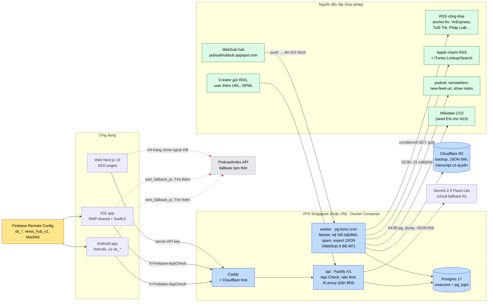
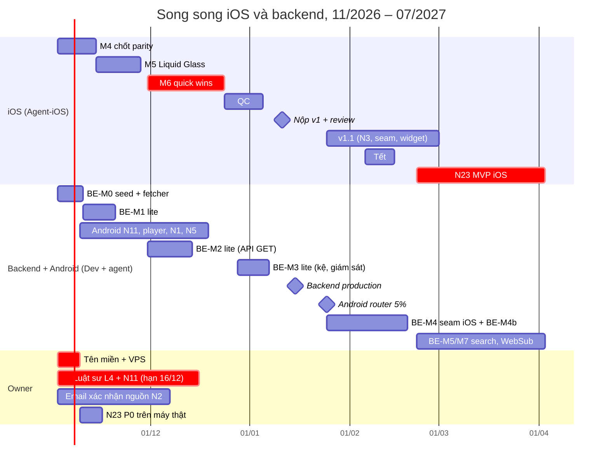

# Kế hoạch: backend podcast riêng, quick wins và cược lớn

> **Trạng thái: Chưa làm** (2026-11-01) — backend riêng (§2), chỉ mục Việt QW-BE và các cược lớn (§4) chưa bắt đầu; mới có khung profile `backend` trong `deploy/docker-compose.yml` (PR #32).
> Riêng các quick win §3.2–§3.4 đã làm trong iOS M6 (PR #30) và Android (PR #36, #38, #39).

> Ticket: TSP-20 (đề xuất) · Ngày lập: 2026-10-30 · Mốc code: `Podcast-ios` @ `a6c8f8e` (iOS M4 đang chạy, T1 xong)
> Gom từ: `docs/in-progress/research/de-xuat-tinh-nang-dot-pha.md` (N1–N26), `docs/in-progress/plans/roadmap-backlog.md`, `docs/in-progress/plans/web-vps-deploy.md`, `docs/in-progress/plans/seo-web-dashboard.md`, `docs/in-progress/research/feature-roadmap-ai-growth.md`, `docs/done/ios/README.md`, `docs/in-progress/policy/store-policy-review.md`, cùng ba bản research ngày 30/10/2026 (backend, quick wins, cược lớn).
> **Đã qua vòng phản biện 30/10/2026** (pháp lý + kỹ thuật + chi phí): các đoạn "Phản biện" ghi lý do sửa/cắt/dời lịch dưới từng mục đã đổi.
> Số liệu "đo 30/10/2026" do agent tự đo, request chậm, UA `TSPodcastResearch/0.1`. **"chưa kiểm chứng"** là chưa tìm được nguồn gốc. Mã ticket TSP-20 trở đi là **placeholder**, owner tạo ticket thật rồi thay số.

---

## 0. Tóm tắt

- **Backend riêng là nền chung của cả ba cược lớn**, nên làm trước như một quick win, nhưng **bản "lite"**: Postgres + crawler TypeScript trên chính VPS của web, cron hằng ngày, **~22–23,5 dev-day (+20% trượt ≈ 26–28)**, production **~15/01/2027** (không phải 18/12), chi phí bắt đầu **~$30/tháng gồm cả web** (VPS 2 vCPU/4 GB), nâng lên ~$58 khi cần.
- **Không cần PodcastIndex để có show Việt đang hoạt động:** Apple VN charts + iTunes Lookup + tự tải RSS cho **636 feed Việt, 166 có tập trong 30 ngày** (PodcastIndex: 324). 12 từ khoá iTunes Search thêm 366 feed. Dump PodcastIndex **không dùng** trong MVP. File nghiên cứu `scratchpad/pidb/vi_active.tsv` (120 feed lấy từ PodcastIndex, 51 feed không có trong danh sách Apple) **không bao giờ** được dùng làm seed.
- **Không lưu bất cứ gì từ PodcastIndex API vào DB** (ToS §5.5). **Không container backend nào có key PodcastIndex** (bỏ parity job). PodcastIndex vẫn chạy live trong app làm fallback và "Tìm thêm trên toàn cầu", tắt dần theo cờ Remote Config `ds_*`.
- **iOS v1 (M6) thêm 7 quick win** (~17–18 dev-day): player cơ bản (skip, hẹn giờ ngủ), N4 tốc độ, N5 tìm trong show, **N2 hub Thời sự & Bản tin**, N1 lite, N11 consent lite, App Shortcuts (không widget, không Live Activity), N7. iOS v1 **không có code backend, không có cờ `ds_*`** (seam KMP làm sau khi nộp v1).
- **Cổng pháp lý cứng:** luật sư phải trả lời câu hỏi Nghị định 147 (L4) **trước code freeze M6 (16/12/2026)**. Nếu không, N2 ra khỏi binary (Apple 2.5.19 cấm tính năng ẩn).
- **Cược signature N23** (MVP iOS 02–03/2027, **~5–6 tuần**, sau Tết): learn-mode player (câu, chạm để tua, lặp câu, chậm không đổi cao độ), dịch câu bằng Apple Translation, lưu câu. Transcript chỉ từ creator (`podcast:transcript`) hoặc `SpeechTranscriber` on-device (iOS 26+). Sổ từ FSRS, quiz, từ điển offline, transcript server Gemini: **ra khỏi MVP**, chỉ làm khi MVP đạt chỉ số.
- **AI tier (D-C):** Foundation Models on-device miễn phí (iPhone 15 Pro+), Apple Translation miễn phí, cloud fallback Gemini 2.5 Flash-Lite qua backend, **trần cứng $50/tháng**.
- **Chi phí định kỳ:** ~$30 (11/2026–01/2027) → ~$35–65 (02–04/2027) → tối đa ~$120 (05–07/2027, khi bật AI cloud). Luật sư là chi phí một lần (**chưa có báo giá**).

> **Phản biện (reviewer, 30/10/2026):** Bản trước hứa backend 31–38 dev-day + Android quick win ~18 dev-day + KMP seam cho **một** dev trong W1–W10 (~45 ngày làm việc thực) — quá tải ~20–60% kể cả trước hệ số trượt. Đã cắt backend xuống bản lite (bỏ WebSub, trang `/internal`, play ping, parity, POST endpoint khỏi v0), dời seam iOS sang sau khi nộp v1, cắt widget/Live Activity khỏi M6, rút N23 MVP về giả thuyết cốt lõi. Chi phí VPS bắt đầu ở gói $24 (đã kiểm giá DigitalOcean 30/10/2026), nâng cấp khi có số đo.

### Quyết định owner đã chốt (không mở lại)

| ID | Quyết định | Hệ quả trong kế hoạch này |
|---|---|---|
| D-A | N23 "Học tiếng Anh bằng podcast thật" là cược signature | §4.1; backend có catalog tiếng Anh tuyển chọn (BE-M8) |
| D-B | Hub N2 "Thời sự & Bản tin" (tập on-demand từ RSS chính thức, không phải stream radio) vào iOS v1 | §3, scope M6; có cổng luật sư L4 |
| D-C | Không tham gia Apple Small Business Program, nên không dùng Private Cloud Compute. AI Apple chỉ là Foundation Models on-device | §4.2: thứ tự on-device → Apple Translation → cloud fallback |
| D-D | Không xin PodcastIndex. Tự dựng backend + DB từ nguồn độc lập; dùng PodcastIndex API live trong khuôn khổ ToS; không chép nội dung API vào DB | §1–§2, ticket TSP-21…TSP-39 |

**Trả lời hai câu hỏi của owner:**
- *"Không đăng ký có đường AI Apple miễn phí không?"* **Có.** Foundation Models on-device miễn phí và không cần chương trình nào (cần iPhone 15 Pro trở lên, bật Apple Intelligence, ngôn ngữ Siri tiếng Việt, iOS 26.1+, ngữ cảnh ~4k token). Ngoài ra còn miễn phí và chạy trên **mọi** máy hỗ trợ: Apple Translation (iOS 17.4+/18+) và `SpeechTranscriber` (iOS 26+). Không có PCC.
- *"Không xin phép chỉ mục, chỉ dựng filter riêng có được không?"* **Được, theo hai lớp.** (1) Ngay bây giờ: lọc phía app trên kết quả PodcastIndex live (N1: blocklist host/author, ẩn show, allowlist). Lọc kết quả hiển thị không phải là sao chép nên không vướng §5.5. (2) Song song: DB riêng dựng từ nguồn độc lập (§2), dần thay PodcastIndex theo từng endpoint.

### Mâu thuẫn giữa ba bản research và cách giải quyết

| Điểm | Bản A nói | Bản B nói | Chốt | Lý do |
|---|---|---|---|---|
| Ngôn ngữ crawler | TypeScript/Node 22 (backend) | Kotlin/JVM dùng lại parser KMP (cược lớn) | **TypeScript** | `podcast-partytime` (MIT) parse sẵn Podcasting 2.0, tiết kiệm vài tuần. `web/` đã là TS. KMP chưa có parser RSS (N3 `TranscriptParser` là code phía app). Một contract test Kotlin giữ JSON khớp model KMP |
| Dump PodcastIndex | Bỏ qua, vùng xám | Dùng được làm seed URL (maintainer nói "knock yourself out", discussion #558) | **Không dùng trong MVP.** Giữ làm tuỳ chọn sau khi luật sư trả lời L6, chỉ lấy URL, provenance `seed:pi_dump`, xoá hàng loạt được | Apple + iTunes đã đủ cho show Việt đang hoạt động. Lời maintainer chỉ là phát biểu không chính thức, ToS không nhắc tới dump |
| Số show Việt | 605/636 (tiêu đề có dấu, 19 genre) | ~699 (tiêu đề hoặc mô tả, 22 genre) | Ghi **~600–700**; KPI đo bằng số feed hoạt động 30/90 ngày | Khác tiêu chí đếm |
| Postgres | 17/18 | 16 | **Postgres 17** | Bản ổn định, `unaccent` + `pg_trgm` có sẵn |
| Lịch poll | Adaptive theo khoảng cách tập + WebSub | Tier hot/active/dormant/dead | **Adaptive** ở v0; WebSub ở BE-M7 (§2.2); tier chỉ là tên gọi | ~75% feed Việt khai WebSub hub, push rẻ hơn poll, nhưng 304 + poll thích ứng đã đủ cho v0 |
| App đọc dữ liệu | API live + cờ RC theo endpoint | JSON tĩnh export lên CDN | **API là đường chính.** Thêm export JSON tĩnh hằng đêm lên R2 cho `news_hub` và `lists` để sống sót khi VPS chết | Cả hai; JSON tĩnh rẻ và chịu lỗi |
| Tên cờ nguồn hub | `ds_news_hub` | `news_hub_source = rc\|backend` | **`ds_news_hub = pi\|own\|own_fallback_pi`** cho nguồn tập; `news_hub_v1` (JSON) cho danh sách nguồn | Một bộ cờ thống nhất |
| Effort backend | 31–38 dev-day | 4–6 tuần | **Bản lite ~22–25 dev-day (+20% trượt)**; phần còn lại (WebSub, `/internal`, play ping, seam iOS) sau khi nộp iOS v1 | Dev còn phải làm Android quick win cùng lúc (xem Phản biện §2.8) |
| AI proxy | Kotlin backend | — | **Module trong service `api` TypeScript** | Một backend duy nhất |
| Lookup rate | 15/phút | ≤20/phút | **15/phút** | Chừa biên dưới giới hạn ~20/phút của Apple |
| Play ping | Không ID, ngoài phạm vi dữ liệu cá nhân | Theo consent analytics | **Chỉ gửi khi người dùng bật "Phân tích sử dụng"** cho tới khi luật sư (L5) nói nó thuộc "Cần thiết" | Thận trọng theo N11 (im lặng không phải đồng ý) |

---

## 1. Kiến trúc tổng

Ô xám nét đứt là thứ tạm thời (PodcastIndex, chỉ gọi từ app/web). Đường đỏ là luồng tới PodcastIndex: chỉ đọc live, **không bao giờ** ghi nội dung vào DB.



**Ba bất biến (ghi trong ADR TSP-20, có test):**
1. **Container `api`, `worker`, `postgres` không có key PodcastIndex.** Container `web` vẫn giữ key cho trang show ngoài DB như hiện nay, nhưng không có credential Postgres của backend (chỉ gọi API công khai `/v1`). Test CI kiểm cấu hình Compose/secret.
2. Mọi hàng `feeds` có `discovered_via` thuộc danh sách cho phép (`apple_chart`, `itunes_search`, `podroll`, `remote_item`, `new_feed_url`, `submission`, `user_url`, `media_site`, `wikidata`), kèm `discovered_at` và `discovered_ref` (URL/ID nguồn khám phá) để audit được. Query audit hằng ngày + test CI báo lỗi khi có giá trị khác.
3. **Không có đường nào từ client tự đưa URL vào DB:** `byurl`/`byguid` chỉ đọc (miss → 404, không xếp hàng, không ghi log URL); chỉ form "Thêm RSS"/creator submit do người dùng chủ động gửi mới tạo `candidate`. App không bao giờ tự gửi favourite/lịch sử (vốn lấy từ PodcastIndex) lên backend để "bổ sung" catalog.
4. Không tải hay host lại audio. Ngoại lệ duy nhất (sau MVP N23): worker transcript cho show **có cơ sở quyền** (§4.1), xoá audio ngay sau khi xử lý.

> **Phản biện:** Bản trước để parity job giữ key PodcastIndex trên chính VPS backend và so sánh dữ liệu PodcastIndex với DB riêng "trong RAM" để định hướng mở rộng catalog. Đó vẫn là dùng nội dung API để dựng một chỉ mục cạnh tranh (ToS v1.1 §5.5 mục 1 "build databases"; §4.1 mục 1 cấm API client "functions substantially the same… and offer it for use by third parties" — đã đọc lại ToS 30/10/2026), và tạo một kênh rò rỉ khó chứng minh là sạch. Đã bỏ parity; thay bằng KPI phủ so với Apple charts (§2.7). Thêm bất biến 3 vì luồng chuyển ID (`/byurl` với URL lấy từ favourite PodcastIndex) là đường rò rỉ ẩn lớn nhất nếu backend "tiện tay" crawl URL lạ.

---

## 2. Backend riêng

### 2.1 Nguồn dữ liệu

Mọi nguồn chỉ dùng để **tìm ra URL feed**. Mọi metadata lưu trong DB đều lấy từ việc tự tải RSS gốc.

| # | Nguồn | Cách dùng | Điều khoản / giấy phép | Rủi ro |
|---|---|---|---|---|
| 1 | **RSS công khai** | Nguồn metadata duy nhất: show, tập, enclosure, transcript URL, chapters URL, podroll. Link tới enclosure gốc | Không có giấy phép chính thức; chuẩn ngành: RSS mở là đồng ý ngầm cho app tổng hợp, với điều kiện không host lại, không chèn quảng cáo vào audio, không thu phí show miễn phí, không sửa metadata ([Podnews](https://podnews.net/article/the-unwritten-contract)). Bản quyền vẫn của nhà sản xuất. Cách hiểu theo luật VN **chưa kiểm chứng** (L8) | Thấp. Tôn trọng `podcast:block`, `itunes:block`, gỡ khi có yêu cầu |
| 2 | **Apple VN charts, endpoint legacy theo genre** `itunes.apple.com/vn/rss/toppodcasts/limit=200/genre=G/json` | **Chỉ để khám phá** (tìm `apple_id` mới) và xếp thứ tự duyệt `vetted`. Snapshot hằng ngày ~20 call VN (US/GB chỉ khi làm N23). Lưu `(apple_id, genre, rank, ngày)` **tối đa 90 ngày**, không vào điểm kệ công khai | Endpoint legacy, không có tài liệu, **không nằm trong danh sách nguồn đã duyệt của dự án** (chỉ `rss.marketingtools.apple.com`); không tìm thấy điều khoản riêng. Đo 30/10/2026: 19/19 genre trả 200, 3.720 show | Trung bình (pháp lý chưa rõ + có thể bị tắt). Gộp vào câu hỏi L3. Kệ phải chạy được khi thiếu nguồn này |
| 3 | **Apple charts RSS v2** `rss.marketingtools.apple.com` | **Nguồn chart chính được phép** (tối đa 50, không theo genre); #2 chỉ bổ sung khi còn sống | JSON ghi "Copyright © 2026 Apple Inc."; trang công cụ chỉ có dòng copyright, **không có điều khoản hay link điều khoản** (reviewer kiểm lại 30/10/2026). Giới hạn 10/25/50. VN trả 504 hai lần khi đo | Thấp–trung bình. Không bao giờ hiển thị "BXH Apple", rank hay artwork của Apple |
| 4 | **iTunes Lookup/Search API** | Đổi `apple_id` → `feedUrl`; Search theo từ khoá tiếng Việt mỗi tuần. Tối đa 15 call/phút, batch 150 id. Chỉ lưu `feedUrl` + `collectionId` | ~20 call/phút; nội dung là "promotional", không dùng "for independent entertainment value" ([Apple](https://performance-partners.apple.com/search-api)). Dùng để tìm URL feed nằm ngoài mục đích chữ nghĩa | **Xám → luật sư L3**, hoặc owner ký chấp nhận rủi ro theo thông lệ ngành. Giảm rủi ro: không lưu/hiển thị artwork, mô tả, genre của Apple; thêm badge "Có trên Apple Podcasts" |
| 5 | **Link trong feed**: `podcast:podroll`, `remoteItem` (cần `feedGuid`, `feedUrl` tuỳ chọn), `itunes:new-feed-url`, redirect 301, URL trong show notes | Duyệt đồ thị hằng tuần (BE-M7). Chỉ resolve từ `feedUrl` hoặc GUID đã có trong DB. **Không** resolve qua PodcastIndex `byguid`. **URL trong show notes:** chỉ nhận URL trỏ thẳng tới file RSS/Atom (kiểm `Content-Type` XML + phần tử `<rss>`), qua robots.txt; **denylist tên miền cứng**: `spotify.com`, `*.spotify.com`, `podcasts.apple.com`, `music.apple.com`, `youtube.com`, `youtu.be`, `google.*`, `facebook.com`, `podcastindex.org`, `api.podcastindex.org`; không bao giờ tải trang HTML để "đào" link | Nội dung của chính feed ([remote-item.md](https://github.com/Podcastindex-org/podcast-namespace/blob/main/docs/tags/remote-item.md)) | Thấp. Hiện 0/120 feed Việt có podroll |
| 6 | **Creator gửi RSS (N21), user "Thêm RSS bằng URL", import OPML** | Thành `candidate`, chỉ công khai sau khi vetted (N1). Không gắn URL với người gửi | Điều khoản creator + consent | Thấp. PDPL: email người gửi mã hoá |
| 7 | **Trang podcast của báo/đài Việt** (podcast.tuoitre.vn, VnExpress, VOV) | Seed URL feed bằng tay một lần, kiểm lại tối đa hằng tháng. **Không bao giờ crawl RSS tin/chữ** | robots.txt: vnexpress.net `Allow: /`; tuoitre.vn Allow (trừ search, print); vov.vn `Crawl-delay: 20`. **Điều khoản RSS của VnExpress và Tuổi Trẻ: miễn phí "cho các cá nhân và các tổ chức phi lợi nhuận", có thể thu hồi** ([vnexpress.net/rss](https://vnexpress.net/rss), [tuoitre.vn/rss.htm](https://tuoitre.vn/rss.htm)). Có áp cho feed *podcast* (họ cũng gửi lên Apple Podcasts) không: **chưa kiểm chứng** | Trung bình. **Xin xác nhận bằng văn bản từ từng toà soạn trước khi đưa vào hub N2.** Đây là xin chủ nội dung, không phải PodcastIndex, nên khớp D-D |
| 8 | **WebSub hub** (`pubsubhubbub.appspot.com`) | Subscribe theo `rel=hub` trong feed; push chỉ **lên lịch fetch**, không tin nội dung push | Giao thức mở. 30/40 feed Việt mẫu khai hub (đo 30/10/2026) | Thấp |
| 9 | **Podping** (Hive) | Một consumer; URL khớp thì fetch ngay. Chủ yếu giúp catalog EN | Mở ([podping-hivewatcher](https://github.com/Podcastindex-org/podping-hivewatcher)). Spotify for Creators có gửi podping không: **chưa kiểm chứng** | Thấp. Pha sau (BE-M7) |
| 10 | **Wikidata** (P1019 feed URL) | Seed catalog tiếng Anh cho N23. 6.082 podcast có feed, 0 tiếng Việt | **CC0** | Không |
| 11 | **VOA Learning English** | Show được phép lưu và phục vụ transcript/bản dịch trên server | Tác phẩm chính phủ Mỹ, public domain (17 USC §105, kiến thức nền); một số mục có nội dung bên thứ ba. Trang chủ có bài ngày 30/10/2026 (reviewer đo 30/10/2026), nhưng tương lai USAGM vẫn bất ổn (tranh chấp toà án 2025–2026). Không xây N23 dựa vào một nguồn này | Thấp |
| 12 | **Tín hiệu trong app** (play ping, follow) | Đầu vào trending; chỉ công khai bucket ≥ 20 người | Dữ liệu của ta, theo consent analytics | Thấp |
| 13 | **YouTube Data API v3** | **Không có trong MVP.** Sau này chỉ là nút "Xem trên YouTube" cho show đã có, làm mới ≤ 30 ngày | 10.000 unit/ngày; `search.list` 100 unit; lưu tối đa 30 ngày (III.E.4); **không gộp dữ liệu nhiều kênh** (III.E.2.a); **không tạo chỉ số dẫn xuất** (III.E.4.h); không tách audio, không phát nền (III.I.7–9) ([policies](https://developers.google.com/youtube/terms/developer-policies), [quota](https://developers.google.com/youtube/v3/determine_quota_cost)) | Hạn chế. View YouTube không vào trending, không tính là catalog. Không tải trang hay Atom feed của YouTube |
| 14 | **PodcastIndex API (live)** | Chỉ trong app/web như hiện nay: fallback, "Tìm thêm trên toàn cầu", nhạc (`bymedium`). Cache trong giới hạn header | ToS v1.1: §5.5 cấm scrape, dựng DB, bản sao vĩnh viễn; §4.1 cấm API client "functions substantially the same"; §7.2 bắt ghi nguồn ([ToS](https://github.com/Podcastindex-org/legal/blob/main/TermsOfService.md)) | Thấp nếu bất biến §1 được giữ bằng code |
| 15 | **Dump PodcastIndex** `public.podcastindex.org/podcastindex_feeds.db.tgz` | **Không dùng trong MVP** | Không có giấy phép chính thức. README repo ghi MIT nhưng dump không nằm trong repo ([repo](https://github.com/Podcastindex-org/database)). Maintainer 14/08/2023: "If you want to build a database knock yourself out. Even commercial is fine… I'd rather provide a download" ([discussion #558](https://github.com/Podcastindex-org/podcast-namespace/discussions/558)). Câu "free, for any use" trên trang chủ chỉ thấy qua bản sao (podcastindex.org trả 403) — **chưa kiểm chứng** | Thấp–trung bình. Chỉ xem lại sau L6; nếu dùng: chỉ URL, `discovered_via='seed:pi_dump'` (thêm vào danh sách cho phép khi đó), tự fetch từng feed |
| ✗ | Trang Spotify / creators.spotify.com, trang `podcasts.apple.com`, trang YouTube, kết quả Google, mọi thứ sau đăng nhập hoặc chống bot; danh sách từ Oxford 3000/5000 (có bản quyền) | — | Cấm theo ràng buộc dự án | Không bao giờ |

**Phân bố host feed Việt (636 feed, đo 30/10/2026):** anchor.fm 463 (73%), castos 20, acast 14, soundcloud 11, buzzsprout 11, podcast.tuoitre.vn 4. anchor.fm hỗ trợ `ETag`/`If-None-Match` (304, 0 byte) và gzip (feed VOV Thời sự 30,0 MB → 4,7 MB, 7.896 item). VnExpress và Tuổi Trẻ **không** gửi ETag/Last-Modified, phải tải cả file và so SHA-256.

> **Phản biện (nguồn):**
> - **Kiểm lại 30/10/2026:** điều khoản RSS VnExpress và Tuổi Trẻ đúng như ghi (miễn phí "cho các cá nhân và các tổ chức phi lợi nhuận", yêu cầu ghi nguồn, thu hồi bất cứ lúc nào); cả hai trang **chỉ liệt kê feed tin chữ, không liệt kê feed podcast**, nên việc áp cho feed podcast vẫn mơ hồ → giữ yêu cầu xác nhận văn bản. iTunes Search API: "approximately 20 calls per minute", "only to promote store content", artwork chỉ để quảng bá, gần badge/link về store — đúng như ghi. PodcastIndex ToS v1.1 (02/03/2021) §4.1, §5.5, §7.2 đúng như trích. `docs-api` của PodcastIndex là **MIT** (đã kiểm qua GitHub API) nên mô phỏng tên trường JSON là ổn; repo `database` **không có file LICENSE** (GitHub API trả Not Found) — càng củng cố việc không dùng dump.
> - **robots.txt của anchor.fm (73% catalog):** `anchor.fm/robots.txt` trả 302 sang `podcasters.spotify.com/...` rồi về một **trang HTML** của creators.spotify.com; còn `creators.spotify.com/robots.txt` là `Disallow: /` (trừ vài trang marketing). Theo RFC 9309, file không phải robots hợp lệ sau redirect = không có luật, nên fetch `anchor.fm/s/*/podcast/rss` không vi phạm robots; nhưng **không bao giờ** đi theo link sang `creators.spotify.com`/`podcasters.spotify.com` (Disallow) và ghi rõ cách hiểu này trong ADR. Feed RSS anchor.fm là feed creator tự phân phối cho directory, không phải "scrape Spotify"; điều khoản riêng của Spotify for Creators về bên thứ ba đọc RSS **chưa kiểm chứng**.
> - **Apple charts legacy** không thuộc danh sách nguồn đã duyệt; đã hạ xuống "chỉ khám phá + thứ tự duyệt", không còn là 20% điểm kệ công khai (§2.4). Nguồn chính là `rss.marketingtools.apple.com`.
> - **Provenance của bộ đo:** `be_dl/vn_feeds.json` (636 URL) đến từ Apple + iTunes; còn `pidb/vi_active.tsv` (120 hàng, có ID PodcastIndex) là dữ liệu PodcastIndex — chỉ dùng cho con số so sánh "324"/"0/120 có podroll", **không được nạp**. Seed BE-M0 phải chạy lại discovery từ đầu bằng crawler, không import file scratchpad nào. "Bản tin pháp luật" không có trong cả hai danh sách → ghi `discovered_via='media_site'` khi seed tay.

### 2.2 Crawler

**Stack:** Node 22 + TypeScript, một package `backend/` trong monorepo. `podcast-partytime` 5.0.0 (MIT) + `fast-xml-parser` 5.11 (MIT) để parse; `pg-boss` 12.38 (MIT) cho queue và cron **ngay trong Postgres** (không cần Redis); Fastify cho API; Kysely cho SQL.

**Fetcher**
- `User-Agent: TSPodcastBot/1.0 (+https://<domain>/bot; bot@<domain>)`. Trang `/bot` mô tả bot làm gì và cách opt-out.
- `Accept-Encoding: gzip, br`; gửi `If-None-Match` / `If-Modified-Since` khi có.
- Timeout 30 s, tối đa 5 redirect, body tối đa 60 MB.
- Feed không có validator: so SHA-256 của body, giống nhau thì bỏ qua parse.
- Feed khổng lồ (VOV ~8.000 item): parse dạng stream hoặc dừng sau K GUID liên tiếp đã biết; reconcile toàn bộ mỗi tuần.

**Lịch sự**
- Token bucket theo host: tối đa 2 request đồng thời, ≥ 1 s giữa hai request (anchor.fm và host lớn); vov.vn 20 s.
- robots.txt (RFC 9309) cache 24 h, áp cho mọi fetch HTML; với URL feed cũng tôn trọng `Disallow` tường minh.
- Tôn trọng `Retry-After` khi 429/503.

**Poll thích ứng** (`next_poll_at` theo feed)

| Loại feed | Chu kỳ |
|---|---|
| Hub tin (N2) | 15 phút nếu host trả 304 (anchor.fm); **30 phút** với host không có ETag/Last-Modified (VnExpress, Tuổi Trẻ, Pháp Luật); + WebSub từ BE-M7 |
| Hoạt động (có tập trong 30 ngày), không WebSub | `clamp(trung vị khoảng cách tập / 4, 30 phút, 12 h)` |
| Có WebSub | 24 h (lưới an toàn) |
| Ngủ > 90 ngày | Hằng ngày |
| Ngủ > 365 ngày | Hằng tuần |
| Chết | Hằng tháng |

WebSub (BE-M7, không trong v0): callback `https://api.<domain>/websub/{feedId}` có HMAC secret, gia hạn lease trước khi hết hạn.

> **Phản biện:** Poll 15 phút cả file với host không có validator là 96 lần tải/ngày/feed cho nội dung đăng 1–3 lần/ngày — hợp lệ nhưng không "lịch sự", và vô ích trong v0 vì iOS v1 lấy hub qua PodcastIndex. Đã nới lên 30 phút cho host không có ETag. WebSub dời sang BE-M7: poll thích ứng + 304 đã đủ cho ~600 feed hoạt động, WebSub thêm một bề mặt công khai (callback) phải bảo vệ. Giữ `If-None-Match`, `Retry-After`, circuit breaker; thêm: tôn trọng `Crawl-delay` nếu có, và trang `/bot` phải sống **trước** request đầu tiên mang UA `TSPodcastBot` (cần tên miền B2 → nếu chưa có domain ở W1, crawler dùng UA kèm email liên hệ tạm, không chạy quy mô lớn).

**Ngân sách lỗi**
- 5xx/timeout: backoff mũ 1 h → 7 ngày. 404: chết sau 3 lần liên tiếp trải ≥ 7 ngày. 410: chết ngay.
- Circuit breaker theo host: > 20% lỗi trong 15 phút thì dừng host đó 30 phút.
- SLO: ≥ 97% fetch thành công/ngày với feed hoạt động; độ trễ tập mới p95 < 1 h với feed tin. Lỗi SLO → cảnh báo Telegram.

**Parse:** RSS 2.0 + iTunes (title, author, owner, image, categories, explicit, type, block, new-feed-url, season, episode, episodeType) và Podcasting 2.0 (`guid`, `locked`, `block`, `txt` gồm `purpose="ai-content"` và `verify`, `funding`, `person`, `podroll`/`remoteItem`, `trailer`, `liveItem`, `transcript`, `chapters` chỉ URL, `soundbite`, `alternateEnclosure`, `location`, `medium`, `value` lưu nhưng không dùng). `medium=music` để PodcastIndex lo.

**Định danh và chống trùng**
- Feed: (1) `podcast:guid`; (2) không có thì UUIDv5 của URL bỏ scheme và dấu `/` cuối, namespace `ead4c236-bf58-58c6-a2c6-a6b28d128cb6` ([guid.md](https://github.com/Podcastindex-org/podcast-namespace/blob/main/docs/tags/guid.md)) — khoá chung giữa các hệ thống mà không chép dữ liệu PodcastIndex; (3) so khớp mờ (tiêu đề chuẩn hoá, tác giả, enclosure đầu) để đưa vào hàng duyệt.
- Feed chuyển nhà: 301 hoặc `itunes:new-feed-url` cập nhật `feeds.url` và ghi `feed_urls`.
- Tập: `(feed_id, guid)`; không có GUID thì enclosure URL chuẩn hoá (bỏ prefix podtrac/op3/chartable **chỉ cho khoá**), rồi `(title, pubDate)`.
- Artwork hotlink trong MVP. Proxy resize ảnh chỉ làm sau khi có quy trình gỡ và ý kiến luật sư (L8).

### 2.3 Schema (Postgres 17, rút gọn)

```sql
-- định danh & nguồn gốc
feeds(id bigint PK /* sequence bắt đầu 1e12 */, podcast_guid uuid UNIQUE, url text UNIQUE,
  title, author, description, image_url, link, language, explicit bool, itunes_type, medium,
  apple_id bigint,  /* KHÔNG lưu itunes:owner name/email: claim N21 đọc email từ feed lúc claim */
  locked bool, blocked bool, ai_content bool, funding jsonb,
  newest_item_at, episode_count, status /* candidate|active|dormant|dead|blocked */,
  discovered_via text NOT NULL /* danh sách cho phép, §1 */, discovered_at, discovered_ref text,
  vetted bool, spam_score real,
  lang_detected text, level text /* N23: A1-A2|B1|B2+ */,
  etag, last_modified, body_sha256, next_poll_at, poll_interval,
  websub_hub, websub_expires_at, consecutive_errors, last_http_status, created_at, updated_at,
  search_doc tsvector GENERATED ALWAYS AS (to_tsvector('simple',
    f_unaccent(coalesce(title,'')||' '||coalesce(author,'')||' '||coalesce(description,'')))) STORED)
feed_urls(feed_id, url, reason /* 301|new-feed-url|submitted */, seen_at)
episodes(id bigint PK /* 1e12+ */, feed_id FK, guid, title, description, link, published_at,
  duration_s, enclosure_url, enclosure_type, enclosure_length, image_url, season, episode,
  episode_type, explicit, transcript_urls jsonb, chapters_url, soundbites jsonb,
  alternate_enclosures jsonb, search_doc tsvector GENERATED …, UNIQUE(feed_id, guid))
live_items(feed_id, guid, status, start_at, end_at, enclosure_url)
-- people / feed_people / episode_people (podcast:person): HOÃN, chưa có tính năng nào cần; là dữ liệu cá nhân
categories(id, name, parent_id); feed_categories(feed_id, category_id)  -- client map theo TÊN
feed_links(from_feed, to_feed_guid, to_url, kind /* podroll|remoteItem|shownote */)
transcripts(episode_id, source /* creator|server_ai */, licence_basis /* creator_tag|public_domain|opt_in */,
  r2_key, lang, created_at)                                   -- N3/N16/N23
-- tín hiệu & đầu ra
apple_chart_snapshots(day, country, genre, rank, apple_id)     -- chỉ nội bộ
play_counts_daily(day, episode_id, feed_id, plays int)        -- gộp, không ID thiết bị
trending_snapshots(day, scope /* vi|en|cat:<id> */, rank, feed_id, score, components jsonb)
coverage_metrics(day, apple_chart_vn_total int, in_db int, active_30d int)  -- phủ so với Apple charts, không dùng PodcastIndex
-- biên tập & an toàn (N1)
curation_lists(slug, title, kind /* allow|block|shelf|news_hub|learn_en */, config jsonb)
list_items(list, feed_id, pos, note, confirmed_at)
policy_rules(kind /* host_block|author_block|keyword|feed_block */, value, reason, created_by)
reports(id, feed_id, episode_id, reason, created_at)  -- không lưu thông tin người báo cáo
submissions(id, url, contact_email_enc /* xoá sau 90 ngày */, status, reviewed_by)
claims(feed_id, method /* email_code|podcast_txt */, email_hash /* HMAC có khoá, không hash trần */, verified_at)
websub_subscriptions(feed_id, hub, topic, secret, lease_until)
fetch_log(feed_id, at, status, bytes, ms, error)   -- partition theo tháng, giữ 30 ngày
audit_log(at, actor, action, entity, before jsonb, after jsonb)
```

- Tìm kiếm: `CREATE EXTENSION unaccent, pg_trgm;` hàm `IMMUTABLE f_unaccent(text)`; GIN trên `search_doc` + GIN trigram trên `f_unaccent(lower(title))`. Config `'simple'` vì Postgres không có stemmer tiếng Việt. `unaccent.rules` đã có `Đ→D, đ→d, ơ→o, ư→u…` (đã kiểm).
- Kích thước: 3–5k feed Việt + 200–500 feed EN tuyển chọn, 0,5–1 triệu tập, **~2–4 GB** kể cả index.

> **Phản biện (PDPL):** Bản trước lưu `owner_name`, `owner_email_enc` của mọi feed và bảng `people` (tên, ảnh người dẫn/khách mời) — đều là dữ liệu cá nhân của creator, thu thập không có đồng ý, không phục vụ endpoint nào của v0, và mâu thuẫn với §4.3 ("không lưu email, chỉ hash"). Theo nguyên tắc tối thiểu hoá của PDPL 91/2025 (văn bản hướng dẫn: **chưa kiểm chứng lại** 30/10/2026), đã bỏ khỏi schema; claim N21 đọc email từ feed tại thời điểm claim. `author` (tên hiển thị của show) vẫn lưu vì là metadata xuất bản, nhưng vẫn là câu hỏi L5. Hash email trần (SHA-256) của địa chỉ email dò ngược được → dùng HMAC có khoá. Đặt thời hạn lưu: `submissions.contact_email_enc` 90 ngày, `fetch_log` 30 ngày, `apple_chart_snapshots` 90 ngày; ghi vào privacy policy. Cloudflare (Mỹ) và VPS Singapore đều nhận IP người dùng → hồ sơ chuyển dữ liệu xuyên biên giới là câu hỏi L5 (**cần luật sư**).

### 2.4 Trending riêng

Chạy 03:00 ICT mỗi ngày, làm nhẹ mỗi giờ, chỉ trên feed `vetted`:

```
score = 0.35·norm(log1p(unique_plays_7d))        -- play ping trong app, Bayesian smoothing
      + 0.15·momentum(plays_7d / plays_prev_7d, có trần)
      + 0.20·velocity(số tập mới 14 ngày, trần 7, có decay)
      + 0.20·apple_signal(Σ_genre 1/log2(rank+1), VN, 3 ngày gần nhất)
      + 0.10·freshness(newest_item_at)
      − penalties(spam_score, ai_content nếu user ẩn AI); blocked → loại
```

- Khi chưa có lượng play đáng kể (tháng đầu), trọng số play dồn sang velocity + apple_signal; khi endpoint Apple legacy chết, `apple_signal = 0` và phân bổ lại — trending vẫn chạy.
- Tên kệ: **"Nổi bật" / "Đang lên"**, không "BXH", không nhắc Apple. YouTube view không tham gia.
- Play ping: `POST /v1/events/play {episodeId}`, App Check, gửi một lần/tập/ngày sau 30 s nghe, **chỉ khi đã bật "Phân tích sử dụng"**. Server chỉ tăng `play_counts_daily`; không lưu install ID; Caddy không log IP cho route này. Ghi vào privacy policy.

**v0 (trong quick win, thay công thức trên cho tới khi có play ping):**
```
"Nổi bật"       = curation_lists(kind='shelf') do biên tập chọn (thứ tự tay)
"Mới cập nhật"  = feed vetted theo newest_item_at (= E5 recent)
"Đang lên" v0   = 0.6·velocity + 0.4·freshness trên feed vetted, mỗi publisher tối đa 2 slot;
                  apple_signal chỉ dùng làm tie-breaker, trọng số ≤ 0.10, tắt khi có ≥ 4 tuần play ping
```
Công thức đầy đủ ở trên là **v1** (TSP-32, sau khi Android consent TSP-48 đã ship ≥ 4 tuần để có dữ liệu).

> **Phản biện:** (1) Play ping cần consent trên client trước, mà N11 Android/iOS chỉ ship cuối 12/2026–01/2027 → tháng đầu không có dữ liệu; điểm 35%+15% dựa trên play là vô nghĩa ở v0. (2) Để `apple_signal` 20% trong kệ công khai là tái phân phối gián tiếp thứ hạng từ endpoint legacy không có điều khoản; Apple Search API chỉ cho dùng "to promote store content". Đã hạ xuống tie-breaker ≤ 10% và có hạn tắt. (3) Velocity thuần sẽ đẩy feed tin và spam (đăng nhiều) lên đầu → chỉ chạy trên feed `vetted` + trần theo publisher. Kệ biên tập là phương án thật thà nhất khi catalog còn nhỏ.

### 2.5 API phục vụ

Đường dẫn và tên trường JSON **mô phỏng các endpoint PodcastIndex mà KMP `PodcastIndexApi` đang gọi (E1–E11)**, nên decoder hiện có trên iOS và model Retrofit trên Android dùng lại nguyên. Chỉ chép *tên trường*, không chép dữ liệu. Dữ liệu từ DB riêng nên §4.1 ToS PodcastIndex không áp.

| Endpoint | Thay cho | Ghi chú |
|---|---|---|
| `GET /v1/podcasts/trending?max&since&lang&cat&notcat` | E1 | Từ `trending_snapshots` |
| `GET /v1/recent/feeds?max&since&lang&cat` | E5 | Theo `newest_item_at`, chỉ feed vetted |
| `GET /v1/podcasts/byfeedid?id` · `/byguid?guid` · `/byurl?url` | E11 | `byurl`/`byguid` phục vụ chuyển ID; **chỉ đọc**: miss → 404, không xếp hàng crawl, không log URL (bất biến §1.3) |
| `GET /v1/episodes/byfeedid?id&max&since` | E10 | |
| `GET /v1/episodes/live` | E2 | Từ `live_items` (sau v0) |
| `GET /v1/categories/list` | E9 | ID riêng; client map theo tên |
| `GET /v1/search/byterm?q&max` | E7 | BE-M5 (sau v0). `websearch_to_tsquery('simple', f_unaccent(q))` + trigram + độ phổ biến. Chỉ catalog của ta; client giữ PodcastIndex cho "Tìm thêm" |
| `GET /v1/hubs/news` | N2 | Tập mới nhất mỗi nguồn hub + playlist "Điểm tin sáng" dựng sẵn |
| `GET /v1/lists/{slug}` · `GET /v1/policy` | N1/N18/N23 | Allow/block list, kệ; về sau thay list trong Remote Config |
| `POST /v1/submit` · `POST /v1/reports` · `POST /v1/events/play` | N21/N1 | **Sau v0.** App Check bắt buộc (enforce, không monitor) + rate limit |
| `POST /v1/ai/{summary,explain}` | N15 | 05/2027+. Proxy Gemini, quota theo install, trần tháng (§4.2). Quota theo install = lưu định danh cài đặt → dữ liệu cá nhân, cần L5 |
| `POST /websub/{id}` | — | BE-M7. Callback hub, xác thực HMAC |

- **ID:** sequence bắt đầu **1.000.000.000.000**; ID PodcastIndex ở mức triệu, nên `Long` trong Room (feedId, lịch sử, favourite) không bao giờ đụng nhau và client biết nguồn từ dải ID.
- **Auth:** header `X-Firebase-AppCheck`, server tự kiểm JWT RS256 theo JWKS `https://firebaseappcheck.googleapis.com/v1/jwks` (cache 6 h), `iss`/`aud` theo project number, `sub` trong allow-list app ID ([docs](https://firebase.google.com/docs/app-check/custom-resource-backend)). Bật chế độ monitor trước, enforce sau. Token limited-use + replay protection chỉ cho `POST /submit`. Web dùng API key phía server Next.js.
- **Cache:** `Cache-Control: public, max-age` 300 (trending/recent), 900 (feed), 60 (hub tin); LRU trong process; ETag. Cloudflare free phía trước. Dữ liệu công khai nên hit cache bỏ qua App Check là chấp nhận được.
- **Rate limit:** ~120 req/phút/IP, 10/phút cho POST, ngân sách theo app ID.
- **JSON tĩnh dự phòng:** worker export `news_hub.json`, `lists/*.json` lên R2 lúc 05:30; app dùng khi API lỗi (sau bundled default).
- **Lợi ích cho web:** trang SEO của show Việt đọc từ API riêng, **bỏ được ràng buộc build lại mỗi 7 ngày và nguy cơ 429** trong `web-vps-deploy.md` §6. **Hub tin không lên web** cho tới khi có trả lời L4.

> **Phản biện:** v0 chỉ cần các endpoint **GET** mà Android router 5% dùng (E1, E5, E9–E11, hub, lists). Mọi POST (submit, reports, play) mở bề mặt ghi công khai cần App Check enforce, chống spam và quy trình duyệt — dời ra sau v0. Mô phỏng tên trường JSON của PodcastIndex hợp lệ vì spec `docs-api` là MIT (giữ thông báo MIT nếu chép văn bản spec); nhưng **không** gắn chữ "PodcastIndex" hay logo vào API của ta. Router Android phải định tuyến theo dải ID: ID ≥ 1e12 khi backend lỗi thì fallback bằng PodcastIndex `podcasts/byfeedurl` với URL feed của ta (client gọi, không ghi gì vào DB).

### 2.6 Hosting, chi phí, vận hành

**Khuyến nghị:** dùng chính VPS đã lên kế hoạch cho web, **bắt đầu 2 vCPU / 4 GB ($24)**, Docker Compose gồm `caddy`, `web`, `api`, `worker`, `postgres` (volume), swap 2 GB, giới hạn RAM từng container. **Nâng lên 4 vCPU / 8 GB ($48)** khi một trong các điều kiện: > 3.000 feed hoạt động, p95 API > 400 ms, RAM > 80% kéo dài, hoặc bắt đầu worker transcript N23. Resize droplet là thao tác vài phút. Nếu luật sư (L5) yêu cầu lưu trữ trong nước: chuyển sang VPS VN cùng cấu hình (Viettel IDC/BizFly ~600–800k VND, **chưa kiểm chứng**).

| Hạng mục | Phương án A: một VPS (khuyến nghị) | Phương án B: GCP |
|---|---|---|
| Compute + DB | DigitalOcean SG 2 vCPU/4 GB **$24** lúc đầu → 4 vCPU/8 GB **$48** (đã kiểm 30/10/2026, [pricing](https://www.digitalocean.com/pricing/droplets)). Hetzner SG tăng giá 2 lần năm 2026, giá SG **chưa kiểm chứng** | Cloud SQL shared-core ~$11–17 (không SLA) hoặc ~$50; Cloud Run ~$0–5; Scheduler ~$0,3 (**chưa kiểm chứng**) |
| Backup droplet | +20% tuần: $4,8 (gói $24) / $9,6 (gói $48) | Có sẵn |
| `pg_dump` offsite + JSON tĩnh + transcript | Cloudflare R2: 10 GB free, $0,015/GB sau đó, không phí egress ([R2](https://developers.cloudflare.com/r2/pricing/)) → **$0** | GCS ~$1 |
| Cloudflare, UptimeRobot, healthchecks.io, Apple/YouTube API | $0 | $0 |
| **Tổng** | **~$30–32/tháng lúc đầu, ~$58–60 sau khi nâng cấp** (gồm cả web; phần tăng thêm so với kế hoạch web: $0–8 lúc đầu, ~$35 sau nâng cấp) | ~$30–80 |

- Băng thông crawl: ~600 feed hoạt động (đa số WebSub/304) + ~4k feed ngủ mỗi ngày một lần, gzip → **~15–40 GB/tháng (ước lượng)**, thừa trong hạn mức VPS.
- Backup: `pg_dump -Fc` hằng đêm lên R2, giữ 14 bản ngày + 8 bản tuần; CI hằng tuần restore vào container tạm và chạy smoke query. DB cũng dựng lại được từ đầu bằng crawl lại (~1 ngày).
- Giám sát: healthchecks.io cho mỗi cron, UptimeRobot `/healthz`, `pg_stat_statements`, một hàng chỉ số mỗi ngày (feed đã fetch, tỷ lệ 304, lỗi theo host, tập mới, WebSub push, lag p95), cảnh báo Telegram, xoay log Docker.

> **Phản biện (chi phí):** 1–1,5k feed và < 1 GB dữ liệu ở v0 không cần 8 GB RAM. Rủi ro thật của gói 4 GB là parse feed 20–24 MB của VOV trong Node → bắt buộc parse stream/dừng sớm (đã có trong §2.2) và giới hạn 1 job parse feed lớn cùng lúc. Bắt đầu nhỏ tiết kiệm ~$29/tháng trong 3 tháng đầu, khi chưa ai dùng backend. Chi phí ẩn chưa tính trong bảng: **giờ vận hành** (cảnh báo, feed hỏng, hàng duyệt spam 2–4 h/tuần — §4.3) ≈ 0,5–1 dev-day/tuần sau khi lên production; phí luật sư (chưa có báo giá).

**Lịch job (pg-boss cron, giờ ICT)**

| Tần suất | Việc |
|---|---|
| Mỗi phút | Dispatcher chọn feed đến hạn |
| 15 phút | Feed hub tin |
| Mỗi giờ | Kệ "Đang lên" v0 làm mới nhẹ; (BE-M7: gia hạn WebSub lease) |
| 02:00 | Apple charts (~40 call) + Lookup Apple ID mới (15/phút) |
| 03:00 | Spam scoring, kệ, quét feed chết, audit `discovered_via`, KPI phủ so với Apple charts |
| 04:00 | Backup |
| 05:30 | Export JSON tĩnh lên R2 |
| Hằng tuần | Mở rộng từ khoá iTunes, reconcile feed khổng lồ; (BE-M7: duyệt podroll). robots.txt cache 24 h theo host như §2.2 |

### 2.7 Lộ trình rời PodcastIndex theo cờ Remote Config

1. **Seam trong KMP (TSP-34):** interface `PodcastDataSource` trong `shared/commonMain` với đúng các hàm của `PodcastIndexApi` hiện tại (`getTrending`, `getRecentFeeds`, `getLiveEpisodes`, `getPodcastsByMedium`, `searchPodcasts`, `searchMusicPodcasts`, `getCategories`, `getEpisodesByFeedId`, `getPodcastByFeedId`) + `getNewsHub`, `getList`. Ba bản: `PodcastIndexDataSource` (bọc class hiện tại), `TsBackendDataSource` (cùng Ktor client, base URL và plugin auth khác), `RoutingDataSource`. Refactor thuần, có test sẵn, **làm sau khi nộp iOS v1 (W11)** để không đụng M5/M6/QC: agent iOS sửa Home/Search/Detail trong M5–M6 cùng lúc với seam sẽ gây xung đột merge và hồi quy ngay trước QC.
2. **Android** không dùng `:shared` (quyết định cũ). Vì API mô phỏng JSON PodcastIndex, Android chỉ cần thêm một Retrofit instance với base URL + interceptor App Check và một router theo cờ (TSP-38, ~2–3 dev-day). Nếu owner cho Android dùng `:shared` cho module mới (§8), Android dùng thẳng `RoutingDataSource`.
3. **Cờ Remote Config** (một cờ mỗi endpoint): `ds_trending`, `ds_recent`, `ds_feed`, `ds_episodes`, `ds_search`, `ds_categories`, `ds_live`, `ds_news_hub`, giá trị `"pi" | "own" | "own_fallback_pi"`; `ds_own_base_url`. Rollout % qua điều kiện RC (5 → 20 → 50 → 100%), tách Android/iOS. Android khai báo cờ ở TSP-38; **iOS v1 không có cờ `ds_*`** (cờ vào iOS ở v1.1 cùng seam).
4. **Fallback:** `own_fallback_pi` chuyển sang PodcastIndex khi lỗi, timeout 3 s hoặc kết quả rỗng; circuit breaker 5 lỗi/60 s → PodcastIndex 10 phút; event `ds_fallback` ghi lý do.
5. **Chuyển ID:** lần đầu chạy với cờ `own`, app gọi `/v1/podcasts/byurl` theo lô cho favourite/lịch sử (có `feedUrl`) và ghi đè ID; hàng không resolve giữ ID PodcastIndex và vẫn do PodcastIndex phục vụ. Route theo dải ID (≥ 1e12 là của ta). Danh mục yêu thích map theo tên.
6. **KPI phủ (thay parity, không dùng PodcastIndex):** mỗi ngày đo `coverage_metrics` = số show trong Apple charts VN (v2 + legacy nếu còn) có trong DB và đang hoạt động; mục tiêu ≥ 90% top-200 có trong DB. So sánh chất lượng với PodcastIndex chỉ làm **thủ công, phía client** (QA mở hai cờ trên máy thật), không ghi gì về server.
7. **Điều kiện chuyển một endpoint sang `own`:** crash-free không đổi, p95 < 400 ms từ VN, `ds_fallback` < 1%, phủ ≥ 90% top-200 Apple VN, và chỉ số hành vi trên nhóm 5% (tỷ lệ bấm kệ, thời lượng nghe/phiên) không giảm quá 5% so với nhóm `pi`.
8. **Thứ tự:** `ds_news_hub` và trending/recent Việt (I-1, nơi dữ liệu ta mạnh và PodcastIndex nhiều spam) → feed/episodes cho show Việt (I-2) → search (I-3, PodcastIndex còn lại làm "Tìm thêm trên toàn cầu") → PodcastIndex chỉ cho long tail toàn cầu và nhạc (I-4). Ghi nguồn PodcastIndex (ToS §7.2) chỉ trên bề mặt còn dùng PodcastIndex.
9. **KPI:** % call catalog của app do backend phục vụ (mục tiêu: 10% cuối 02/2027 (Android 5–20%), 50% cuối 05/2027, ≥ 90% cuối 2027).

> **Phản biện:** Parity job bị bỏ (xem §1). Chỉ số A/B hành vi trên nhóm rollout là tiêu chí tốt hơn "overlap với PodcastIndex" — mục tiêu là catalog tốt hơn cho người Việt, không phải giống PodcastIndex. KPI % call đã hạ vì backend production dời sang 15/01/2027 và iOS chỉ bật sau khi v1.1 có seam.

### 2.8 Mốc backend (1 dev + agent, dev-day)

| Mốc | Phạm vi | Dev-day |
|---|---|---|
| BE-M0 | Skeleton `backend/`, Compose, schema v0, discovery Apple charts (v2 + legacy) + Lookup + Search **chạy mới từ crawler** (không import file scratchpad), fetcher (conditional GET, gzip, SHA-256, stream parse), crawl đầu ~1–1,5k feed Việt, báo cáo phủ | 5 |
| BE-M1 lite | Scheduler thích ứng + robots + token bucket + ngân sách lỗi (3), chống trùng + feed chuyển nhà (1,5), luật spam + cờ `vetted` duyệt bằng CLI/CSV (1,5–2). **Không** WebSub, **không** trang `/internal` | 6–6,5 |
| BE-M2 lite | API v1 **chỉ GET** (E1, E5, E9–E11, hub, lists) + JSON tĩnh R2 (3), App Check chế độ monitor + rate limit + cache + Cloudflare (1,5), contract test Kotlin (1) | 5,5 |
| BE-M3 lite | Kệ v0 (biên tập + Mới cập nhật + Đang lên v0), KPI phủ, healthchecks, backup R2 + restore test | 3–4 |
| TSP-38 | Android: Retrofit backend + router theo dải ID + cờ + rollout 5% | 2,5 |
| **Cộng quick win "Chỉ mục Việt v0 lite"** | | **22–23,5** (+20% trượt ≈ 26–28) |
| BE-M4 | Sau khi nộp iOS v1: KMP seam (TSP-34) + `RoutingDataSource`/fallback (TSP-35) + chuyển ID (TSP-36) + bật iOS (TSP-39) | 6–7 |
| BE-M4b | Play ping + trending v1 (TSP-32), POST reports, trang `/internal` (TSP-28 phần UI) | 5–6 |
| BE-M5 | Search riêng (unaccent + trigram, xếp hạng), chuyển search Việt | 5–7 |
| BE-M6 | Cổng creator N21: gửi RSS, kiểm tra thẻ, claim, badge "Đã xác nhận chủ feed", OPML | 10–15 |
| BE-M7 | WebSub (TSP-26), duyệt podroll/remoteItem, mở rộng từ khoá, Podping | 6–8 |
| BE-M8 (sau MVP N23) | Catalog EN tuyển chọn cho N23 v1.1 (~200 show), gắn level, hook transcript server | 5–8 |
| BE-M9 (tuỳ chọn) | YouTube link-out (làm mới 30 ngày), proxy resize ảnh sau khi luật sư đồng ý | 4–6 |

> **Phản biện (effort):** Năng lực Dev W1–W10 (02/11/2026–08/01/2027) ≈ 50 ngày − nghỉ 01/01 − ~4 ngày review/ops/họp ≈ **45 dev-day**. Bản trước đặt lên Dev: backend 31–38 + Android quick win ~18 (TSP-48…52) + seam 2 = **51–58**, nhân hệ số trượt 1,3 tự ghi trong §5 = 66–75 — không khả thi, và "backend production 18/12" rơi đúng tuần owner/PO bận nghiệm thu M6 + code freeze. Bản lite: backend 22–23,5 + Android ~18 ≈ 40–42 (44–46 khi tính trượt 20% cho backend) → vừa khít, không còn chỗ cho việc mới, nên **production backend ~15/01/2027, Android 5% ~25/01/2027**. Nếu còn trượt, thứ tự cắt: TSP-38 rollout lùi 2 tuần trước, rồi BE-M3 kệ "Đang lên" (giữ biên tập + Mới cập nhật). Ước lượng 1 dev + agent cho crawler RSS thật (feed hỏng encoding, GUID trùng, feed 24 MB) thường trượt; 20% là mức tối thiểu.

---

## 3. Quick wins

### 3.1 Sự thật từ code và đo đạc làm thay đổi kế hoạch

1. **iOS chưa có tốc độ, skip ±, hẹn giờ ngủ** (`AudioEngine.swift` chỉ có play/pause/seek/next/previous). Android cũng chưa (`updatePlaybackSpeedList()` trong `PlayerViewModel.kt:435` rỗng). `app-store-submission-plan.md` §9 ghi đây là "phải có" cho iOS v1, và N2 (kệ đêm khuya), N10 (Live Activity) đều cần hẹn giờ ngủ → **player cơ bản là tiền đề của M6**.
2. **Android không dùng `:shared`**, nên mọi thứ viết trong shared chỉ giúp iOS; Android viết lại (+40–60% effort) trừ khi owner đổi (§8).
3. **Remote Config chưa chạy trên iOS** (thiếu `GoogleService-Info.plist`) → mọi list điều khiển bằng RC (N1, N2) cần **JSON bundled** làm mặc định, như `BlacklistRepository`.
4. **PodcastIndex JSON không trả** `podroll`, `podcast:txt`, `podcast:block`, `alternateEnclosure`, `liveItem` (0 lần trong `pi_api.json`). Có trả `funding`, `persons`, `transcripts`, `chaptersUrl`, `season`, `episodeType=trailer`. → N8, nhãn AI của N1, N9 v2 **phụ thuộc crawler backend**.
5. **Feed VOV trên anchor.fm 20–24 MB**; một lần tải 20,4 MB về là XML hỏng. **App không bao giờ tải các RSS này**: v1 dùng PodcastIndex `episodes/byfeedid?max=…` (tối đa 1000), v2 dùng backend.
6. **Có feed giả mạo:** "Đọc truyện đêm khuya | VOV Live" (owner `podcast@giadinhhama.com`), "Truyện Đêm Khuya VOV" (Spreaker). Tìm "VOV" còn ra spam cờ bạc ("KUBET…", "789betv13.com") → phải xác minh chủ feed, và N1 cần cả với nguồn ngoài PodcastIndex.
7. **Apple 2.5.19:** "Don't include any hidden, dormant, or undocumented features." N2 không được ship ẩn rồi bật bằng RC; hoặc **bật khi review** (mô tả trong review notes), hoặc không có trong binary. Kill switch để *gỡ* sau này thì được.
8. **Remote Config tính phí từ 01/09/2026:** miễn phí 100.000 fetch/ngày/project, sau đó $0,06/10k fetch (Blaze) ([pricing](https://firebase.google.com/pricing)). Giữ fetch interval ≥ 12 h.
9. Không có chữ "xe máy" trong `app/`, `web/src`, `fastlane/`, `distribution/` → N7 v1 chỉ là kiểm metadata/screenshot.

### 3.2 Bảng quick win

Effort: dev-day (1 dev + agent, gồm unit test). "sh" = KMP shared, "And" = Android viết riêng, "BE" = backend.

| ID | Phạm vi v1 | Nền tảng | Phụ thuộc | Effort | Tiêu chí nghiệm thu |
|---|---|---|---|---|---|
| **QW-BE** "Chỉ mục Việt v0 lite" | Backend §2.8 BE-M0…M3 lite + TSP-38; kệ/recent Việt + hub N2 từ DB riêng trên Android 5% | BE + And | Tên miền (B2), VPS | 22–23,5 (+20%) | ≥ 160 feed Việt hoạt động 30 ngày trong DB; 0 hàng `discovered_via` ngoài danh sách; `api`/`worker` không có key PodcastIndex (test CI); phủ ≥ 90% top-200 Apple VN; SLO fetch ≥ 97%; p95 API < 400 ms từ VN; `ds_fallback` < 1% ở 5% Android |
| **Player cơ bản** | Skip −15/+30 s + remote command; hẹn giờ ngủ 5/10/15/30/45/60 phút, hết tập, fade 10 s | sh 0,5 · iOS 2 · And 2,5 | — | 2 / 2,5 | Màn khoá hiện −15/+30; hẹn giờ fade rồi dừng ở 0; "Hết tập" dừng không tự chuyển; sống qua background; unit test state machine với `EpochClock` |
| **N4** (phần S) | Tốc độ 0,5–3,0× bước 0,1 + chip; nhớ theo show; giữ cao độ | sh 0,5 · iOS 1,5 · And 2 | `KeyValueStore` | 2 / 2 | Tốc độ theo show còn sau khi khởi động lại; Now Playing đúng thời gian ở 1,5×; không méo giọng ở 2× |
| **N5** | Tìm trong show bỏ dấu (gồm đ/Đ) | sh 0,5 · iOS 1 · And 1,5 | — | 1,5 / 1,5 | "doc truyen" khớp "Đọc truyện"; < 100 ms cho 1.000 tập; có chú thích khi show > 1.000 tập |
| **N2** | Hub "Thời sự & Bản tin": mục Home, màn hub, playlist "Điểm tin sáng" (không AI), kệ "Truyện đêm khuya" tự hẹn giờ 30 phút | sh 2,5 · iOS 3 · And 4 · BE 2 (v2) | JSON bundled + RC `news_hub_v1`; PodcastIndex live; player cơ bản; **L4 trước freeze**; email xác nhận chủ feed | 5,5 / 4 | Chỉ nguồn có `confirmedAt` hiện; "Phát tất cả" xếp đúng thứ tự; chuỗi của ta không chứa từ cấm; review notes viết xong |
| **N1** lite | Blocklist host + author; "Ẩn show này"; "Báo cáo nội dung" (mailto trên iOS; Firestore + App Check trên Android) | sh 1 · iOS 1 · And 3 (+1,5) | JSON bundled + RC | 2 / 4,5 | Host thử (`ngocbaomedia.com`) không bao giờ xuất hiện ở Home/Search; show đã ẩn còn ẩn sau khởi động lại; form báo cáo điền sẵn ID |
| **N11** consent lite | Màn quyền riêng tư lần đầu, không chặn; Analytics/Crashlytics tắt tới khi opt-in; toggle trong Cài đặt | iOS 1,5 · And 3 (gộp UMP) | Văn bản luật sư; URL privacy (B2) | 1,5 / 3 | Cài mới + "Chỉ cần thiết" → 0 request Analytics/Crashlytics (kiểm bằng proxy); link policy mở được |
| **N10** phần a (M6: chỉ App Shortcuts) | M6: App Intents trong app target + App Shortcuts vi/en. v1.1: widget "Tiếp tục nghe", Live Activity hẹn giờ, Control widget | M6: iOS 1,5–2 · v1.1: iOS 5 (+1) | v1.1: App Group, extension target, provisioning | 1,5–2 (M6) | Câu tiếng Anh chạy trên iOS 17+; **câu tiếng Việt chỉ trên iOS 18.4+** khi Siri đặt tiếng Việt (Siri tiếng Việt có từ iOS 18.4); Shortcuts app liệt kê đủ intent |
| **N7** | Quy tắc câu chữ: bus/metro/xe ô tô, không "xe máy", không gợi ý nghe khi lái | tất cả 0,25 (And ASO 0,5) | — | 0,25 / 0,5 | grep `xe máy\|chạy xe\|lái xe` trên String Catalog + metadata fastlane = 0 |
| **N3** | Tab "Bản ghi" (SRT/VTT/JSON/HTML), chương (`chaptersUrl`, rồi timestamp trong show notes), chạm để tua | sh 2 · iOS 2,5 · And 3 | Không | 4,5 / 5 | "Tâm Sự Tài Chính" (SRT Spotify) hiện và tua đúng; feed có timestamp trong show notes hiện chương |
| **N9** v1 | Trailer, nhóm "Tập 12 · Mùa 3", "Ủng hộ nhà sản xuất" (`funding`) | sh 1 · iOS 1,5 · And 1,5 | v2 cần BE | 2,5 / 1,5 | Feed có trailer hiện nút; nhóm mùa khi ≥ 2 tập có `season` |
| **N8** | "Show gợi ý" từ podroll; fallback "Podroll Việt" | sh 1 · iOS 1 · And 1 · BE 1,5 | **Crawler BE** | 2 + BE | Ít nhất một feed Việt thật có podroll hiển thị |
| **N12** | Chia sẻ: Tập / Từ mốc này (`?t=`) / Chương; trang tập web có OG + nghe thử 60 s từ enclosure gốc | web 4 · iOS 2 · And 3 | **B2 + web VPS**, Universal/App Links | 9 tổng | Link dán vào Zalo hiện tiêu đề + ảnh (thử tay; cách Zalo dựng preview **chưa kiểm chứng**) |

**Nơi đặt:** M6 (iOS v1) = player cơ bản, N4, N5, N2, N1 lite, N11 lite, App Shortcuts (phần đầu của N10a), N7. iOS v1.1 = N3 (ưu tiên đầu, tiền đề N23), seam backend + cờ `ds_*`, widget + Live Activity, N9 v1, N12 (khi có domain), Spotlight. Sau crawler = N8, N9 v2. Android: §5.

> **Phản biện:** (1) Tiêu chí cũ "Siri chạy câu tiếng Việt trên máy iOS 17+" không đạt được: Siri chỉ có tiếng Việt từ iOS 18.4 ([VnExpress](https://e.vnexpress.net/news/tech/tech-news/vietnamese-siri-goes-live-on-iphone-supports-ride-hailing-money-transfer-4868566.html)); deployment target iOS 17 (`architecture.md`). (2) Widget + Live Activity cần extension target mới, App Group, provisioning/entitlement và một vòng kiểm trên máy thật — loại việc loop agent làm chậm và dễ hỏng signing ngay trước QC; giá trị cho 4.2 phần lớn đã có ở App Shortcuts + Now Playing. Dời sang v1.1, tiết kiệm ~5 dev-day. (3) QW-BE chỉ còn bản lite; seam KMP không thuộc QW-BE nữa.

### 3.3 N2 "Thời sự & Bản tin": nguồn, biên tập, UI

**Nguồn đề xuất (kiểm 30/10/2026; đều là feed tập `audio/mpeg`, không phải stream):**

| Kệ | Feed | RSS | iTunes ID | Dấu hiệu chủ sở hữu |
|---|---|---|---|---|
| Tin | VOV - Chương trình Thời sự | https://anchor.fm/s/86ec8d4/podcast/rss | 1448565355 | author/copyright "Đài Tiếng nói Việt Nam", link vov1.vn, owner `banthoisu.vov@gmail.com`; ~3 tập/ngày |
| Tin | VOV - Tin nhanh 24h | https://anchor.fm/s/86f0c04/podcast/rss | 1448603366 | Như trên |
| Tin | VOV - Sự kiện Bàn luận | https://anchor.fm/s/8535a2c/podcast/rss | 1447959801 | Như trên; 8.012 item |
| Tin | VOV - Kinh tế Tài chính | https://anchor.fm/s/84e912c/podcast/rss | 1447843388 | Như trên |
| Tin | VnExpress Hôm nay | https://vnexpress.net/rss/podcast/vnexpress-hom-nay.rss | 1751444063 | Host trên vnexpress.net, owner `podcast@vnexpress.net` |
| Tin | Podcast Tuổi Trẻ Online | https://podcast.tuoitre.vn/podcast-feed.rss | 1627456657 | Host trên tuoitre.vn, audio cdn2.tuoitre.vn |
| Tin | Bản tin pháp luật (Báo Pháp Luật VN) | https://baophapluat.vn/rss/podcasts/ban-tin-phap-luat/feed.xml | 1652462907 | Host trên baophapluat.vn |
| Đêm | Đài Hà Nội · Đọc truyện đêm khuya | https://anchor.fm/s/e75b3a50/podcast/rss | — (tra lúc seed) | owner `noidungso@hanoionline.vn` (email trên tên miền đài) |

Tuỳ chọn thêm sau: VOV Nội chính (anchor.fm/s/87b8d30), VOV Khoa học Công nghệ (anchor.fm/s/89fc894), VOV Giao thông "Sự việc & Góc nhìn" (anchor.fm/s/23ae4638). VnExpress "Hộp đen", "Giải mã" để kệ khác.

**Loại khỏi v1:** "RADIO NHÂN DÂN" (chữ "RADIO" trong tiêu đề, nội dung lẫn); hai feed "truyện đêm khuya VOV" không chứng minh được của VOV; truyện thiếu nhi (N18 bỏ kệ thiếu nhi vì Play Families); báo tiếng Việt ở nước ngoài (SBS, RFI, BBC, VOA) — vẫn tìm được qua Search (quyết định biên tập, xem L4 câu 6).

**Quy tắc xác nhận (cứng):**
- Mỗi nguồn trong `news_hub_default.json` có `confirmedAt`. **Code bỏ qua nguồn có `confirmedAt = null`.** Owner điền ngày khi nhận được email xác nhận từ địa chỉ owner trong feed **và** kênh liên hệ chính thức trên tên miền của toà soạn. Lưu thư trả lời (Apple 5.2.3: "Authorization must be provided upon request").
- VnExpress và Tuổi Trẻ: bắt buộc có xác nhận vì điều khoản RSS "phi lợi nhuận".
- **Ngưỡng ship:** cần ≥ 2 nguồn tin đã xác nhận + kệ đêm khuya (hoặc ≥ 3 nguồn tin). Dưới ngưỡng ở code freeze → owner quyết (giữ hub nhỏ hay lùi v1.0.1).

**Biên tập:** `NewsHubConfig` trong shared, decode từ RC `news_hub_v1` (JSON), fallback `news_hub_default.json`:

```json
{"version":1,"enabled":true,"sections":[
  {"id":"news","sources":[{"key":"vov_thoisu","feedUrl":"https://anchor.fm/s/86ec8d4/podcast/rss","itunesId":1448565355,
    "confirmedAt":null,"brief":{"take":1,"maxAgeHours":24,"preferTitle":"Thời sự 6h"}}]},
  {"id":"night","sleepTimerMinutes":30,"sources":[]}]}
```

- Khoá là dữ liệu biên tập của ta (URL feed, iTunes ID từ toà soạn/Apple). **Không có trường ID PodcastIndex** trong JSON (ID chỉ nằm trong cache trên máy), để file này chuyển nguyên sang `curation_lists` mà không mang dữ liệu PodcastIndex vào DB.
- iOS v1: resolve `podcasts/byitunesid` hoặc `byfeedurl` một lần (cache 7 ngày), rồi `episodes/byfeedid?max=20` mỗi nguồn (cache 15 phút). Nguồn không resolve được qua PodcastIndex thì bỏ qua (unit test) và ghi event. **Phải kiểm trước W5:** Tuổi Trẻ và Bản tin pháp luật không có trong danh sách 120 feed Việt hoạt động của PodcastIndex mà research lấy được — có resolve được không **chưa kiểm chứng**; nếu không, v1 chỉ có các nguồn còn lại (app không tự tải RSS).
- **"Điểm tin sáng"** dựng trong shared: mỗi nguồn lấy tập mới nhất trong `maxAgeHours` (24 h; VnExpress 48 h); VOV Thời sự ưu tiên tiêu đề "Thời sự 6h" trước 11:00; Tuổi Trẻ lấy 2; theo thứ tự config; bỏ nguồn cũ; giao cho `PlaybackQueue` tự chuyển tập. Không AI, không viết lại.
- Về sau: `curation_lists(kind='news_hub')` giữ cùng JSON + audit; `GET /v1/hubs/news` trả brief dựng sẵn; cờ `ds_news_hub` chuyển nguồn tập, danh sách nguồn vẫn từ `news_hub_v1`.

**UI iOS (không chữ "Radio"):**
- Tab Khám phá: mục "Thời sự & Bản tin" ngay sau hàng trending đầu tiên — thẻ lớn "Điểm tin sáng · Thứ Năm 30/10" (số tập, tổng phút, "Phát tất cả"), rồi hàng tập mới nhất, "Xem tất cả".
- Màn hub: thẻ brief → "Mới nhất" (30 tập mới theo `pubDate`, artwork/tên feed gốc) → "Nguồn" (lưới show, mở Podcast detail thường) → "Truyện đêm khuya" (biểu tượng trăng; phát từ kệ này tự hẹn giờ 30 phút, toast "Đã hẹn giờ tắt 30 phút · Đổi") → footer "Nội dung do các cơ quan báo chí phát hành qua RSS và được phát từ địa chỉ gốc của nhà xuất bản." + link "Báo cáo / yêu cầu gỡ".
- Từ cấm trong chuỗi của ta: "Radio", "Đài", "Phát thanh", "Trực tiếp", "Live", "Kênh". Tiêu đề feed (vd "Đài Hà Nội") là chữ của nhà phát hành, được hiển thị trong app nhưng **không** trong screenshot/ASO. Không logo VOV/VOH/Tuổi Trẻ ngoài artwork feed (5.2.1).
- Review notes: "On-demand episodes published by Vietnamese news organisations through their own public podcast RSS feeds; played from the publisher's own audio URLs; no live streams, no re-hosting; confirmations from publishers available on request." (Feed Thời sự tự mô tả "Các chương trình Thời sự trực tiếp trong ngày" — nói rõ đây là bản ghi đăng sau khi phát.)

> **Phản biện (N2):** Footer cũ "…phát **trực tiếp** từ nguồn gốc" vi phạm chính unit test từ cấm ("Trực tiếp") và gợi ý stream live trước reviewer → đổi thành "được phát từ địa chỉ gốc của nhà xuất bản". Bỏ `piFeedId` khỏi JSON biên tập: kế hoạch nói JSON này "về sau" vào `curation_lists` — tức sẽ chép ID PodcastIndex vào DB. Thêm kiểm tra khả năng resolve qua PodcastIndex vì hub v1 phụ thuộc hoàn toàn PodcastIndex live. Email `banthoisu.vov@gmail.com` (Gmail) một mình không chứng minh chủ sở hữu → giữ quy tắc "hai kênh" (owner trong feed **và** kênh chính thức trên tên miền toà soạn). Kệ "Truyện đêm khuya": truyện đọc là tác phẩm văn học của tác giả thứ ba; quyền phát hành thuộc đài — câu xác nhận gửi Đài Hà Nội phải hỏi rõ đài có quyền phân phối lại qua RSS cho ứng dụng bên thứ ba (**cần luật sư** nếu đài trả lời mơ hồ).

### 3.4 Đưa vào iOS v1 (M6)

**Ước lượng:** player cơ bản 2 · N4 2 · N5 1,5 · N2 5,5 · N1 lite 2 · N11 lite 1,5 · App Shortcuts 1,5–2 · N7 + analytics + review notes 1 = **~17–17,5 dev-day**, lịch ~3,5 tuần với loop agent (30/11–23/12), còn ~1 tuần đệm trước freeze.

**Thứ tự cắt nếu thiếu thời gian:** (1) N5 sang v1.1 (−1,5); (2) App Shortcuts sang v1.1 (−2); (3) kệ "Truyện đêm khuya" của N2 (giữ tin). **Không cắt:** N2 phần tin (D-B), player cơ bản, N4, N11, N1 lite.

> **Phản biện (M6):** Bản trước ~22–23 dev-day + một gạch đầu dòng có điều kiện ("nếu seam TSP-34 đã vào shared thì Home/Detail/Search đi qua nó") — scope có điều kiện là thứ loop agent xử lý tệ nhất, và đụng lớp dữ liệu của Home/Search/Detail ngay trước QC là rủi ro hồi quy lớn nhất. Đã bỏ hẳn: v1 không có code backend, không cờ `ds_*` (đồng thời triệt rủi ro 2.5.19 "dormant feature" cho đường backend). Widget/Live Activity sang v1.1 (xem §3.2). M4 hiện mới ghi tiến độ T2 (commit `d62b505`), nên M5 (W3–W4) và M6 (W5–W8) đều phụ thuộc M4 xong đúng W2; đệm 1 tuần ở trên là để hấp thụ trượt đó, không phải để thêm việc.

**Cổng:** chưa có trả lời L4 trước code freeze M6 (16/12/2026) → hub không vào binary (2.5.19); show vẫn tìm được qua Search; owner quyết lại (trái D-B nên chỉ owner quyết).

Đoạn scope dán thẳng vào script loop iOS (cùng định dạng M0–M5):

```js
  M6: {
    title: 'Thời sự & Bản tin, player cơ bản, App Shortcuts — quick wins trước QC',
    scope: `
- Player basics first (prerequisite): skip −15 s / +30 s on the Player and as MPRemoteCommandCenter skipBackward/skipForward (preferredIntervals) on the lock screen (next/previous stay in the queue sheet); a SleepTimer state machine in shared (off / 5,10,15,30,45,60 min / end of episode, 10 s volume fade, cancelled by manual pause; time injected through EpochClock) driven from AudioEngine, with a timer button and sheet on the Player. "End of episode" stops at the end of the item without auto-advancing.
- N4 (S part only): speed sheet 0.5–3.0× in 0.1 steps plus chips (0.8/1.0/1.2/1.5/2.0); PlaybackProfileRepository(feedId) in shared on the existing KeyValueStore (per-show speed, global default, "apply to all shows" toggle); AVPlayerItem.audioTimePitchAlgorithm = .timeDomain, player.defaultRate, Now Playing playback rate and changePlaybackRateCommand. No DSP/"Giọng rõ hơn".
- N5: diacritic-insensitive "search in this show" on Podcast detail (.searchable, shown when >20 episodes). VietnameseFold (NFD, strip combining marks, đ/Đ→d, lowercase) and EpisodeFilter in shared with unit tests ("doc truyen" matches "Đọc truyện"); first query loads up to max=1000 episodes once through the existing 15-min cache; footnote when the show has more episodes than were loaded; empty state "Không tìm thấy tập phù hợp".
- N2 "Thời sự & Bản tin" hub (owner decision D-B): NewsHubConfig in shared decoded from Remote Config key news_hub_v1 (JSON) with a bundled news_hub_default.json fallback (Firebase is optional at runtime, as in M4). Seed the bundled file with exactly these sources, each with confirmedAt = null until the owner fills in the date: news = VOV Chương trình Thời sự (https://anchor.fm/s/86ec8d4/podcast/rss, itunes 1448565355, preferTitle "Thời sự 6h" before 11:00), VOV Tin nhanh 24h (https://anchor.fm/s/86f0c04/podcast/rss, 1448603366), VOV Sự kiện Bàn luận (https://anchor.fm/s/8535a2c/podcast/rss, 1447959801), VOV Kinh tế Tài chính (https://anchor.fm/s/84e912c/podcast/rss, 1447843388), VnExpress Hôm nay (https://vnexpress.net/rss/podcast/vnexpress-hom-nay.rss, 1751444063, maxAgeHours 48), Podcast Tuổi Trẻ Online (https://podcast.tuoitre.vn/podcast-feed.rss, 1627456657, take 2), Bản tin pháp luật (https://baophapluat.vn/rss/podcasts/ban-tin-phap-luat/feed.xml, 1652462907); night = Đài Hà Nội Đọc truyện đêm khuya (https://anchor.fm/s/e75b3a50/podcast/rss). Sources whose confirmedAt is null are skipped at runtime (unit-tested); never add any other feed. Resolve each source through PodcastIndex byitunesid/byfeedurl (7-day cache) then episodes/byfeedid?max=20 (15-min cache) — never fetch these RSS files on device (some are >20 MB). A source that does not resolve is skipped (unit-tested) and logged once; record in the progress doc which of the 8 sources resolved. The JSON carries no PodcastIndex ID field; resolved IDs live only in the on-device cache. "Điểm tin sáng" playlist built in shared (newest item per source within maxAgeHours (default 24), preferTitle rule, source order, stale sources skipped) and handed to PlaybackQueue with auto-advance; no AI, no rewriting. UI: a "Thời sự & Bản tin" section on Home right after the first trending row (brief card "Điểm tin sáng · <weekday dd/MM>" with item count, total minutes and "Phát tất cả", newest row, "Xem tất cả") and a hub screen (brief, "Mới nhất" = newest 30 items across sources with each feed's own artwork, "Nguồn" grid opening the normal Podcast detail, "Truyện đêm khuya" shelf whose play action sets a 30-min sleep timer with a toast "Đã hẹn giờ tắt 30 phút · Đổi"). Footer attribution "Nội dung do các cơ quan báo chí phát hành qua RSS và được phát từ địa chỉ gốc của nhà xuất bản." + "Báo cáo / yêu cầu gỡ" link. Our own strings must not contain Radio/Đài/Phát thanh/Trực tiếp/Live/Kênh (checked by a unit test over the String Catalog keys used by the hub). The hub is ON in the reviewed build (guideline 2.5.19 forbids dormant features); the Remote Config enabled=false switch exists only to remove it later. Never ship a hub with zero confirmed sources: if fewer sources than the owner's threshold are confirmed at code freeze, stop and ask the owner (the hub is then removed from the binary, not hidden).
- Data layer is frozen for M6: no PodcastDataSource seam, no ds_* Remote Config keys, no TSPodcast backend URL or code in the v1 binary. The hub uses the existing PodcastIndexApi through a NewsHubRepository; Home, Detail and Search data paths are not refactored.
- N1 lite: BlacklistRepository gains host (feed and enclosure host) and author lists in the same Remote Config/asset JSON (unit test: a seeded host such as ngocbaomedia.com never reaches Home or Search); "Ẩn show này" (local set of feedIds applied in Home, Search, hub, Detail recommendations; manage in Settings → "Show đã ẩn"); "Báo cáo nội dung" opens a pre-filled mail (feedId, episodeId, app version) — no Firestore.
- N11 consent lite: first-launch privacy sheet that never blocks the app (Cần thiết always on and explained; Phân tích sử dụng and Báo cáo sự cố off until opted in; "Đồng ý tất cả" / "Chỉ cần thiết", both continue into the app); Info.plist sets FIREBASE_ANALYTICS_COLLECTION_ENABLED=NO and FirebaseCrashlyticsCollectionEnabled=NO and they are enabled at runtime only after consent; same toggles in the M4 Settings screen; consent version + timestamp stored locally. Wording comes from the owner/lawyer; until then use placeholder strings flagged in the progress doc.
- App Shortcuts (first slice of N10 part a): App Intents in the app target only (ContinueListeningIntent as AudioPlaybackIntent, PauseIntent, SetSleepTimerIntent(minutes)) and an AppShortcutsProvider with en + vi phrases ("Tiếp tục nghe trên ${applicationName}", "Hẹn giờ tắt ${applicationName}"). English phrases must work on iOS 17+; Vietnamese phrases only work where Siri is set to Vietnamese (iOS 18.4+) — test on such a device or simulator and note the result in the progress doc. No new extension target, no App Group: widget, Live Activity, ControlWidget and Spotlight are out of scope (v1.1). Cut order if M6 runs late: N5, then App Shortcuts, then the night shelf of the hub.
- N7: no store or in-app copy suggests listening while riding a motorbike or driving ("xe máy", "chạy xe", "lái xe" grep over String Catalog and fastlane metadata returns nothing).
- Analytics behind the existing seam (respecting consent): news_hub_open, news_brief_play, news_source_unresolved, speed_change, sleep_timer_set, show_search, show_hidden, content_report, shortcut_invoked.
- Same test rule as M4: unit tests for all shared logic plus the smoke check; keep every existing accessibilityIdentifier and add identifiers for new controls. Write the App Review notes paragraph for the hub (on-demand episodes published by Vietnamese news organisations through their own public podcast RSS feeds, played from publisher URLs, no live streams, no re-hosting, confirmations available on request; note that the VOV news feed's own description says "trực tiếp" but the items are recordings uploaded after broadcast).`,
  },
```

---

## 4. Cược lớn

Cả ba cược dùng chung backend §2. Thứ tự: **N23 (signature) → AI tier → Nhà của podcast Việt**, nhưng phần index Việt đã có sẵn từ quick win QW-BE.

### 4.1 N23 "Học tiếng Anh bằng podcast thật" (signature, D-A)

**Bằng chứng nhu cầu (đo 30/10/2026):** 16/100 show top Apple VN là học tiếng Anh (6 Minute English #7, Listening Time #10, English With Us #17, Thai Van Linh #37, Luke's #39, … Ms Thuỷ KISS English #85); thêm 9 show học tiếng Trung/Nhật/Đức. ~68/200 show Education VN là học tiếng Anh. **0/18 feed học tiếng Anh/nói rõ đã tải có `podcast:transcript`** → transcript là khoảng trống thật.

**MVP (iOS trước, sau khi v1 được duyệt) — chỉ kiểm một giả thuyết: "người học Việt có dùng learn-mode trên podcast thật không?":**
1. **Kệ "Học tiếng Anh"** ~20 show, chia 3 nhóm thô (Chậm/dễ, Trung cấp, Nâng cao) do biên tập gắn tay, cấu hình qua Remote Config/JSON bundled (giống `news_hub_v1`), **không cần backend**. Chỉ tập `en` có lời nói.
2. **Learn-mode player:** transcript dạng câu, chạm để tua, tự cuộn + highlight; **lặp câu** (một chạm); chậm 0,5–1,0× không đổi cao độ (dùng lại N4). A–B tuỳ ý: ngoài MVP.
3. **Nguồn transcript:** (a) `podcast:transcript` của creator (dùng parser N3); (b) không có thì `SpeechTranscriber` on-device (iOS 26+) trên tập người dùng đã tải về, kết quả chỉ ở trên máy. Máy < iOS 26 và tập không có transcript: "Chưa có bản ghi". **Không** transcript server trong MVP.
4. **Dịch câu** bằng Apple Translation `TranslationSession` (iOS 18+), nhãn "Bản dịch máy" + "Xem bản gốc".
5. **Lưu câu** (câu + bản dịch + mốc thời gian + tập) vào danh sách local; chạm để nghe lại đoạn đó từ enclosure gốc.

**Ngoài MVP (N23 v1.1, chỉ khi MVP đạt ngưỡng ở "Chỉ số"):** tra từ offline (Wiktionary/kaikki, CC BY-SA), sổ từ + FSRS, quiz không AI, A–B tuỳ ý, transcript server (Gemini, chỉ show có quyền, L2), catalog EN 200 show + level tự động (BE-M8), streak/widget ôn tập, giải thích AI và tóm tắt tiếng Việt (N15), shadowing/chấm phát âm, sync nhiều máy (cần tài khoản), tiếng Trung/Nhật.

> **Phản biện (N23 MVP):** Bản trước có 7 hạng mục + bậc thang transcript 4 tầng + BE-M8 + worker Gemini ≈ 8–10 tuần iOS + ~10 dev-day backend + 2 câu hỏi luật sư (L1, L2) làm điều kiện bắt đầu — đó là v1 của sản phẩm học, không phải MVP. Sổ từ FSRS, quiz và từ điển đều là tính năng **giữ chân** chỉ có nghĩa khi đã có người dùng learn-mode. Từ điển Wiktionary kéo theo nghĩa vụ share-alike (CC BY-SA) và một pipeline dữ liệu riêng. Transcript server kéo theo L2 (tác phẩm phái sinh) và phụ thuộc VOA (tương lai USAGM bất ổn). MVP mới ≈ **21–24 dev-day (~5–6 tuần lịch)**, không cần backend, chỉ cần L1 (transcribe on-device cho học cá nhân). Đổi lại: MVP chỉ đầy đủ trên iOS 26+; chấp nhận vì mục tiêu là đo nhu cầu.

**Pipeline transcript ("bậc thang quyền")**

| Bậc | Nguồn | Lưu ở đâu | Khi nào |
|---|---|---|---|
| 1 | `podcast:transcript` trong feed | Link tới file của creator | Luôn ưu tiên (hiện 0/18) |
| 2 | Transcript chính thức trên web nhà xuất bản (BBC Learning English) | **Chỉ link ra**, không chép | Khi có; điều khoản BBC **chưa kiểm chứng** |
| 3 | Transcript server cho show **có cơ sở quyền**: VOA (public domain), creator opt-in, giấy phép mở | R2 JSON (~50–150 KB/tập) + hàng `transcripts(licence_basis)` | **N23 v1.1**, sau L2. Worker Gemini batch, xoá audio sau xử lý |
| 4 | On-device `SpeechTranscriber` (iOS 26+) cho tập tiếng Anh người dùng tải về | Chỉ trên máy, không upload | Bản học cá nhân; luật sư L1 |
| 5 | Android không có transcript server | "Chưa có bản ghi" | Whisper on-device là v2 |

**Chương trình "Transcript cho creator":** tặng creator dạy tiếng Anh bản transcript tự động; họ duyệt rồi tự đăng qua host dưới dạng `podcast:transcript`. Biến vấn đề tác phẩm phái sinh thành hợp tác, và mọi app đều hưởng. Bắt đầu với creator Việt đang có mặt trong charts: Thai Van Linh, KISS English, Callum Nguyen, English With Us.

**Speech-to-text:**
- Phase 0 benchmark 10 tập (BBC, Luke's, English With Us, TED): WER và sai số mốc câu (mục tiêu ≤ 300 ms).
- Server: **Gemini 2.5 Flash-Lite Batch** (audio in $0,30/M, batch $0,15/M; out $0,40/M ([pricing](https://ai.google.dev/gemini-api/docs/pricing))) ≈ **$0,016–0,033/tập 50 phút**; catalog 300–600 tập mới/tháng ≈ **$2,5–5/tháng**; backfill 30 tập × 50 show ≈ $12 một lần. Độ chính xác timestamp với audio dài **chưa kiểm chứng** — đây là lý do benchmark.
- On-device: `SpeechTranscriber` iOS 26+ (LibriSpeech WER 2,12%/4,56% so với Whisper Small 3,74%/7,95%, benchmark một bên, đọc chứ không phải podcast ([mjtsai](https://mjtsai.com/blog/2026/07/22/whisper-and-speechanalyzer/))). Overcast chạy SpeechAnalyzer trên backend Mac mini ([9to5mac](https://9to5mac.com/2026/04/08/overcast-launches-podcast-transcripts-in-new-app-update-for-iphone/)); dùng SpeechAnalyzer phía server có câu hỏi giấy phép DPLA (**chưa kiểm chứng**), nên server dùng Gemini hoặc Whisper (MIT).
- **Mac mini M4** (14.999.000 VND, [EveryMac](https://everymac.com/global-mac-prices/all-msrp-mac-mini-prices-in-vietnam.html), ~$25/tháng khấu hao 24 tháng): chỉ mua khi benchmark cho thấy Whisper rõ ràng hơn Gemini về timestamp, hoặc khối lượng N16 tiếng Việt > ~700–1.000 tập/tháng.

**Dữ liệu:** server giữ catalog, level, transcript có quyền, độ khó từ tính từ corpus của ta (không dùng danh sách Oxford), "từ được lưu nhiều nhất mỗi tập" đã k-ẩn danh. Máy giữ sổ từ, trạng thái FSRS, tiến độ, transcript/bản dịch on-device. Không có tài khoản trong MVP.

**Kiếm tiền (không bao giờ thu phí podcast):** lõi miễn phí; "TSPodcast Plus" qua IAP/Play Billing ở v2 (sổ không giới hạn + sync, transcript cloud theo yêu cầu cho Android/máy cũ, giải thích AI vượt quota, gói học offline, không quảng cáo). Thử 39–59k/tháng hoặc 299–399k/năm (mốc: YouTube Premium Lite VN 49–65k; ELSA Pro năm 1.095.000–1.595.000 VND, **chưa kiểm chứng giá hiện tại**). AdMob không chạy trong learn mode. Vị trí "Đối tác học tập" gắn nhãn "Tài trợ" (L7).

**Chỉ số:** DAU learn-mode / DAU; phiên có ≥ 1 loop hoặc dịch; từ lưu/người/tuần; tỷ lệ hoàn thành ôn; D30 người học so với toàn bộ (KPI danh mục D30 ≥ 10%); % lượt nghe EN trong catalog có transcript trong 24 h; báo lỗi transcript/1.000 lượt xem; chi phí/người học ≤ $0,02/tháng; rating iOS ≥ 4,5; chuyển đổi Plus ≥ 1,5% (v2).

**Điều kiện bắt đầu MVP:** (1) iOS v1 được duyệt và N3 (v1.1) đã merge; (2) P0: `SpeechTranscriber` tiếng Anh cho mốc câu dùng được (sai số ≤ 300 ms trên 10 tập), Apple Translation en→vi chạy offline; (3) luật sư trả lời L1; (4) ~20 show đã biên tập.

**Ngưỡng để làm N23 v1.1 (đo 6 tuần sau khi ship MVP):** ≥ 15% người nghe tập EN mở learn-mode; ≥ 30% phiên learn-mode có lặp câu hoặc dịch; ≥ 3 câu lưu/người học/tuần; D30 người học ≥ D30 toàn app. Không đạt → giữ learn-mode như tính năng, không đầu tư BE-M8/FSRS/Plus.

**Lộ trình N23**

| Pha | Phạm vi | Effort | Khi |
|---|---|---|---|
| P0 xác minh | Trên máy thật: `SpeechTranscriber.supportedLocales` + sai số mốc câu trên 10 tập EN, `LanguageAvailability` en→vi offline, `SystemLanguageModel` với Siri vi và en; gửi L1 | S (3 dev-day) | 11/2026, song song M4 (owner chạy máy) |
| Biên tập kệ | ~20 show EN, 3 nhóm, JSON/RC | Owner/biên tập ~1 ngày | 01/2027 |
| MVP iOS | Mục 1–5 ở trên | **M, ~21–24 dev-day (~5–6 tuần)** | **22/02–03/04/2027** (sau Tết ~06/02/2027 và sau khi N3 v1.1 merge) |
| Đo ngưỡng | 6 tuần dữ liệu | — | 04–05/2027 |
| N23 v1.1 (nếu đạt ngưỡng) | Tra từ offline, sổ từ + FSRS, quiz, A–B, BE-M8 catalog + level, transcript server cho show có quyền (L2) | L | 05–07/2027 |
| MVP Android | Chỉ sau v1.1 (Android không có STT on-device tương đương; cần transcript server) — ML Kit Translation | M (+4–6 tuần) | H2/2027 |
| v2 | Streak/widget, giải thích Foundation Models, tóm tắt 60 s tiếng Việt (N15), Plus IAP, cổng transcript cho creator | L | H2/2027 |
| v3 | Tài khoản + sync, shadowing, tiếng Trung/Nhật, "Hỏi bằng tiếng Việt" (N25) | L–XL | 2028 |

**Rủi ro N23:** transcript/bản dịch server là tác phẩm phái sinh (giữ ở show có quyền); bản quyền BBC; loãng định vị (giữ là một *chế độ* chỉ bật trên tập tiếng Anh, store vẫn là Podcasts); metadata không hứa "chuẩn IELTS" (2.3.1); `SpeechTranscriber` chỉ iOS 26+; lệch timestamp với MP3 VBR; cạnh tranh ELSA, Duolingo, "Fluent: Học qua Podcast", Snipd.

### 4.2 Tầng AI (D-C)

**Định tuyến `EpisodeIntelligence`** (interface trong KMP, bản native mỗi nền tảng):

| Thứ tự | iOS | Android |
|---|---|---|
| 1 | Dữ liệu creator: transcript, chapters trong feed | Như iOS |
| 2 | Cache server chung (chỉ cho kết quả sinh trên cloud) | Như iOS |
| 3 | **Foundation Models on-device** khi `SystemLanguageModel.default.availability == .available` và locale hỗ trợ: map-reduce 6–8 khúc cho vừa 4k token; kết quả chỉ cache trên máy. Việc: tóm tắt 3 câu, 5 ý chính, tag chủ đề, giải thích từ. Dịch câu: Apple Translation (không cần Apple Intelligence) | ML Kit Translation on-device (chỉ dịch) |
| 4 | Cloud fallback qua `POST /v1/ai/*` | Cloud fallback; sau này Firebase AI Logic hybrid `PREFER_ON_DEVICE` (thử nghiệm, Gemini Nano, ít máy ở VN, tiếng Việt **chưa kiểm chứng**) |

- Đo tỷ lệ người dùng đủ điều kiện bằng event `fm_availability_reason` (tỷ lệ ở VN **chưa kiểm chứng**). Chất lượng khi Siri tiếng Anh mà đầu ra tiếng Việt: **chưa kiểm chứng** (P0).
- Không upload kết quả Foundation Models lên cache chung cho tới khi đọc DPLA (**chưa kiểm chứng**); AUP cấm vi phạm SHTT, lách guardrail, gỡ nhãn AI ([Apple AUP](https://developer.apple.com/support/terms/acceptable-use-requirements-for-the-foundation-models-framework/)).

**Cloud fallback:** Gemini 2.5 Flash-Lite (text $0,10/$0,40, audio in $0,30, batch nửa giá; dữ liệu tier trả phí không dùng cải thiện sản phẩm Google). Gọi qua backend (không gọi Firebase AI Logic từ client) để có quota/install, trần toàn cục, cache theo tập, key ở server, App Check.
- Đơn giá: tóm tắt từ transcript (20k in + 1k out) ≈ **$0,0024/tập**; transcript tiếng Việt từ audio ≈ $0,04–0,05/50 phút.
- Trần: 3 tóm tắt/ngày/install; transcript tiếng Việt chỉ cho tập trong allowlist N14 và chỉ khi người dùng bấm. Bộ đếm riêng **dừng cứng ở $50/tháng** (tính năng hiện "đang bận", vẫn phục vụ cache). Budget alert Google Cloud 50/80/100% làm lớp phụ (alert không tự dừng chi).
- Dự kiến ở 1k MAU: **~$30–40/tháng**. Nếu 2.5 Flash-Lite bị khai tử và phải sang 3.5 Flash-Lite, ước lượng $55–70 → trần $50 buộc quota chặt hơn.

**Tuân thủ:** nhãn AI (Luật AI 134/2025 Điều 11; Nghị định 142/2026 Điều 18 miễn nhãn cho bản dịch/tóm tắt không sai lệch, nhưng vẫn gắn); nút báo cáo; consent Apple 5.1.2(i) trước khi gửi câu hỏi tự do của người dùng lên Gemini; danh sách creator opt-out (N11).

**Effort:** iOS on-device M (~8 dev-day), proxy + cache + trần S–M (~4), UI cloud Android S–M (~5), benchmark S. **Điều kiện bắt đầu:** N3 đã ship, backend v0 chạy, N11 consent + nhãn đã ship, ≥ 80% đánh giá tốt trong 50 tập duyệt nội bộ.

### 4.3 "Nhà của podcast Việt" (N14 + N21) trên backend riêng

- **Chỉ mục Việt:** nguồn §2.1; nhận diện ngôn ngữ bằng `<language>` + heuristic dấu tiếng Việt + thư viện (lingua Apache-2.0; fastText lid.176 CC BY-SA **chưa kiểm chứng**); luật spam/AI-slop: blocklist host, từ khoá cờ bạc, một publisher đẩy nhiều feed, nhịp đăng bất thường, enclosure trùng, mô tả mỏng, `podcast:txt purpose="ai-content"` → hàng duyệt cho biên tập (~2–4 h/tuần).
- **Kệ "Đang lên" và "Podcast Việt mới":** trending §2.4; công khai dưới dạng kệ trong app và trang web trên VPS. Không gọi "BXH" cho tới khi lượng dữ liệu trong app đủ lớn.
- **Công cụ creator trên web (BE-M6):**
  1. Gửi RSS (Cloudflare Turnstile, miễn phí **chưa kiểm chứng**) → kiểm tra → hàng chờ. Tuỳ chọn chuyển tiếp sang PodcastIndex `add/byfeedurl` (ghi *vào* PodcastIndex không vướng §5.5).
  2. Kiểm tra thẻ: transcript, chapters, podroll, soundbite, person, funding, language, explicit, kích thước artwork; hướng dẫn tiếng Việt theo từng host.
  3. Nhận show: mã một lần gửi tới `itunes:owner/email` (không lưu email, chỉ hash + thời điểm), hoặc token `podcast:txt purpose="verify"`.
  4. Badge **"Đã xác nhận chủ feed"** (không dùng chữ "verified").
  5. v2: dashboard lượt nghe gộp, opt-in transcript, opt-out AI, link chia sẻ.
- **Không** cho creator đăng văn bản tự do công khai (sẽ giống mạng xã hội/UGC theo Nghị định 147, phải xác thực số điện thoại).
- Effort: index + scoring + kệ M (phần lớn đã có ở QW-BE); công cụ creator M–L (10–15); dashboard L. Chi phí thêm $0–10/tháng (email giao dịch, **chưa kiểm chứng** free tier) + giờ biên tập.
- Điều kiện: backend v0 chạy với bất biến "không dữ liệu PodcastIndex" có test; biên tập viên được chỉ định + tiêu chí biên tập bằng văn bản; trang gỡ/liên hệ lên sóng (B2); luật sư trả lời L4, L5.

---

## 5. Lộ trình theo pha

Tuần W1 bắt đầu thứ Hai 02/11/2026. **Người làm:** "Agent-iOS" = loop PO/dev agent của iOS (owner duyệt); "Dev" = developer người (backend, Android, KMP seam) cùng agent; "Owner" = việc không code thay được. Nếu chỉ có 1 dev, backend vẫn chạy song song vì iOS do loop agent làm; lịch backend có thể giãn ×1,3.

| Tuần | iOS (Agent-iOS) | Backend / KMP / Android (Dev + agent) | Owner |
|---|---|---|---|
| W1 (02–06/11) | M4 T2–T5 | TSP-20 ADR (bất biến §1) + `/bot`; TSP-21 skeleton; TSP-22 discovery (chỉ từ Apple/iTunes, chạy mới) | Mua tên miền (B2); brief luật sư (L1, L3–L5, N11 trước; L2, L6–L8 sau); gửi email xác nhận 8 nguồn N2 (hai kênh); tạo Firebase iOS app + plist; trả lời câu hỏi §8 |
| W2 (09–13/11) | M4 xong, PO nghiệm thu | TSP-23 fetcher, TSP-24 báo cáo phủ; Android TSP-48 (N7 + N11 + UMP) | N23 P0 trên iPhone 15 Pro+ iOS 26 (TSP-60); kiểm 8 nguồn N2 có resolve qua PodcastIndex không |
| W3–W4 (16–27/11) | **M5 Liquid Glass** | TSP-25, TSP-27, TSP-28 (CLI) — scheduler, dedup, spam/vetted; Android TSP-50 (player + N4) | Duyệt danh sách vetted đầu tiên; nhận trả lời từ toà soạn |
| W5–W8 (30/11–25/12) | **M6** (§3.4, ~17,5 dev-day); code freeze **16/12** cho N2 theo L4; freeze toàn bộ 23/12 | TSP-29…31, TSP-33 (API GET, App Check monitor, contract test, giám sát/backup); Android TSP-49 (N1), TSP-51 (N5); TSP-52 (N2) chỉ sau L4 | **Trả lời L4 + văn bản N11 trước 16/12**; điền `confirmedAt`; PO nghiệm thu M6 |
| W9–W10 (28/12–08/01) | **QC** iOS (XCUITest, walkthrough, screenshot) | Kệ v0 + KPI phủ (BE-M3 lite); ổn định crawler; **không** đụng `shared/` trong lúc QC | App Store Connect, App Privacy, review notes |
| W11–W12 (11–22/01/2027) | Nộp iOS v1 (không có code backend) | **Backend production ~15/01**; TSP-38 Android router → **5% ~25/01** | — |
| W13–W14 (25/01–05/02) | Sau khi v1 duyệt: v1.1 = N3 + seam TSP-34/35/36 + widget/Live Activity | Android 5 → 20%; BE-M4b (play ping, reports) | Biên tập ~20 show cho kệ Học tiếng Anh |
| Tết (~06–14/02/2027) | — | — | Nghỉ; chỉ trực cảnh báo |
| 15/02–04/2027 | v1.1 ship + TSP-39 iOS 5% → 100%; **N23 MVP iOS 22/02–03/04** (TSP-63…68 bản rút gọn) | Android 20 → 50%; BE-M5 search; BE-M7 WebSub/podroll | Chương trình transcript cho creator (chuẩn bị, chưa cam kết); đọc số đo N23 |
| 05–07/2027 | N23 v1.1 nếu đạt ngưỡng; N15 on-device (TSP-75) | BE-M8 + worker transcript (nếu N23 đạt ngưỡng, sau L2); BE-M6 cổng creator; AI proxy + trần (TSP-74); "Đang lên" công khai + web (TSP-77) | Quyết giá Plus |
| H2/2027 | N23 v2 (Plus, streak/widget, giải thích) | N23 Android; dashboard creator; I-4 (PodcastIndex chỉ còn long tail + nhạc) | — |

> **Phản biện (lộ trình):** (1) Dev bị đặt cùng lúc backend 31–38 + Android 18 dev-day trong W1–W10 — xem §2.8; đã dời production backend sang ~15/01 và Android 5% ~25/01. (2) TSP-34 seam ở W3–W4 sửa `shared/` đúng lúc agent iOS làm M5/M6 trên cùng module → dời sang W13 (sau khi nộp v1). (3) Không đụng `shared/` trong W9–W10 để QC đo đúng binary sẽ nộp. (4) Gantt cũ đặt N23 MVP bắt đầu 08/02/2027 — giữa Tết (~06/02/2027, **chưa kiểm chứng ngày chính xác**) và trước khi N3 (tiền đề của learn-mode) ship — dời sang 22/02. (5) Android N2 (TSP-52) cùng chịu cổng L4 như iOS.



---

## 6. Ticket breakdown

Số TSP là placeholder (TSP-19 là số cuối hiện có). Effort tính dev-day.

| Ticket | Tiêu đề | Effort | Phụ thuộc |
|---|---|---|---|
| **Backend & KMP** | | | |
| TSP-20 | ADR "không dữ liệu PodcastIndex trong DB" (4 bất biến §1, cách hiểu robots anchor.fm) + sổ đăng ký nguồn kèm điều khoản + trang `/bot` | 0,5 | — |
| TSP-21 | Skeleton `backend/`: Compose, Postgres 17 schema v0, pg-boss, CI, sequence 1e12 | 2 | TSP-20, B2 (domain cho UA) |
| TSP-22 | Discovery: Apple charts VN (v2 chính, legacy bổ sung), iTunes Lookup/Search 15/phút; chạy mới, không import file scratchpad | 1,5 | TSP-21, owner ký L3 tạm |
| TSP-23 | Fetcher: conditional GET, gzip, SHA-256, partytime, upsert, stream feed khổng lồ | 3 | TSP-21 |
| TSP-24 | Báo cáo phủ + seed `curation_lists` hub tin | 0,5 | TSP-22, TSP-23 |
| TSP-25 | Scheduler thích ứng + robots + token bucket + ngân sách lỗi | 3 | TSP-23 |
| TSP-26 | (BE-M7) WebSub subscribe + callback HMAC + gia hạn | 1,5 | TSP-25 |
| TSP-27 | Định danh/chống trùng, feed chuyển nhà | 1,5 | TSP-23 |
| TSP-28 | Luật spam + `vetted` duyệt bằng CLI/CSV (v0: 1,5–2); trang `/internal` trong `web/` sau v0 (+1,5) | 1,5–2 | TSP-27 |
| TSP-29 | API v1 chỉ GET (E1, E5, E9–E11, hub, lists) + export JSON tĩnh | 3 | TSP-28 |
| TSP-30 | App Check (monitor ở v0), rate limit, cache, Cloudflare | 1,5 | TSP-29 |
| TSP-31 | Contract test Kotlin: decode JSON API bằng serializer KMP | 1 | TSP-29 |
| TSP-32 | (BE-M4b) Trending v1 + `POST /v1/events/play` (theo consent). v0 chỉ có kệ biên tập + Đang lên v0 (1,5, trong BE-M3 lite) | 3 | TSP-29, TSP-48 ship ≥ 4 tuần |
| TSP-33 | Giám sát, backup R2, restore test hằng tuần | 2 | TSP-21 |
| TSP-34 | KMP `PodcastDataSource` seam (không đổi hành vi) + khai báo key RC `ds_*` = `pi` | 2 | **iOS v1 đã nộp** (W13) |
| TSP-35 | `RoutingDataSource` + fallback + circuit breaker + event `ds_fallback` | 2,5 | TSP-34, TSP-29 |
| TSP-36 | Chuyển ID qua `/byurl` cho favourite/lịch sử | 1,5 | TSP-35 |
| ~~TSP-37~~ | ~~Parity job~~ — **bỏ** (giữ key PodcastIndex trên backend). Thay bằng KPI phủ so với Apple charts trong BE-M3 lite (0,5) | 0 | — |
| TSP-38 | Android: Retrofit backend + router theo cờ và dải ID (fallback `byfeedurl` cho ID ≥ 1e12) + rollout 5% | 2,5 | TSP-30, BE-M3 lite |
| TSP-39 | iOS: bật `own_fallback_pi` theo % sau khi v1 được duyệt | 1 | TSP-35, TSP-36, iOS v1 duyệt |
| **iOS M6** | | | |
| TSP-40 | M6 player cơ bản (skip, SleepTimer) | 2 | M5 |
| TSP-41 | M6 N4 tốc độ + PlaybackProfile | 2 | TSP-40 |
| TSP-42 | M6 N5 tìm trong show + VietnameseFold | 1,5 | M5 |
| TSP-43 | M6 N2 hub (NewsHubConfig không có ID PodcastIndex, Điểm tin sáng, UI, review notes, kiểm resolve 8 nguồn) | 5,5 | TSP-40, L4, email xác nhận |
| TSP-44 | M6 N1 lite | 2 | M5 |
| TSP-45 | M6 N11 consent lite | 1,5 | Văn bản luật sư (placeholder được) |
| TSP-46 | M6 App Intents + App Shortcuts (en iOS 17+, vi iOS 18.4+) | 1,5–2 | TSP-40 |
| TSP-46b | v1.1 widget "Tiếp tục nghe" + Live Activity hẹn giờ (+ Control widget) | 5 (+1) | TSP-46, iOS v1 duyệt |
| TSP-47 | M6 N7 + analytics event | 1 | — |
| **Android** | | | |
| TSP-48 | Android N7 ASO + N11 consent gộp UMP | 3,5 | Văn bản luật sư |
| TSP-49 | Android N1 (host blocklist, `vi_discover_allowlist` **khoá theo URL feed/`podcast:guid`, không theo ID PodcastIndex**, ẩn show, Firestore reports + App Check) | 4,5 | — |
| TSP-50 | Android player cơ bản + N4 (Media3, skip silence) | 4,5 | — |
| TSP-51 | Android N5 | 1,5 | — |
| TSP-52 | Android N2 (kệ Discover + màn hub; tab Radio giữ riêng) | 4 | TSP-50, L4 |
| **Sau v1** | | | |
| TSP-53 | N3 transcript + chương (shared + iOS v1.1; Android) | 4,5 / 5 | — |
| TSP-54 | N12 chia sẻ + trang tập web OG + App/Universal Links | 9 | B2, web VPS |
| TSP-55 | N9 v1 (trailer, mùa, funding) | 2,5 / 1,5 | Owner quyết link membership |
| TSP-56 | N8 podroll | 2 + 1,5 BE | TSP-29 |
| **N23 & AI & Nhà podcast Việt** | | | |
| TSP-60 | N23 P0: kiểm Speech/Translation/FM trên máy + benchmark STT 10 tập | 3 | Máy iPhone 15 Pro+ |
| TSP-61 | (N23 v1.1) BE-M8 catalog EN tuyển chọn + level + Wikidata seed | 5–8 | Ngưỡng N23 đạt |
| TSP-62 | (N23 v1.1) Worker transcript Gemini batch cho show có quyền + R2 + `transcripts` | 4 | TSP-61, L2 |
| TSP-63 | N23 learn-mode player (câu, tua, cuộn, lặp câu, chậm); A–B tuỳ ý để v1.1 | 7–8 | TSP-53, TSP-41 |
| TSP-64 | N23 dịch câu: Apple Translation (từ điển offline Wiktionary để v1.1, +3) | 3 | TSP-60 |
| TSP-65 | N23 lưu câu (local) + nghe lại đoạn; sổ từ + FSRS để v1.1 (+5) | 2–3 | TSP-63 |
| TSP-66 | (N23 v1.1) quiz không AI | 4 | Ngưỡng N23 đạt |
| TSP-67 | N23 kệ "Học tiếng Anh" ~20 show, JSON/RC, 3 nhóm thô + analytics learn-mode | 2 | — |
| TSP-68 | N23 transcript on-device `SpeechTranscriber` (iOS 26+) | 4 | TSP-60, L1 |
| TSP-69 | Chương trình "Transcript cho creator" (outreach, quy trình) | Owner | TSP-62 |
| TSP-70 | N23 Android (sau v1.1) | 20–30 | TSP-62, ngưỡng N23 đạt |
| TSP-71 | BE-M5 search riêng + chuyển `ds_search` cho show Việt | 5–7 | TSP-38 |
| TSP-72 | BE-M6 cổng creator N21 | 10–15 | TSP-29, B2, L5 |
| TSP-73 | BE-M7 podroll/remoteItem, mở rộng từ khoá, Podping | 5–7 | TSP-27 |
| TSP-74 | AI proxy `/v1/ai/*` + quota + trần $50 + cache | 4 | TSP-30, N11 |
| TSP-75 | iOS `EpisodeIntelligence` on-device Foundation Models | 8 | TSP-53, TSP-74 |
| TSP-76 | Android UI AI cloud | 5 | TSP-74 |
| TSP-77 | Kệ "Đang lên" / "Podcast Việt mới" công khai + trang web | 4 | TSP-32, L4 (phần web) |

**Tổng effort:** backend quick win lite ~22–23,5 (+20%), iOS M6 ~17,5, Android quick win ~18, sau v1 ~25 (gồm seam iOS + widget), N23 MVP iOS ~21–24 (P0 3 + TSP-63/64/65/67/68), N23 v1.1 ~25 (chỉ khi đạt ngưỡng), AI ~17, creator + search ~25.

> **Phản biện:** Ticket đã khớp lại với §2.8, §3.4, §4.1. TSP-37 bị bỏ. Các ticket N23 v1.1 có điều kiện "ngưỡng N23 đạt" thay vì lên lịch cứng.

---

## 7. Rủi ro, pháp lý, chi phí

### 7.1 Câu hỏi luật sư (gửi một lần, W1)

| ID | Câu hỏi | Hạn cần trả lời | Chặn gì |
|---|---|---|---|
| **L4** | Nghị định 147/2024 (Đ.3 k17/k19/k20, Đ.24–25): hub N2 trong app (tập nguyên vẹn từ RSS của báo/đài, audio phát từ URL nhà xuất bản, playlist tự dựng "Điểm tin sáng") có là "cung cấp thông tin tổng hợp" cần giấy phép trang TTĐT tổng hợp không? Kệ cấp show (chỉ thẻ show) có khác không? Nếu cần phép: cá nhân có xin được hay phải là doanh nghiệp VN; điều kiện, thời gian, chi phí; yêu cầu ≥ 3 thoả thuận với cơ quan báo chí và trễ 1 giờ có khả thi cho audio? Email xác nhận của toà soạn có đủ theo Luật SHTT (quyền tổ chức phát sóng) và Luật Báo chí 126/2025? Dự thảo sửa đổi ND 147 (lấy ý kiến từ 13/07/2026) có thay đổi gì? Loại báo nước ngoài khỏi hub có an toàn hơn/bắt buộc không? Trang web hiển thị tập báo chí có cần phép không? | **16/12/2026** | N2 trong binary M6; mọi trang web hub |
| **N11** | Văn bản màn quyền riêng tư + privacy policy theo PDPL 91/2025, ND 356/2025, ND 330/2026 (phạt 30–50 triệu, Đ.43; im lặng không là đồng ý) | 16/12/2026 | M6 TSP-45, Android TSP-48 |
| **L3** | Dùng iTunes Lookup/Search chỉ để tìm URL feed có hợp điều khoản "promotional purpose" của Apple không? Dùng endpoint chart legacy `itunes.apple.com/{cc}/rss/...` (không có điều khoản công bố) để khám phá và làm tie-breaker ≤ 10% cho kệ "Đang lên" có được không? | 12/2026 (trước backend production) | Discovery nguồn #2, #4 (hoặc owner ký chấp nhận rủi ro) |
| **L5** | PDPL khi crawl feed có dữ liệu cá nhân (tên tác giả/host trong `itunes:author`; ta đã bỏ email/tên owner và `podcast:person`); play ping không ID có thuộc "Cần thiết"; IP người dùng đi qua Cloudflare (Mỹ) và VPS Singapore — có phải lập hồ sơ chuyển dữ liệu xuyên biên giới; quota AI theo install ID; tài khoản creator có kích hoạt nghĩa vụ lưu trữ trong nước theo Luật An ninh mạng 116/2025 / ND 53/2022 không | 12/2026 | Vị trí VPS; TSP-32 consent; TSP-72; TSP-74 |
| **L6** | Dump PodcastIndex dùng làm seed URL được không với chỉ lời phép không chính thức? URL feed lần đầu thấy trong phản hồi API PodcastIndex có là "content returned from the APIs"? (Mặc định thận trọng: có → không bao giờ nạp) | Không gấp | Chỉ mở rộng catalog |
| **L8** | Hiển thị mô tả + artwork từ RSS (giấy phép ngầm theo luật VN); cache/resize artwork; chỉ mục của ta có được bảo hộ như "sưu tập dữ liệu" (Luật SHTT Đ.22, **chưa kiểm chứng**); quy trình gỡ và SLA | 01/2027 | BE-M9 proxy ảnh; trang web |
| **L1** | Người dùng tự transcribe/dịch on-device để học cá nhân có thuộc ngoại lệ sử dụng cá nhân (Luật SHTT Đ.25, sửa 2022)? App cung cấp công cụ đó có rủi ro gì? | **01/2027 — chặn N23 MVP** | TSP-68 |
| **L2** | Lưu và phục vụ transcript/bản dịch tự động trên server: chỉ khi creator cho phép, giấy phép mở, public domain? Đài phát truyện đọc (Đài Hà Nội) có quyền cho bên thứ ba phát lại qua RSS không? | 04/2027 (chỉ chặn N23 v1.1) | TSP-62, chương trình creator |
| **L7** | Vị trí "Tài trợ" và link khoá học của creator trên kệ học (Luật Quảng cáo 75/2025, Apple 3.1.1/3.1.3) | 04/2027 | Kiếm tiền N23 |

### 7.2 Rủi ro chính

| Rủi ro | Mức | Giảm thiểu |
|---|---|---|
| L4 trả lời "cần giấy phép" hoặc trả lời muộn | Cao | Cổng 16/12; hub ra khỏi binary, show vẫn tìm được; owner quyết lại D-B (thoả thuận văn bản hoặc đối tác có phép) |
| Toà soạn không trả lời email xác nhận | Trung bình | Code bỏ qua nguồn chưa xác nhận; ngưỡng ≥ 2–3 nguồn; owner gọi điện/qua người quen |
| Apple tắt endpoint charts legacy | Trung bình | Trending chạy không cần nó; v2 generator làm dự phòng; iTunes Search + creator submit vẫn tìm show |
| Apple coi việc dùng Lookup là ngoài mục đích | Thấp–trung bình | Chỉ lưu `feedUrl` + ID; badge Apple Podcasts; L3; nếu bị cấm: dừng nguồn #4, giữ feed đã có (đã tự fetch) |
| Rò dữ liệu PodcastIndex vào DB | Thấp | Không container backend nào có key (bỏ parity); `byurl` chỉ đọc; JSON biên tập không có ID PodcastIndex; không import file scratchpad (`pidb/`); `discovered_ref` + audit + test CI; ADR |
| Hidden feature (2.5.19) vì code backend nằm trong binary iOS | Rất thấp ở v1 (không có code backend) | Từ v1.1: đổi nguồn dữ liệu không đổi tính năng/UI; review notes nói app lấy dữ liệu từ "public RSS feeds via our directory and PodcastIndex" |
| VPS một instance chết | Trung bình | App có `own_fallback_pi` + JSON tĩnh R2 + bundled; deploy lại ~10 phút; DB khôi phục từ R2 hoặc crawl lại ~1 ngày |
| Feed anchor.fm 20–30 MB làm nặng worker | Thấp | gzip, 304, WebSub, stream parse, dừng sớm theo GUID đã biết |
| Gemini 2.5 Flash-Lite bị khai tử / tăng giá | Trung bình | Trần $50 cứng; cache theo tập; phương án Mac mini + Whisper |
| N23 làm loãng định vị app | Trung bình | Chế độ chỉ bật trên tập EN; store vẫn Podcasts; không hứa điểm IELTS |
| Một dev, nhiều luồng | Cao | iOS do loop agent; backend bản lite, production 15/01; widget đã ra khỏi M6; N23 MVP rút gọn, chỉ bắt đầu sau khi v1 được duyệt và N3 merge |
| Một nguồn host chiếm 73% catalog (anchor.fm/Spotify) đổi chính sách, chặn bot hoặc rate-limit | Trung bình | UA định danh + `/bot`, 304/gzip, ≤ 2 kết nối; theo dõi tỷ lệ 403/429 theo host; nếu bị chặn: liên hệ Spotify, giảm tần suất, app fallback PodcastIndex |

### 7.3 Chi phí định kỳ theo pha (USD/tháng)

| Hạng mục | Pha 1: 11/2026–01/2027 | Pha 2: 02–04/2027 | Pha 3: 05–07/2027 |
|---|---|---|---|
| VPS (web + backend) | 24 (2 vCPU/4 GB) | 24–48 (nâng khi chạm ngưỡng §2.6) | 48 |
| Backup droplet (20%) | 4,8 | 4,8–9,6 | 9,6 |
| Tên miền | 1–2 | 1–2 | 1–2 |
| R2 (backup, JSON, transcript) | 0 | 0 | 0–5 |
| Firebase (RC, Firestore, App Check, FCM) | 0 | 0 | 0 (dưới 100k fetch RC/ngày; giá RC mới từ 01/09/2026 đã kiểm) |
| Gemini transcript N23 (batch) | 0 | 0 (MVP không có transcript server) | 0–20 (chỉ khi N23 đạt ngưỡng) |
| Email giao dịch creator | 0 | 0 | 0–10 |
| AI cloud fallback N15/N16 | 0 | 0 | ≤ 50 (dự kiến 30–40) |
| **Tổng** | **~$30–32** | **~$30–60** | **~$60–145** (thường ~$95–120) |
| Một lần | Luật sư (**chưa có báo giá** — xin 2–3 báo giá ở W1) | — | Backfill transcript $12–41 (nếu làm); Mac mini 14.999.000 VND (tuỳ chọn) |

So với kế hoạch web hiện có ($12–24/tháng), phần backend tăng thêm **$0–8/tháng** ở pha 1 (cùng droplet $24), ~$35 sau khi nâng cấp. Nếu L5 bắt buộc lưu trữ trong nước: VPS VN cùng cấu hình (**chưa kiểm chứng** giá). Chi phí lớn nhất không nằm trong bảng: **thời gian người** (Dev + biên tập 2–4 h/tuần + ops 0,5–1 dev-day/tuần sau production) và phí luật sư.

> **Phản biện (chi phí):** Bảng cũ tính $48 + $10 từ tháng 11 dù chưa có người dùng backend tới 25/01, và tính Gemini transcript N23 ở pha 2 dù MVP mới không có transcript server. Giá DigitalOcean ($24/$48, backup 20% tuần) và giá Remote Config mới (miễn phí 100k fetch/ngày, rồi $0,06/10k, từ 01/09/2026) đã kiểm lại 30/10/2026.

---

## 8. Việc owner cần làm / quyết

**Làm trong W1–W2:**
1. **Mua tên miền (B2)** và tạo VPS **2 vCPU/4 GB ($24)**, nâng cấp sau theo ngưỡng §2.6 (hoặc chờ L5 nếu muốn VPS VN). Chặn: UA crawler, `/bot`, App Check backend, N12, privacy URL.
2. **Thuê luật sư** (xin 2–3 báo giá) và gửi L4 + N11 + L3 + L5 + L1 trước; L2, L6–L8 sau. Hạn: L4 + N11 **trước 16/12/2026**, L3 + L5 trước 15/01/2027, L1 trước 02/2027.
3. **Gửi email xác nhận** cho 8 nguồn N2 (owner trong feed + kênh chính thức trên tên miền toà soạn): VOV (`banthoisu.vov@gmail.com`), Đài Hà Nội (`noidungso@hanoionline.vn`), VnExpress (`podcast@vnexpress.net`), Tuổi Trẻ (`podcast@tuoitre.com.vn`), Pháp Luật (`phapluatradio@gmail.com`). Gửi **thêm** qua kênh liên hệ chính thức trên tên miền toà soạn (Gmail một mình không đủ). Thư cho Đài Hà Nội hỏi rõ quyền phân phối lại truyện đọc qua RSS. Lưu thư trả lời, điền `confirmedAt`.
4. **Tạo Firebase iOS app + `GoogleService-Info.plist`** (không có thì iOS chỉ dùng list bundled, không App Check).
5. **Chạy N23 P0** trên một iPhone 15 Pro trở lên, iOS 26.1+ (Siri tiếng Việt, rồi tiếng Anh).
6. **Không dùng file scratchpad** (`pidb/`, `qw-pi/`, `be_dl/`) làm seed; xoá `pidb/vi_active.tsv` sau khi kế hoạch được duyệt.

**Quyết định:**
6b. **Android có được phụ thuộc `:shared` cho module logic mới không** (NewsHub, VietnameseFold, SleepTimer, PlaybackProfile, FSRS, TranscriptParser, RoutingDataSource)? Khuyến nghị: **có, chỉ cho module mới** — giảm 40–60% effort Android. Đây là mở lại một phần quyết định cũ "Android không chuyển sang shared", nên cần owner chốt.
7. **Rủi ro iTunes Lookup + chart legacy (L3):** chờ luật sư, hay ký chấp nhận rủi ro theo thông lệ ngành để backend chạy ngay từ W1? Khuyến nghị: chấp nhận tạm **chỉ cho khám phá URL feed**, có ghi chép, dừng được trong một ngày; không dùng thứ hạng Apple làm trọng số chính của kệ công khai.
8. **Ngưỡng ship N2** nếu thiếu xác nhận (≥ 2 nguồn tin + kệ đêm, hay lùi v1.0.1).
9. iOS có hiện link "Ủng hộ nhà sản xuất" tới nền tảng membership mở khoá nội dung không (Apple 3.1.1/3.2.1(vii)) — N9.
10. **Chỉ định biên tập viên** (vài giờ/tháng cho allowlist N1 và nguồn hub; ~2 h/tuần cho kệ Học tiếng Anh từ 02/2027; 2–4 h/tuần cho hàng duyệt spam).
11. Kênh cảnh báo (Telegram) và ai nhận cảnh báo SLO.
12. Từ 05/2027: giá thử Plus (39–59k/tháng hoặc 299–399k/năm) và có mở "Đối tác học tập" không (sau L7).
13. **Duyệt ngưỡng N23** (§4.1): đạt thì làm v1.1 (FSRS, quiz, transcript server, BE-M8), không đạt thì giữ learn-mode như một tính năng.
14. **Chấp nhận lịch mới:** backend production ~15/01/2027 (không phải 18/12), Android 5% ~25/01, N23 MVP 22/02–03/04/2027.

**Không cần owner quyết lại:** D-A…D-D; dùng TypeScript cho backend; không dùng dump PodcastIndex trong MVP; iOS v1 không gọi backend và không có cờ `ds_*`; không có parity job.

> **Phản biện:** Thêm mục 6, 13, 14; sửa 1, 2, 3, 7 cho khớp các thay đổi ở §2–§7. Mục 6b đánh số lại để giữ tham chiếu "§8" cũ.

---

## 9. Nguồn

**PodcastIndex**
- ToS v1.1: https://github.com/Podcastindex-org/legal/blob/main/TermsOfService.md
- Repo database: https://github.com/Podcastindex-org/database · dump: https://public.podcastindex.org/podcastindex_feeds.db.tgz
- Phát biểu maintainer về dump: https://github.com/Podcastindex-org/podcast-namespace/discussions/558
- API spec (`max` ≤ 1000, các trường trả về): https://github.com/Podcastindex-org/docs-api/blob/master/docs/pi_api.json
- Namespace `guid`: https://github.com/Podcastindex-org/podcast-namespace/blob/main/docs/tags/guid.md · `remoteItem`: https://github.com/Podcastindex-org/podcast-namespace/blob/main/docs/tags/remote-item.md
- Podping: https://github.com/Podcastindex-org/podping · https://github.com/Podcastindex-org/podping-hivewatcher · https://livewire.io/podping-via-websockets/

**Apple**
- iTunes Search API (điều khoản, giới hạn): https://performance-partners.apple.com/search-api · endpoint: https://itunes.apple.com/search
- RSS generator: https://rss.marketingtools.apple.com/ · charts đã đo: https://rss.marketingtools.apple.com/api/v2/vn/podcasts/top/100/podcasts.json · https://itunes.apple.com/vn/rss/toppodcasts/limit=200/genre=1304/json
- App Review Guidelines (2.5.2, 2.5.19, 3.1.1, 4.2, 5.1.1, 5.2.1, 5.2.3): https://developer.apple.com/app-store/review/guidelines/
- Foundation Models AUP: https://developer.apple.com/support/terms/acceptable-use-requirements-for-the-foundation-models-framework/ · forum `fm serve`: https://developer.apple.com/forums/thread/842813
- Tính năng theo khu vực: https://www.apple.com/ios/feature-availability/
- Translation API: https://wwdcnotes.com/documentation/wwdc24-10117-meet-the-translation-api/ · Translate: https://en.wikipedia.org/wiki/Translate_(Apple)
- SpeechAnalyzer: https://developer.apple.com/videos/play/wwdc2025/277/ · benchmark: https://mjtsai.com/blog/2026/07/22/whisper-and-speechanalyzer/ · https://www.gigazine.net/gsc_news/en/20260714-apple-speech-analyzer-benchmark/
- Overcast transcript: https://9to5mac.com/2026/04/08/overcast-launches-podcast-transcripts-in-new-app-update-for-iphone/
- AudioPlaybackIntent từ widget (báo cáo dev, **chưa kiểm chứng**): https://developer.apple.com/forums/thread/738477 · https://developer.apple.com/forums/thread/759517 · https://engineered.at/articles/performing-widget-intents-in-app-on-ios
- Giá Mac mini VN: https://everymac.com/global-mac-prices/all-msrp-mac-mini-prices-in-vietnam.html

**Google / Firebase**
- Gemini pricing: https://ai.google.dev/gemini-api/docs/pricing
- YouTube developer policies: https://developers.google.com/youtube/terms/developer-policies · quota: https://developers.google.com/youtube/v3/determine_quota_cost · playlists: https://developers.google.com/youtube/v3/docs/playlists · ToS: https://www.youtube.com/t/terms
- ML Kit Translation: https://developers.google.com/ml-kit/language/translation/translation-language-support · hybrid inference: https://android-developers.googleblog.com/2026/04/Hybrid-inference-and-new-AI-models-are-coming-to-Android.html
- Firebase pricing (RC từ 01/09/2026, Firestore, App Check, FCM): https://firebase.google.com/pricing · RC: https://firebase.google.com/docs/remote-config/parameters · App Check backend riêng: https://firebase.google.com/docs/app-check/custom-resource-backend · FCM Live Activity: https://firebase.google.com/docs/cloud-messaging/customize-messages/live-activity

**Hạ tầng**
- DigitalOcean: https://www.digitalocean.com/pricing/droplets · Cloudflare R2: https://developers.cloudflare.com/r2/pricing/
- Hetzner tăng giá 2026: https://docs.hetzner.com/general/infrastructure-and-availability/price-adjustment/ · https://northflank.com/blog/hetzner-cloud-server-price-increases · https://heise.de/-11333037
- Cloud SQL (thứ cấp): https://cloud.google.com/sql/pricing · https://www.bytebase.com/dbcost/cloudsql/instance/db-f1-micro/
- Viettel IDC (thứ cấp): https://greennode.ai/blog/cloud-server-bang-gia-thue
- RFC 9309 robots.txt: https://www.rfc-editor.org/rfc/rfc9309
- Postgres unaccent rules: https://raw.githubusercontent.com/postgres/postgres/master/contrib/unaccent/unaccent.rules
- npm: podcast-partytime 5.0.0, fast-xml-parser 5.11, pg-boss 12.38 (MIT, đã kiểm trên registry)

**Nội dung, catalog, mã nguồn mở**
- Podnews "unwritten contract": https://podnews.net/article/the-unwritten-contract
- VOA Learning English: https://learningenglish.voanews.com/a/8114228.html
- FSRS: https://github.com/moderato-app/swift-fsrs · https://github.com/LordDarthArt/fsrs-kotlin/wiki
- ELSA VN (mốc giá): https://vn.elsaspeak.com/homepage
- Zalo link preview (không có tài liệu chính thức, **chưa kiểm chứng**): https://chungdoi.com/en/help/articles/fix-share-preview

**Vòng phản biện 30/10/2026 (đã kiểm)**
- robots.txt: https://anchor.fm/robots.txt (302 → trang HTML của creators.spotify.com) · https://creators.spotify.com/robots.txt (`Disallow: /`) · https://vnexpress.net/robots.txt · https://podcast.tuoitre.vn/robots.txt · https://baophapluat.vn/robots.txt (đều cho phép)
- Trang công cụ RSS Apple không có điều khoản, giới hạn 10/25/50: https://rss.marketingtools.apple.com/
- Giấy phép repo PodcastIndex (GitHub API): `docs-api` MIT; `database`, `legal` không có file LICENSE
- Siri tiếng Việt từ iOS 18.4: https://e.vnexpress.net/news/tech/tech-news/vietnamese-siri-goes-live-on-iphone-supports-ride-hailing-money-transfer-4868566.html
- VOA/USAGM 2026: https://www.jurist.org/news/2026/03/us-federal-judge-orders-voice-of-america-broadcasting-restored/ · trang chủ https://learningenglish.voanews.com/ có bài ngày 30/10/2026
- Điều khoản RSS VnExpress / Tuổi Trẻ: https://vnexpress.net/rss · https://tuoitre.vn/rss.htm
- Feed N2 đã kiểm 30/10/2026: các URL trong §3.3; thêm https://anchor.fm/s/87b8d30/podcast/rss · https://anchor.fm/s/89fc894/podcast/rss · https://anchor.fm/s/23ae4638/podcast/rss · https://anchor.fm/s/107c2d0a0/podcast/rss · https://vnexpress.net/rss/podcast/hop-den.rss · https://vnexpress.net/rss/podcast/giai-ma.rss

**Pháp luật Việt Nam**
- Nghị định 147/2024 Điều 3: https://hethongphapluat.com/nghi-dinh-147-2024-nd-cp-quan-ly-cung-cap-su-dung-dich-vu-internet-va-thong-tin-tren-mang/dieu-3 · Chương III Mục 1: https://hethongphapluat.com/nghi-dinh-147-2024-nd-cp-quan-ly-cung-cap-su-dung-dich-vu-internet-va-thong-tin-tren-mang/chuong-3/muc-1
- Toàn văn ND 147 (luatvietnam): https://luatvietnam.vn/thong-tin/nghi-dinh-147-2024-nd-cp-cua-chinh-phu-quan-ly-cung-cap-su-dung-dich-vu-internet-va-thong-tin-tren-mang-372523-d1.html · thủ tục phép trang TTĐT tổng hợp: https://luatvietnam.vn/linh-vuc-khac/thiet-lap-trang-thong-tin-dien-tu-tong-hop-883-100102-article.html · dự thảo sửa đổi: https://lsvn.vn/de-xuat-nguoi-phu-trach-noi-dung-cua-trang-thong-tin-dien-tu-phai-tham-gia-dao-tao-tap-huan-a179062.html
- Luật SHTT: https://caselaw.vn/van-ban-phap-luat/115977-luat-so-huu-tri-tue-so-50-2005-qh11-ngay-29-11-2005-cua-quoc-hoi
- PDPL 91/2025, ND 356/2025, ND 330/2026, Luật An ninh mạng 116/2025, Luật AI 134/2025, ND 142/2026: theo `docs/in-progress/policy/store-policy-review.md` và `docs/in-progress/research/de-xuat-tinh-nang-dot-pha.md`, **chưa kiểm chứng lại** ngày 30/10/2026.

**Tài liệu trong repo (chỉ đọc)**
- `docs/in-progress/research/de-xuat-tinh-nang-dot-pha.md`, `docs/in-progress/plans/roadmap-backlog.md`, `docs/in-progress/plans/web-vps-deploy.md`, `docs/in-progress/plans/seo-web-dashboard.md`, `docs/in-progress/research/feature-roadmap-ai-growth.md`, `docs/done/ios/README.md`, `docs/in-progress/ios/progress.md`, `docs/in-progress/ios/app-store-submission-plan.md` §9, `docs/in-progress/policy/store-policy-review.md`
- Code: `shared/src/commonMain/kotlin/tss/t/shared/network/PodcastIndexApi.kt`, `shared/src/commonMain/kotlin/tss/t/shared/storage/Entities.kt`, `shared/.../blacklist/BlacklistRepository.kt`, `iosApp/TSPodcast/Playback/AudioEngine.swift`, `app/src/main/java/tss/t/podcast/ui/screens/player/PlayerViewModel.kt:435`

**Dữ liệu đo (scratchpad)**
- `/private/tmp/claude-501/-Users-ts1258-Tun-AndroidStudioProjects-Podcast/0ab9c047-6c8f-4a69-a21f-5d5076696848/scratchpad/be_dl` (charts, lookup, danh sách feed Việt)
- `/private/tmp/claude-501/-Users-ts1258-Tun-AndroidStudioProjects-Podcast/0ab9c047-6c8f-4a69-a21f-5d5076696848/scratchpad/qw-feeds/` (snapshot feed N2)
- `/private/tmp/claude-501/-Users-ts1258-Tun-AndroidStudioProjects-Podcast/0ab9c047-6c8f-4a69-a21f-5d5076696848/scratchpad/dl/` (top.json, old.json, lookup.json, genres/, feeds/)
