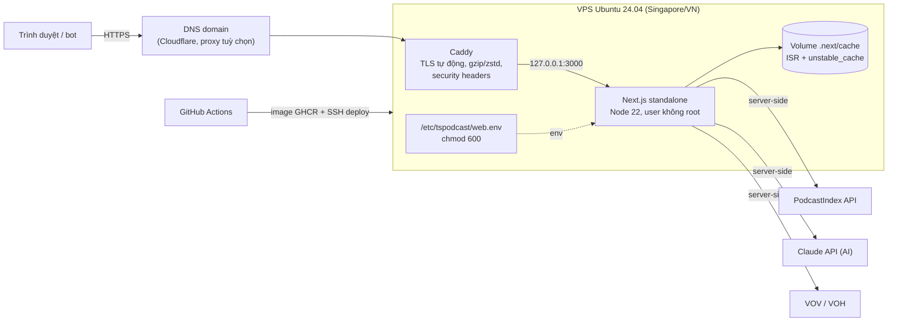

# Kế hoạch: đưa website `web/` lên VPS (bản đầy đủ: search, AI, ISR)

> Ticket: TSP-18 · Ngày lập: 2026-10-29 · Trạng thái: **Bản nháp chờ owner duyệt**
> Liên quan: `web/README.md` (biến môi trường, deploy), `docs/plans/seo-web-dashboard.md` (§A.12 hosting, §A.10 App Links), `docs/plans/roadmap-backlog.md` (B2 tên miền).

---

## 0. Hiện trạng và mục tiêu

| | Bản tạm (đang chạy) | Bản đích (VPS) |
|---|---|---|
| URL | `https://tspodcast.web.app` (Firebase Hosting, gói Spark miễn phí) | `https://<domain>` |
| Kiểu build | `npm run build:static`: HTML tĩnh dựng một lần | `next build` + `next start` (Node), ISR |
| Nội dung | Trang chủ, thịnh hành, radio, 16 danh mục nổi bật, ~210 podcast, ~12 tập mỗi podcast | Mọi podcast/tập (render khi có request rồi cache) |
| Search, AI | Không có (route `*.dynamic.ts(x)` bị bỏ khỏi build) | Có |
| Dữ liệu | Cũ dần cho tới lần build sau | Làm mới theo `revalidate` (10 phút – 24 giờ) |
| Key PodcastIndex | Chỉ dùng lúc build, script quét `out/` và chặn deploy nếu thấy key | Chỉ nằm trong env của server, không bao giờ xuống trình duyệt |

Site Firebase cũ `podcast-25c93.web.app` (landing 02/2025, có `privacy.html` đang dùng làm link chính sách bảo mật) **được giữ nguyên**, không bị ghi đè.

**Điều khoản PodcastIndex (ToS 5.5(1), app đang dùng TTL 7 ngày):** bản tĩnh giữ một bản sao dữ liệu. Phải build và deploy lại **ít nhất mỗi 7 ngày** cho tới khi chuyển sang VPS (xem bước 1).

---

## 1. Kiến trúc đích

- **Một instance là đủ** ở quy mô < 50k MAU. Cache ISR và rate limit AI hiện nằm trong bộ nhớ/ổ đĩa của một instance (`web/README.md`), nên chưa cần Redis.
- **Next standalone** (`output: "standalone"` chỉ trong build server) cho image nhỏ, không cần `node_modules` đầy đủ.
- **Caddy** thay Nginx + certbot: tự xin và gia hạn chứng chỉ Let's Encrypt.

---

## 2. Chọn VPS

| Lựa chọn | Cấu hình gợi ý | Giá tham khảo/tháng | Ghi chú |
|---|---|---|---|
| Vultr / DigitalOcean / Linode, Singapore | 2 vCPU, 2–4 GB RAM, 50 GB SSD | ~$12–24 | Ping VN ~30–50 ms, thanh toán thẻ |
| Hetzner, Singapore | 2 vCPU, 4 GB | ~€8–10 | Rẻ, băng thông kèm theo ít hơn ở region SG |
| VPS trong nước (Viettel IDC, BizFly, Vietnix…) | 2 vCPU, 4 GB | ~200–400k VND | Ping thấp nhất cho người dùng VN, hoá đơn VAT |

Khuyến nghị: **2 vCPU / 4 GB**, Ubuntu 24.04 LTS. `next build` trên máy 2 GB dễ hết RAM, nhưng image được build trên GitHub Actions nên VPS chỉ cần chạy.

---

## 3. Bảo mật key và server

1. **Không có key trong repo hay image.** Env chỉ nằm ở `/etc/tspodcast/web.env` (owner `root:tspodcast`, `chmod 640`). Docker Compose đọc bằng `env_file`. Image build trên CI **không** nhận `PODCASTINDEX_*` hay `ANTHROPIC_API_KEY`.
2. **Ranh giới server/client đã có sẵn trong code:** `src/lib/podcastindex.ts` và `src/lib/ai.ts` import `server-only`, chỉ biến `NEXT_PUBLIC_*` xuống trình duyệt. Trong CI, giữ bước quét bundle `.next/static` tìm giá trị key (cùng cách `scripts/build-static.mjs` quét `out/`).
3. **Server:** chỉ đăng nhập SSH bằng key (tắt password và root login), `ufw` chỉ mở 22/80/443, `fail2ban`, `unattended-upgrades`. Container chạy user không root, `read_only` + `tmpfs` cho `/tmp`, giới hạn RAM.
4. **AI:** đặt spend limit trên Anthropic Console và giữ rate limit theo IP có sẵn ở `/api/ai/*`. Cân nhắc Haiku 5.5 cho tóm tắt (chi phí trong `docs/research/feature-roadmap-ai-growth.md`).
5. **Lưu ý:** key PodcastIndex đang được nhúng trong `libsecuredtoken.so` của app Android, nên ai có APK đều trích xuất được. Nên **xin một cặp key riêng cho web**: thu hồi được độc lập, và tách được quota/429 giữa app và web.

---

## 4. Các bước triển khai

| # | Việc | Ai | Phụ thuộc |
|---|---|---|---|
| 1 | **Ngay:** GitHub Action theo lịch (hằng ngày) chạy `build:static` + `firebase deploy --only hosting:tspodcast`. Secret `PODCASTINDEX_*` + service account Firebase để trong GitHub Environment `web-static`. | Dev | — |
| 2 | Chọn tên miền và nhà cung cấp VPS, tạo VPS | Owner | B2 |
| 3 | Thêm `output: "standalone"` cho build server và `web/Dockerfile` (multi-stage, Node 22 alpine, user `node`) | Dev | — |
| 4 | `deploy/docker-compose.yml` (web + caddy), `deploy/Caddyfile`, volume `.next/cache`, healthcheck `GET /` | Dev | 3 |
| 5 | Ansible hoặc shell script dựng server: user `deploy`, SSH hardening, ufw, Docker, thư mục `/etc/tspodcast` | Dev | 2 |
| 6 | Workflow `web-deploy.yml`: push `main` có thay đổi `web/**` thì lint + build image, quét secret, push GHCR (tag = SHA), SSH `docker compose pull && up -d`, smoke test `/`, `/trending`, `/search?q=test` | Dev | 3–5 |
| 7 | Đặt env trên VPS: `NEXT_PUBLIC_SITE_URL=https://<domain>`, `PODCASTINDEX_*`, `ANTHROPIC_API_KEY` (nếu bật AI), `APP_ADS_TXT`, `ANDROID_CERT_SHA256` | Owner/Dev | 2 |
| 8 | DNS A/AAAA → VPS. Bỏ `SITE_NOINDEX`. Kiểm tra `robots.txt`, `sitemap.xml`, `app-ads.txt`, `/.well-known/assetlinks.json` | Dev | 6, 7 |
| 9 | Search Console + Bing, khai báo Website trong Play listing, link chính sách bảo mật mới | Owner | 8 |
| 10 | Chuyển `tspodcast.web.app` thành redirect 301 sang domain, tắt cron build tĩnh | Dev | 8 |
| 11 | Giám sát: UptimeRobot (5 phút), log Docker có rotate, cảnh báo disk > 80% | Dev | 8 |

Rollback: mỗi deploy giữ tag image trước đó. Muốn quay lại thì chạy `IMAGE_TAG=<sha cũ> docker compose up -d`.

---

## 5. Chi phí ước tính

| Khoản | /tháng |
|---|---|
| VPS 2 vCPU / 4 GB | $12–24 (hoặc ~200–400k VND) |
| Tên miền `.com` / `.vn` | ~$1–2 (chia theo năm) |
| Cloudflare, Caddy, GHCR, UptimeRobot | $0 |
| Claude API (nếu bật AI) | Theo lượt dùng, đặt trần trên Console |

---

## 6. Rủi ro

| Rủi ro | Giảm thiểu |
|---|---|
| PodcastIndex trả 429 khi bot crawl nhiều trang | Cache ISR + `unstable_cache` sẵn có, key riêng cho web, Cloudflare cache HTML ngắn hạn. Đã gặp thật (2026-10-29): build tĩnh đầu tiên gọi ~4.000 request trong vài phút, IP bị chặn ~34 phút (`Retry-After: 2044`, trang lỗi Cloudflare). Từ đó trang tập ở bản tĩnh lấy từ danh sách tập (~450 request mỗi build), mỗi worker giãn 500 ms và dừng ngay khi `Retry-After` > 60 s |
| VPS chết = web chết (một instance) | Uptime alert. Deploy lại được trong ~10 phút từ image GHCR. Bản tĩnh Firebase còn làm dự phòng |
| Lộ env khi debug | Không `docker inspect`/in env trong CI log. `web.env` không nằm trong backup công khai |
| Bản tĩnh giữ dữ liệu quá 7 ngày | Cron build hằng ngày ở bước 1 |
